# Lost Reels: The Making Of

*A Holy Trinity Picture. The dev log of our Epic AI MegaJam 2026 game, the same content as `index.html`.*

Contents: [Making Of](#making-of) · [Timeline](#timeline) · [Decision log](#decision-log) · [The reels](#the-reels) · [How we made it with AI](#how-we-made-it-with-ai) · [Bloopers](#bloopers-from-the-editing-room)


**Team:** Holy Trinity, three people from Poland: Jakub Komosa (kimonzo), Jakub Badyła (Badys) and Bartosz Wolak (Bubuś), and as many agents as the work needs.
**Theme:** Director's Cut.
**Engine:** Unreal Engine 5.9 MegaJam Preview, Windows Shipping build.

This log records how we made the game, including the parts that went wrong, since those are usually where the work happened. Each entry gives the time (CET), what we did, how we split the work between people and agents, the prompts we used, what broke, and what we cut.

We record our team calls on Discord with Craig, one track per person, and transcribe them on our own machine. Each call below says when it happened, who spoke, what came up at which minute, what we decided and how. The transcripts themselves stay private; below are the times, topics and decisions.


## Making Of

*These notes are hidden in the game; this is the jam told by its own props.*

### 01. Take One

*Days 1–3 · Cinema*

First words on tape, day one, two minutes past nine in the morning.  

Bubuś: "Recording. Epic, we are in command here. We have a plan. We are terrible."  

Nobody argued with any of it. The recording ran for two more hours.  

### 02. The Smile Bar

*Day 1 · Studio*

Our first monster smiled at you, and you had to smile back. We cut it on the first morning.  

By the next read-through the script doctor had written the smile bar back into three scenes.  

Badys: "I hope it's gone everywhere now. I'm not writing this thirty times."  

If you see a smile bar anywhere in this building, do not smile at it.  

### 03. Requisition: Rubber Duck

*Days 1–3 · Bus*

Item: one rubber duck. Purpose: none.  

Bubuś: "There has to be a rubber duck. There always has to be one."  
Badys: "A duck that does what?"  
"Nothing."  
"It quacks when you squeeze it."  
"And a small chance it's gold."  

Approved in ten seconds. On day two a tester threw one and it fell through the ground. Check under the floor before you report a lost duck.  

### 04. Script Notes, Draft 3

*Day 2 · Studio*

The machine wrote our player fantasy for us: "Three seconds of fear, then laughter, because the monster looks silly in the light and the rubber duck in your pocket just quacked."  

Badys read it twice. "What kind of ending is that? The monster is not supposed to be funny. You're supposed to be scared."  

We deleted the laughter. We kept the duck. Please be scared now.  

### 05. Call Sheet, End of Day One

*Days 1–3 · Cinema*

Thirteen design documents. Seven architecture decisions. Forty-five stories. At five in the evening the crew asked the programmer what the film is about.  

Kimonzo: "What's it about? I don't know. I didn't settle that."  
Bubuś: "Put that in the notes. After day one we asked our programmer what the game is about and he said: I don't know."  

Done. If you find out, tell the projectionist.  

### 06. Waiting for the Programmer

*Days 1–3 · Bus*

The schedule says Kimonzo builds the whole game. The schedule also says he works his day job until four.  

Late afternoon, Bubuś: "We're not touching our keyboards any more. No programmer. He was due at four. We've had enough."  
Then: "Did he go to the shop for bread, or to a farmer for flour so he could bake it himself?"  

Kimonzo came back at ten to five. He asked if everything was wrong. "Everything's lovely. One small thing. Our programmer is missing."  

### 07. Sick Note

*Day 1 · Studio*

Day one, plan review, around noon.  

Bubuś: "Write down that my head hurt. Write everything down."  
Badys, typing it into the plan: "He got a migraine."  

Treatment: water, a dark room and no design documents until tomorrow. This note is filed under Everything, as requested.  

### 08. Location Scout Report

*Days 1–3 · Bus*

Kimonzo: "Where do the players start? In the forest?"  
Badys: "No. In the cinema."  
Kimonzo: "Then why do we have a forest?"  

By lunch the new map arrived, and everyone started in the forest. An hour later Kimonzo moved them back to the cinema.  

The forest is still out there. It has a camp now, and a signpost, so you know where you are not starting.  

### 09. Polygon Budget

*Day 2 · Studio*

Prop: film reel, hand-held. Vertices: 2.5 million.  

Bubuś: "It has so many vertices the computers will explode."  
Also Bubuś, later: "On the plus side, when the game starts my room warms up right away. Works better than the heater."  

He cut it down. Your graphics card says thank you. Your radiator says nothing.  

### 10. Bus Fit-Out

*Days 1–3 · Bus*

Revive point, attempt one: a red phone booth. It looked wrong inside a bus, and the classic booth turned out to be a registered design. Attempt two: a defibrillator with a heart on it.  

Then two of the crew tried to pass each other by the register, and could not.  
Kimonzo: "It just needs to be ten percent bigger."  

The furniture kept its normal size. Nobody wants to buy batteries at a register the size of a wardrobe.  

### 11. Memo From Management

*Day 3 · Studio*

Bubuś: "Our manager is the AI. It emailed me: download the preview, play it, tell me what's wrong."  
After a long test: "The AI can't manage people. It hands out jobs to the robots and then does them itself."  
Kimonzo: "I wanted to take some work off your hands."  

On Friday afternoon a whole group of agents lost their keys at once and stopped. We logged them back in. Nobody apologised.  

### 12. QA Report, Item 1 (Again)

*Day 3 · Studio*

Kimonzo: "You've been testing the same thing for two good hours and you're not moving on."  
Badys: "I got here an hour ago!"  

Testers: two. Builds on their two computers: also two, and not the same one.  

Badys, the same day: "Reminder: we started yesterday at five. It's two now. That's twenty-one hours."  

Check the date on your reel before you report it broken.  

### 13. The Hydra

*Day 1 · Studio*

Paperwork received after day one: a brief, a concept, an architecture, a backlog of 135 pages and an asset list of 92.  

Badys: "These PDFs breed like a Hydra. Cut off one head and three more grow."  
Also Badys: "I thought I'd type make me a game, and that would be it."  

The cabinet is full. Do not open the bottom drawer. The backlog lives there.  

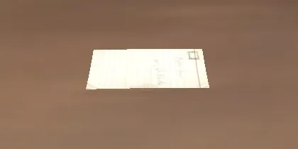

### 14. Last Reel

*Days 1–3 · Cinema*

Day two, late afternoon. Badys watched another team's rabbit run across a screen.  

"Our ant can't even run. It can walk, and it can hit."  
A minute later: "Maybe this game will be bad. But it will be ours. I'll finish it."  

The ant can run now. If you are reading this in the dark, it is probably running toward you.  

### 15. Queue, Day Four

*Days 1–3 · Bus*

Sunday afternoon. Seventeen assistants at work at once, each on its own copy of the game. One compiler. Thirteen of them stood in line for it, like at a post office, holding their numbers. The machine ran out of memory once, just from the waiting.  

Kimonzo: "Stop compiling on the branches. Merge everything. Compile once."  

Thirteen branches went in in eight minutes. Nobody had planned it that way. Everybody had planned something more complicated.  

### 16. Take Fourteen, Retired

*Day 3 · Studio*

All jam long the monster went by a name like a take number: Take Fourteen. On Sunday someone said it sounded wrong, like a shot the director keeps redoing.  

It is the Splicer now. It cuts things and joins them back together.  

The sound man on another page still says "Take fourteen". Only into the microphone, and only when the room is quiet.  

### 17. Inside Out

*Day 3 · Studio*

For three days our own prep script turned the bumps on every Meshy model inside out. Rocks looked dented. Logs looked dented. We blamed the lighting, then the rocks.  

Nobody blamed the script. We had written it ourselves.  

On Sunday someone finally read it. The rocks bulge outward again. If anything here still looks dented, it came that way.  

### 18. Grey Rocks

*Days 1–3 · Cinema*

In the editor the rocks were perfect: moss, cracks, a little lichen. In the packaged game they were grey, like modelling clay.  

The editor had been ticking one box for us without saying so. A packaged game ticks nothing for anyone.  

We ticked it ourselves. The rocks got their colour back, and every note in the studio floated up above the furniture. If a note hovers, it is not a ghost. It is a bug report.  

### 19. Fog, Third Draft

*Days 1–3 · Cinema*

Three fogs in one afternoon.  

Draft one: "Too thick."  
Draft two: "Almost gone."  
Draft three: "Like this morning."  

The morning won. It had been right since breakfast and only had to wait until the afternoon to hear it. The flashlight was asked to calm down, so the fog no longer turns its beam into a white plate.  

### 20. The Tester

*Day 3 · Studio*

For two days every report ended the same way: thanks to BoonRevo for testing.  

BoonRevo found the monster standing next to players and not attacking. BoonRevo said the night vision was too dark. BoonRevo had opinions about the bus door.  

BoonRevo was Badys. He had been testing under his other name the whole time, and accepting the thanks. The thanks stand.  

### 21. Day Three, Undone

*Day 3 · Cinema*

Sunday, after lunch, we decided to be kind to day three. Any reel or battery lost on the way would be waiting at the start, topped up.  

It lasted half an hour. Then someone noticed that, with a free top-up, a crew could skip straight to day three.  

Day three is strict again. What you lose, you lose. Go and get it back.  


## Timeline

**Day 0, Wednesday 11 November 2026**

- [What the theme means, in Epic's words](#what-the-theme-means-in-epicx27s-words)
- [Reading the rules like a contract](#reading-the-rules-like-a-contract)
- [Unreal Engine 5.9, from the launcher to a running build](#unreal-engine-59-from-the-launcher-to-a-running-build)
- [What we built for the team (no game content)](#what-we-built-for-the-team-no-game-content)
- [How we record our own talks](#how-we-record-our-own-talks)

**Day 1, Thursday 12 November 2026**

- 09:36 — [Pitch 01: "Hen's Escape, Re-edited" (working title)](#0936--pitch-01-quothenx27s-escape-re-editedquot-working-title)
- 09:36–09:42 — [Pitch 02: "Smile for the Camera", rejected](#09360942--pitch-02-quotsmile-for-the-cameraquot-rejected)
- 11:15–11:35 — [From notes to a plan](#11151135--from-notes-to-a-plan)
- 12:36 — [The team edits the plan](#1236--the-team-edits-the-plan)
- 12:40–12:50 — [The second call, read by a second agent](#12401250--the-second-call-read-by-a-second-agent)
- 13:00–13:30 — [The studio at full rigor, and a project from the template](#13001330--the-studio-at-full-rigor-and-a-project-from-the-template)
- 14:34–17:07 — [Team call: reading the plan out loud](#team-call-14341707-3-people-153-min--reading-the-plan-out-loud)
- 16:55 — [What is this game about?](#1655--what-is-this-game-about)
- 17:40–18:30 — [First code, first map, six agents at once](#17401830--first-code-first-map-six-agents-at-once)
- 18:30–00:45 — [The backlog burns down, and the reviewer keeps finding doors](#18300045--the-backlog-burns-down-and-the-reviewer-keeps-finding-doors)
- [13.11, 00:45–morning — Measured on the real card, then fixed what the numbers showed](#1311-0045morning--measured-on-the-real-card-then-fixed-what-the-numbers-showed)

**Day 2, Friday 13 November 2026**

- 07:00–09:30 — [Fourteen review notes, the template moves out, the first release candidate](#07000930--fourteen-review-notes-the-template-moves-out-the-first-release-candidate)
- 08:55–10:30 — [A film leader, four small features and Blueprints for the artists](#08551030--a-film-leader-four-small-features-and-blueprints-for-the-artists)
- 10:44–12:27 — [The first playtest: the game was not frozen, the input was](#10441227--the-first-playtest-the-game-was-not-frozen-the-input-was)
- 11:27–12:53 — [The monster opens its eyes](#11271253--the-monster-opens-its-eyes)
- 11:43–12:35 — [Daylight until the siren](#11431235--daylight-until-the-siren)
- 12:15–12:59 — [The cinema gets a town, and the studio moves half a kilometre away](#12151259--the-cinema-gets-a-town-and-the-studio-moves-half-a-kilometre-away)
- 13:13–13:37 — [Back to the cinema, a camp in the forest, and gaps the monster cannot fit through](#13131337--back-to-the-cinema-a-camp-in-the-forest-and-gaps-the-monster-cannot-fit-through)
- 13:18–16:20 — [The second playtest list: nineteen issues, fourteen branches](#13181620--the-second-playtest-list-nineteen-issues-fourteen-branches)
- 13:41–16:37 — [Every sound on the list, generated and wired](#13411637--every-sound-on-the-list-generated-and-wired)
- 14:45–16:21 — [A shorter town with a stream, and studios that grew](#14451621--a-shorter-town-with-a-stream-and-studios-that-grew)
- 15:35–17:07 — [The bus goes into the game, and turns out too narrow](#15351707--the-bus-goes-into-the-game-and-turns-out-too-narrow)
- 17:00–18:44 — [Lamps, notes, throwing and a wardrobe for two](#17001844--lamps-notes-throwing-and-a-wardrobe-for-two)
- 18:44–18:56 — [rc-1311d: one merge, one package](#18441856--rc-1311d-one-merge-one-package)
- 12:34–15:14 — [The crew bus becomes a set you can walk into](#12341514--the-crew-bus-becomes-a-set-you-can-walk-into)
- 20:05–22:10 — [A different studio every day, behind red doors](#20052210--a-different-studio-every-day-behind-red-doors)
- 19:11–19:49 — [Eight issues from the evening play, and a wave stopped halfway](#19111949--eight-issues-from-the-evening-play-and-a-wave-stopped-halfway)
- 21:00–21:10 — [Badys's second list, a new map and a task list for each artist](#21002110--badysx27s-second-list-a-new-map-and-a-task-list-for-each-artist)
- 21:04–22:38 — [L_World from Badys's drawing](#21042238--l_world-from-badysx27s-drawing)
- 20:05–23:06 — [Two studio generators, and we kept Badys's](#20052306--two-studio-generators-and-we-kept-badysx27s)
- 19:23–22:51 — [The rest of the evening: menus, darkness, sound, doors, grates and the rest](#19232251--the-rest-of-the-evening-menus-darkness-sound-doors-grates-and-the-rest)
- 22:33–22:47 — [The team's second balance pass](#22332247--the-teamx27s-second-balance-pass)
- 23:06–23:17 — [rc-1311e: the world map and a random studio, untested on purpose](#23062317--rc-1311e-the-world-map-and-a-random-studio-untested-on-purpose)
- 23:17–23:35 — [rc-1311f: the sounds and effects the cook left out](#23172335--rc-1311f-the-sounds-and-effects-the-cook-left-out)
- 00:08–01:00 (14 November) — [rc-1311g: the review fixes, the studio in its own building](#00080100-14-november--rc-1311g-the-review-fixes-the-studio-in-its-own-building)
- 11:08–14:52 and 14:52–17:15 — [Team calls: playing it together, and how big the town should be](#team-calls-11081452-and-14521715-3-people-224-and-143-min--playing-it-together-and-how-big-the-town-should-be)

**Day 3, Saturday 14 November 2026**

- 00:09 — [rc-1311g, the part players never see: the co-op hardening](#0009--rc-1311g-the-part-players-never-see-the-co-op-hardening)
- 08:20–08:44 — [Badys's third list (#201)](#08200844--badysx27s-third-list-201)
- 08:41–08:55 — [Badys tunes the walk (PR #202)](#08410855--badys-tunes-the-walk-pr-202)
- 09:00–09:18 — [Eleven audits before the last fix wave](#09000918--eleven-audits-before-the-last-fix-wave)
- 14 November — [The projection booth: one look for every screen (#212)](#14-november--the-projection-booth-one-look-for-every-screen-212)
- 10:30–13:00 — [rc-1311h: seventeen branches, one integrator](#10301300--rc-1311h-seventeen-branches-one-integrator)
- 09:20–11:42 — [The second audit round, the last waves and the owner's calls](#09201142--the-second-audit-round-the-last-waves-and-the-ownerx27s-calls)
- 13:00 — [rc-1311h goes out](#1300--rc-1311h-goes-out)
- Afternoon — [The NvRTX question](#afternoon--the-nvrtx-question)
- Afternoon — [Next: the film you actually shot (#204)](#afternoon--next-the-film-you-actually-shot-204)
- 14:00–15:50 — [Take Fourteen gets a body that matches its name (#229)](#14001550--take-fourteen-gets-a-body-that-matches-its-name-229)
- Afternoon — [The forest places get furniture (#235)](#afternoon--the-forest-places-get-furniture-235)
- Afternoon — [Dead wood and rock at the edge of the map (#234)](#afternoon--dead-wood-and-rock-at-the-edge-of-the-map-234)
- 14 November — [Posters on the walls, dirt in the corners, and one poster nobody tells you about (#196, #197)](#14-november--posters-on-the-walls-dirt-in-the-corners-and-one-poster-nobody-tells-you-about-196-197)
- Afternoon — [Bare trees, dry shrubs and a few easter eggs (#234)](#afternoon--bare-trees-dry-shrubs-and-a-few-easter-eggs-234)
- Afternoon — [The studio gets its walls, the van gets its name (#196)](#afternoon--the-studio-gets-its-walls-the-van-gets-its-name-196)
- 13:33–18:00 — [Saturday afternoon: the grey boxes go, rc-1311i goes out](#13331800--saturday-afternoon-the-grey-boxes-go-rc-1311i-goes-out)
- 17:28–22:26 — [A forest you could photograph, and branches you can walk through (#144)](#17282226--a-forest-you-could-photograph-and-branches-you-can-walk-through-144)
- 23:00–23:27 — [The leaves become leaves (#144)](#23002327--the-leaves-become-leaves-144)
- 23:37–00:10 — [Ground to walk on, and a lighter forest (#144)](#23370010--ground-to-walk-on-and-a-lighter-forest-144)
- 18:03–09:30 (Sunday) — [Saturday evening: doors, a walkable studio, rc-1311j](#18030930-sunday--saturday-evening-doors-a-walkable-studio-rc-1311j)

**Day 4, Sunday 15 November 2026**

- 10:20–11:20 — [Teammates you can actually hear (#253)](#10201120--teammates-you-can-actually-hear-253)
- 10:05–11:20 (Sunday) — [The forest learns about air (#252)](#10051120-sunday--the-forest-learns-about-air-252)
- 09:30–12:15 (Sunday) — [Bubuś's cast takes the stage, and everything else gets one more pass](#09301215-sunday--bubuśx27s-cast-takes-the-stage-and-everything-else-gets-one-more-pass)
- 12:20–15:30 (Sunday) — [rc-1511a, a playtest list, a traffic jam of compilers, rc-1511b](#12201530-sunday--rc-1511a-a-playtest-list-a-traffic-jam-of-compilers-rc-1511b)
- 09:17–13:49 — [Team call: playing rc-1311j and rc-1511a](#team-call-09171349-3-people-272-min--playing-rc-1311j-and-rc-1511a)
- 13:58–16:44 — [Team call: the last tests and rc-1511b](#team-call-13581644-3-people-166-min--the-last-tests-and-rc-1511b)
- 15:30–18:30 (Sunday) — [beta, one more round, and the release build](#15301830-sunday--beta-one-more-round-and-the-release-build)

## Decision log


Every decision in one line, oldest first. The "how" column is the part a director's cut is made of.

| When (CET) | Decision | How it was made | Where |
|---|---|---|---|
| 11 Nov, afternoon | Unreal Engine, not UEFN | We need packaged Windows builds, DLSS and full C++; UEFN gives none of the three | Day 0 |
| 11 Nov, afternoon | UE 5.9 MegaJam Preview, 5.8 as fallback | Its built-in MCP lets agents work in the editor; the fallback costs one download | Day 0 |
| 11 Nov, 21:00 | Claude Code Game Studios inside the game repo | First kept apart; reversed the same evening so all three of us get the same agents with `git pull` | Day 0 |
| 11 Nov, evening | AI at authoring time only | No API key may travel inside a public build | Day 0 |
| 11 Nov, evening | No Live Link plugins, no web build | Neither exists for 5.9; FBX export does the job | Day 0 |
| 11 Nov, late | Compile DLSS for 5.9 ourselves | The NVIDIA RTX Award needs it; five attempts, six casts | Day 0 |
| 11 Nov, 22:43 | Record team calls with Craig, transcribe locally | Our own bot cannot hear encrypted Discord voice yet; Craig can | Day 0 |
| 12 Nov, 09:36 | Pitch 01, "Hen's Escape, Re-edited", stays on the table | Picked by Jakub from three chicken ideas; waits for the team | Day 1 |
| 12 Nov, 09:42 | Pitch 02, "Smile for the Camera", rejected | Scoped down and checked against the rules first, then dropped: a game like it already exists | Day 1 |
| 12 Nov, 09:40 | No webcam in any version | Kimonzo asked whether a game rated 13+ can ask children to share their faces online; nobody found a way it could, and it would not fit in 1 GB anyway | [Team call 09:02](#team-call-0902-1113-3-people-131-min--choosing-the-game) |
| 12 Nov, 09:57 | We make concept 03, "Lost Reels" (working title) | Badys turned ressetgames' camera horror into a new layout (cinema, bus, haunted editing house); both agreed, kimonzo kept the rules in view | [Team call 09:02](#team-call-0902-1113-3-people-131-min--choosing-the-game) |
| 12 Nov, 10:20 | 3 reels and 3 big batteries instead of 10 reels | Badys counted the trips: with four players, each would carry a reel back twice, which is a chore, not a game | [Team call 09:02](#team-call-0902-1113-3-people-131-min--choosing-the-game) |
| 12 Nov, 11:30 | The game must be playable alone; online co-op decided Sat 12:00 | Claude's `game-jam` scope pass: judges play solo, and we have one programmer from 16:00. Proposed, waiting for the team | `design/plan.md` (our game plan (the full design written after the first call)) |
| 12 Nov, 11:50 | The monster is an insect with tiny eyes, big ears and antennae | Badys started from "no eyes", ressetgames finished it; the look explains the rule | [Team call 11:36](#team-call-1136-1237-3-people-61-min--reviewing-the-plan) |
| 12 Nov, 11:52 | Co-op is a feature, not an extra; "coming soon" if it misses | kimonzo (who proposed "coming soon") and ressetgames pushed back on Badys's idea of dropping it | [Team call 11:36](#team-call-1136-1237-3-people-61-min--reviewing-the-plan) |
| 12 Nov, 12:36 | The monster hunts by sound, not sight; the smile bar is gone | ressetgames and Badys revised Claude's plan line by line on Discord; a noise bar and sneaking replace the "moves when unseen" rule | [12:36 entry](#1236--the-team-edits-the-plan) |
| 12 Nov, 12:36 | Five maps, one drawn at random each night; 1–4 players; night vision in solo only | Same revision; the team chose variety between nights over a single map, and gave the solo player night vision instead of a friend in the van | [12:36 entry](#1236--the-team-edits-the-plan) |
| 12 Nov, 12:55 | Four cheap ideas from the second call go into the game: a monster you hear coming, a golden duck that quacks, panting after the siren, a hidden gif | kimonzo picked the four the subagent rated cheapest (one sound or one number each); the rest wait in section 7 of the plan | `design/plan.md` (our game plan (the full design written after the first call)) |
| 12 Nov, 12:55 | The studio runs at full rigor: design documents per system, architecture decisions, epics and stories | kimonzo chose "Full" over "Standard" when asked; we want the paper trail, and agents write it in parallel | [13:00 entry](#1300-1330--the-studio-at-full-rigor-and-a-project-from-the-template) |
| 12 Nov, 13:05 | C++ is the primary language; Blueprints for tuning | Claude decided: code an agent writes stays diffable text, while `.uasset` files are binary and off limits to its file tools | [13:00 entry](#1300-1330--the-studio-at-full-rigor-and-a-project-from-the-template) |
| 12 Nov, 13:10 | Claude creates the Unreal project itself instead of kimonzo clicking through the wizard | kimonzo asked why a person should click through a wizard when the agent has the editor through MCP | [13:00 entry](#1300-1330--the-studio-at-full-rigor-and-a-project-from-the-template) |
| 12 Nov, 15:40 | Days, not nights: when the day clock runs out, night falls and the monster may leave the studio; everyone alive returns to the cinema and presses the end-of-day button | Badys and ressetgames read the plan PDFs aloud on a call and answered every open question; Badys dictated the corrections | [Team call 14:34](#team-call-14341707-3-people-153-min--reading-the-plan-out-loud) |
| 12 Nov, 15:40 | 3 reels and 3 batteries across the whole three-day campaign, not per night; three recording studios instead of five cinemas; one cinema that never changes | Same corrections; the other two maps wait for after the jam | [Team call 14:34](#team-call-14341707-3-people-153-min--reading-the-plan-out-loud) |
| 12 Nov, 15:40 | A loss is a loss: the campaign restarts on new maps with new loot; no retries | Same corrections; unlocks between runs are planned for after the jam | [Team call 14:34](#team-call-14341707-3-people-153-min--reading-the-plan-out-loud) |
| 12 Nov, 15:40 | The monster is not funny | Same corrections: the player should be tense, not amused; we deleted the line that promised a laugh after the scare | [Team call 14:34](#team-call-14341707-3-people-153-min--reading-the-plan-out-loud) |
| 12 Nov, 17:30 | Online co-op through Epic Online Services from Friday, not a Saturday maybe; solo and LAN stay offline | kimonzo rejected waiting: resources are not the limit. Claude compared PlayFab, Steam and EOS; EOS ships with the engine and needs no ports. An agent read the 5.9 plugin source and found that Device ID login only works in the newer Online Services layer | ADR-0001 (architecture decision ADR-0001 (authoritative listen server)) |
| 13 Nov, 03:45 | Ray Reconstruction only at Epic on RTX 40 or newer, or when the player asks | Measured on our RTX 3060: with RR the game ran at 63 fps, without it 114; we decided overnight and wrote it down | `2026-11-13-ray-reconstruction.md` (design note: Ray Reconstruction only where it pays) |
| 13 Nov, 05:03 | Play Solo opens no network port | Windows asked solo players about the firewall; solo became a plain standalone game, LAN still listens | `2026-11-13-solo-bez-portu.md` (design note: solo opens no network port) |
| 13 Nov, 09:02 | The code review's fourteen findings are fixed without questions | kimonzo told the reviewer to decide and write every decision down | `2026-11-13-przeglad-112.md` (design note: code review #112, template cleanup, accessibility) |
| 13 Nov, 11:27 | The monster sees 6 m in a 120 degree cone; crouching in the open does not hide you, a table does until you make noise | The team's answer after the first playtest; Claude set the noise that gives a hiding spot away above a crouched shuffle | `2026-11-13-potwor-wzrok-agresja.md` (design note: monster sight, aggression and loot) |
| 13 Nov, 11:35 | Aggression as five film frames that turn red, no stars | The team asked for something like a wanted level; we kept the idea and dressed it as film | `2026-11-13-dzien3-poprawki.md` (design note: shop, crouching, monster sight, aggression, loot deep in the studio) |
| 13 Nov, 11:43 | Bright day outside until the siren, night after it | Team decision; the agent put the sky in code so it would survive the big map | `2026-11-13-niebo-dzien-noc.md` (design note: daylight until the siren, then night with a rising moon) |
| 13 Nov, 12:15 | A whole film town, with the studio about 480 m from the cinema | kimonzo: with the studio 25 m away, carrying a reel home meant nothing | `2026-11-13-duza-mapa.md` (design note: the big map (film town, forest, studio across the bridge)) |
| 13 Nov, 12:41 | The crew bus becomes a walk-in set with the shop, the camera monitors and the revive point inside | Badys asked for it; Claude sized it from the player capsule in the code and showed him two fal pictures before any Rodin credit was spent | Day 2 |
| 13 Nov, 12:48 | A sprint no longer outruns a monster that sees you; player-only gaps and vents are the way out | A tester's request, accepted the same day | `2026-11-13-potwor-wzrok-agresja.md` (design note: monster sight, aggression and loot) |
| 13 Nov, 12:50 | Antennas are a separate model with round dishes | Badys asked about them before the bus went to Rodin; generators break thin rods, so Claude built them in Blender | Day 2 |
| 13 Nov, 12:50 | The bus doors stay open for good, no door logic | Badys, while Rodin was working; the pieces cut out of the doorways became the open doors | Day 2 |
| 13 Nov, 13:05 | The big town stays until we have played it in co-op; then we change it | Badys and ressetgames wanted about a minute from the cinema to the studio, kimonzo a longer game; the test settled it, and the walk was halved at 14:45 | [Team calls 11:08](#team-calls-11081452-and-14521715-3-people-224-and-143-min--playing-it-together-and-how-big-the-town-should-be) |
| 13 Nov, 13:13 | Players start in the cinema again; the forest clearing becomes a crew camp | kimonzo reversed his own forest start an hour later so the intro is seen from the first second | `2026-11-13-duza-mapa.md` (design note: the big map (film town, forest, studio across the bridge)) |
| 13 Nov, 13:14 | Six generated props binned; a cash register, one big CRT station and a sell bin with a SELL HERE sign instead | Badys, after one look at the sheet | Day 2 |
| 13 Nov, 13:30 | The CRT screen is about 90 cm wide, the cameras as a 2×2 split | Badys picked the largest of three sizes; fal would not draw it, so the monitor was enlarged in Blender | Day 2 |
| 13 Nov, 13:30 | The monster may walk into the bus at night | Badys took Claude's recommendation: a safe room for the whole night would kill the tension | Day 2 |
| 13 Nov, 13:30 | The locker as a working stash: open | Badys first chose a working stash, then binned the locker model; waits for the team | Day 2 |
| 13 Nov, 13:50 | Nobody starts with a flashlight; it costs $2 in the bus and lasts the campaign | kimonzo's decision after the playtest (#152); merged at 14:45 | [Day 2, 13:18 entry](#13181620--the-second-playtest-list-nineteen-issues-fourteen-branches) |
| 13 Nov, 14:06 | Co-op money stays shared; every player adds $2 once | The issue asked for a wallet per player; we kept one balance (#159); merged at 14:45 | [Day 2, 13:18 entry](#13181620--the-second-playtest-list-nineteen-issues-fourteen-branches) |
| 13 Nov, 14:30 | Models only on the bus branch, kimonzo writes the code | Badys, after seeing the bus in game: the bus code is kimonzo's area | Day 2 |
| 13 Nov, 14:39 | At night the monster always knows where the players are and hunts the nearest one by path length | Team decision after the playtest (#168); crawl gaps and hiding spots still work | [Day 2, 13:18 entry](#13181620--the-second-playtest-list-nineteen-issues-fourteen-branches) |
| 13 Nov, 14:45 | A hosted game starts only when the host presses START GAME | A playtest request (#156); solo keeps the 50-second auto start | [Day 2, 13:18 entry](#13181620--the-second-playtest-list-nineteen-issues-fourteen-branches) |
| 13 Nov, 14:45 | The road to the studio halved to about 245 m, the day 15 minutes | kimonzo: a walk with a reel of 60 to 70 s instead of two minutes, every place kept; merged at 16:20 | [Day 2, 14:45 entry](#14451621--a-shorter-town-with-a-stream-and-studios-that-grew) |
| 13 Nov, 14:51 | Equipment carries over between days | A tester lost everything at the change of day; kimonzo: everything stays (#167) | [Day 2, 13:18 entry](#13181620--the-second-playtest-list-nineteen-issues-fourteen-branches) |
| 13 Nov, 15:00 | Rear doors closed, register and bin next to the monitor, a wall defibrillator as the revive point | Badys; a red phone booth was tried first and dropped as wrong inside | Day 2 |
| 13 Nov, 16:53 | The bus grows by 10 percent only; if it is still tight, the furniture moves to the walls | kimonzo, on the report that two players cannot pass inside (#171); done at 17:07 | [Day 2, 15:35 entry](#15351707--the-bus-goes-into-the-game-and-turns-out-too-narrow) |
| 13 Nov, 17:00 | Lamps on E, readable signs and notes, throwing as bait, a wardrobe for two, our own achievements | kimonzo wrote five issues (#172–#176) for the last full day | [Day 2, 17:00 entry](#1700now-in-progress--lamps-notes-throwing-and-a-wardrobe-for-two) |
| 13 Nov, 20:05 | The monster's studio is generated anew every day behind two red doors; you go in and out by holding E | Badys asked for it on top of the rc-1311d code, and for a generator that does not care what the main map looks like; the interior sits under the ground and only the doors are on the map | `2026-11-13-losowe-studio.md` (design note: a random studio every day) |
| 13 Nov, 20:20 | Holding the red door takes 2 s, not 1.5 s | Badys corrected his own number while the code was being written; it lives in `Studio.DoorHoldSec` | `2026-11-13-losowe-studio.md` (design note: a random studio every day) |
| 13 Nov, 19:11 | The game gets dark, with a brightness slider and a calibration screen | kimonzo after his own evening play: too bright for horror (#184) | [Day 2, 19:23 entry](#19232251--the-rest-of-the-evening-menus-darkness-sound-doors-grates-and-the-rest) |
| 13 Nov, 21:04 | Agents remove their worktree after a merge | D: filled up with 77 worktrees and about 245 GB in the middle of builds | [Day 2, 19:11 entry](#19111949--eight-issues-from-the-evening-play-and-a-wave-stopped-halfway) |
| 13 Nov, 21:00 | Sneaking only by crouching; no slow walk on Ctrl | Badys's second list (#192); crouching already had the same speed and noise | [Day 2, 21:00 entry](#21002110--badyss-second-list-a-new-map-and-a-task-list-for-each-artist) |
| 13 Nov, 21:00 | Only online co-op in the menu; LAN and IP stay in the QA console | Badys's list (#192) | [Day 2, 21:00 entry](#21002110--badyss-second-list-a-new-map-and-a-task-list-for-each-artist) |
| 13 Nov, 21:00 | Monster Hears My Mic stays, on by default | kimonzo on #192: a solo player would not know to mute | [Day 2, 21:00 entry](#21002110--badyss-second-list-a-new-map-and-a-task-list-for-each-artist) |
| 13 Nov, 21:00 | The clearing "For Kimo" is named after the team: Holy Trinity | kimonzo on #192, first "Golden Trinity", corrected the same evening | [Day 2, 21:04 entry](#21042238--l_world-from-badyss-drawing) |
| 13 Nov, 21:05 | One world map from Badys's plan for all three days | kimonzo (#194): the drawing is simpler than our town, and nobody has to search for the bus | [Day 2, 21:04 entry](#21042238--l_world-from-badyss-drawing) |
| 13 Nov, 22:33 | Badys's values win for every key he changed | His balance pass (PR #198); keys added after his copy kept | [Day 2, 22:33 entry](#22332247--the-teams-second-balance-pass) |
| 13 Nov, 22:44 | Badys's studio generator stays, ours is set aside | kimonzo: his already had the red doors, the night path through them and the runtime navigation | [Day 2, 20:05 entry](#20052306--two-studio-generators-and-we-kept-badyss) |
| 13 Nov, 22:51 | CC0 placeholders wait on their own branch | Importing hundreds of assets the night before testing was too risky; not in rc-1311e | [Day 2, 19:23 entry](#19232251--the-rest-of-the-evening-menus-darkness-sound-doors-grates-and-the-rest) |
| 13 Nov, 23:06 | rc-1311e goes out with only the build script's checks; the tests are tomorrow | kimonzo: after the package the day ends, the team plays it first | [Day 2, 23:06 entry](#23062317--rc-1311e-the-world-map-and-a-random-studio-untested-on-purpose) |
| 14 Nov, 00:09 | The studio stands inside its brick building with open doorways; the red doors, the hold on E and the teleport are gone | kimonzo, before the night: the open studio wins every conflict with the doors | [Day 2, 00:08 entry](#00080100-14-november--rc-1311g-the-review-fixes-the-studio-in-its-own-building) |
| 14 Nov, 08:20 | Each of Badys's eight notes on rc-1311g goes to an agent, five areas at once (#201) | kimonzo filed them the morning they arrived | [Day 3, 08:20 entry](#08200844--badyss-third-list-201) |
| 14 Nov, 08:20 | The monster kills only with a lunge, not by standing close | Badys saw it stand next to a player and do nothing (#201) | [Day 3, 08:20 entry](#08200844--badyss-third-list-201) |
| 14 Nov, 08:55 | Badys's walk, stamina and monster speeds go in as sent (PR #202) | Badys chose the numbers and brought the tests along; kimonzo merged a minute after the PR opened | [Day 3, 08:41 entry](#08410855--badys-tunes-the-walk-pr-202) |
| 14 Nov, 09:00 | Eleven read-only audits before the last fix wave | kimonzo: with forty hours left, read everything once before fixing anything else | [Day 3, 09:00 entry](#09000918--eleven-audits-before-the-last-fix-wave) |
| 14 Nov, 09:19 | The repo stays private; the dev log gets a public copy; no trademark names on the page | The release audit: a public repo would also publish our call transcripts | [Day 3, 09:00 entry](#09000918--eleven-audits-before-the-last-fix-wave) |
| 14 Nov, morning | Night vision only on the raised camera's screen, up to 30 m; no light around a player without a flashlight | kimonzo on Badys's note that night vision was too dark (#201) | [Day 3, owner's calls](#09201142--the-second-audit-round-the-last-waves-and-the-owners-calls) |
| 14 Nov, 10:57 | The day lasts ten minutes, with the siren two minutes before night | kimonzo, during the day-flow wave (#208): ten minutes instead of eighteen; the same wave had first set eight | [Day 3, owner's calls](#09201142--the-second-audit-round-the-last-waves-and-the-owners-calls) |
| 14 Nov, morning | No VC++ installer for ARM64 in the zip; the path tracer shaders stay in | kimonzo on the packaging audit: size does not matter, and we do not trade risk for megabytes (#215) | [Day 3, owner's calls](#09201142--the-second-audit-round-the-last-waves-and-the-owners-calls) |
| 14 Nov, 11:07 | The monster is called Take Fourteen | Out of the ideas audit's "signature for the monster" (#207) | [Day 3, owner's calls](#09201142--the-second-audit-round-the-last-waves-and-the-owners-calls) |
| 14 Nov, 11:32 | Skips need a held Enter, Space or the pad's Menu button | kimonzo, with the intro now returning on every new campaign (#201) | [Day 3, owner's calls](#09201142--the-second-audit-round-the-last-waves-and-the-owners-calls) |
| 14 Nov, 11:37 | The Festival Cut (#203) is dropped | kimonzo: with a ten-minute day a separate short mode is not needed | [Day 3, owner's calls](#09201142--the-second-audit-round-the-last-waves-and-the-owners-calls) |
| 14 Nov, 11:42 | Studio rooms get seeded random furniture from weighted pools | kimonzo, after the asset audit found closets and small rooms standing empty (#217) | [Day 3, owner's calls](#09201142--the-second-audit-round-the-last-waves-and-the-owners-calls) |
| 14 Nov, 10:01 | The raised camera's preview goes to the side and the slot bar folds into a small corner tile | Badys asked for a bigger, uncovered camera screen; kimonzo kept it off the top so it would not cover the middle | [Team call 09:26](#team-call-09261523-3-people-357-min--posters-balance-and-the-rc-1311h-playtest) |
| 14 Nov, 10:27 | Eight posters per studio, readable on E, with an achievement for one of each kind | Badys built them into his generator; the achievement changed from "all eight" to "every kind" so the cinema's posters do not count | [Team call 09:26](#team-call-09261523-3-people-357-min--posters-balance-and-the-rc-1311h-playtest) |
| 14 Nov, 11:09 | A team poster as an easter egg on a banner by the Holy Trinity clearing | A vote on four generated pictures; ressetgames asked for a cap | [Team call 09:26](#team-call-09261523-3-people-357-min--posters-balance-and-the-rc-1311h-playtest) |
| 14 Nov, 13:20 | The game gets a Polish translation | kimonzo started it during the rc-1311h playtest | [Team call 09:26](#team-call-09261523-3-people-357-min--posters-balance-and-the-rc-1311h-playtest) |
| 14 Nov, 15:27 | Sunday: play it through, record the video, import the models, everything ready by 16:00 | Agreed on both calls | [Team call 15:26](#team-call-15261552-3-people-26-min--the-plan-for-the-last-day) |
| 14 Nov, afternoon | DLSS 4.5 stays; no switch to NVIDIA's NvRTX engine branch | 1228 files changed against UE 5.8.3, 166 of them also changed by Epic for 5.9; too risky with a day left | [Day 3, NvRTX entry](#afternoon--the-nvrtx-question) |
| 14 Nov, 17:45 | The forest trees go realistic, "at the level of the bus, the props and the furniture": one spruce and one birch with a few leaf shades, no second pine, no dead trees | Badys picked "bus style 2" for both from four pictures per tree, after asking for more realism than the first round | [Day 3, #144 entry](#17282226--a-forest-you-could-photograph-and-branches-you-can-walk-through-144) |
| 14 Nov, 21:55 | The realistic trees replace the whole #237 forest, oak spots become 40% birch and 60% spruce, lone dead trees become birches, and the shrubs get a realistic model too | Badys chose from options after we found main had moved on to a stylized forest | [Day 3, #144 entry](#17282226--a-forest-you-could-photograph-and-branches-you-can-walk-through-144) |
| 14 Nov, about 22:15 | Players walk through branches and shrubs; only trunks block | Badys asked for it; the walk test found the spruce's collision wrapped its whole skirt of branches | [Day 3, #144 entry](#17282226--a-forest-you-could-photograph-and-branches-you-can-walk-through-144) |
| 15 Nov, 10:58 | On the last night the cinema doors stay open, so the Splicer can come in (#257) | Bubuś and Badys while playing rc-1311j; merged at 11:28 | [Team call 09:17](#team-call-09171349-3-people-272-min--playing-rc-1311j-and-rc-1511a) |
| 15 Nov, 11:01 | The credits name all three of us with a shared writing credit, and the same names go everywhere (#261) | Badys and Bubuś objected to kimonzo being credited alone as the ideas man; kimonzo agreed on the spot | [Team call 09:17](#team-call-09171349-3-people-272-min--playing-rc-1311j-and-rc-1511a) |
| 15 Nov, 12:16 | Textures stay at full size | Bubuś asked for smaller ones to cut the download; kimonzo kept them for 4K screens and Bubuś agreed "if it fits" | [Team call 09:17](#team-call-09171349-3-people-272-min--playing-rc-1311j-and-rc-1511a) |
| 15 Nov, 13:00 | Bubuś's Listener stays the monster and gets its texture fixed instead of a rollback | Bubuś offered the rollback; an agent was already fixing the empty material slot | [Team call 09:17](#team-call-09171349-3-people-272-min--playing-rc-1311j-and-rc-1511a) |
| 15 Nov, 13:41 | The monster gets a real name instead of "Take 14" (The Splicer, #277) | kimonzo asked during the rc-1511a playtest | [Team call 09:17](#team-call-09171349-3-people-272-min--playing-rc-1311j-and-rc-1511a) |
| 15 Nov, 15:41 | Players all look the same for the jam; Bubuś makes separate player textures later | Bubuś, after the half-body colour tint looked odd in co-op | [Team call 13:58](#team-call-13581644-3-people-166-min--the-last-tests-and-rc-1511b) |
| 15 Nov, 15:43 | A cinema poster shows what lies in today's studio (#287) | The compromise after Badys argued that one reel and maybe one battery a day leaves players searching for loot that is not there | [Team call 13:58](#team-call-13581644-3-people-166-min--the-last-tests-and-rc-1511b) |

---


## The reels

## Day 0 — Wednesday 11 November 2026: setting up the set

> Rule 7h lets teams prepare tools, agent configurations, MCP settings, prompt libraries and scripts before the jam. Everything below is that. **No game design, gameplay, levels or art existed before 12 November 06:00 CET**, and the git history can confirm it.

A film set looks empty the evening before shooting. Cables everywhere, a camera nobody has turned on, chairs with names on them. That is roughly what our repository looked like by midnight.

### Timeline

| Time (CET) | What happened |
|---|---|
| afternoon | We read the jam page and the partner email, joined the jam, and chose Unreal Engine over UEFN. Claude Code read the 16-page rules PDF and listed what can disqualify us: content not in English, third-party logos, anything above a teen rating, an unpackaged project, a video under 1920×1080, and a clause saying Epic may ask for our version control history. We took the last one personally. |
| 20:00 | Kickoff stream. Theme: **Director's Cut**. We saved the recording, an automatic transcript and 30 stills of the slides and the MCP demo. |
| 20:30 | Installed the Epic Games Launcher and the Visual Studio C++ workloads. The launcher's "Install Engine" button did nothing at all, politely. |
| 20:45 | Unreal Engine 5.9.0 MegaJam Preview began downloading. |
| 21:00 | Private repo, issues, a project board with one milestone per jam day, the team invited. |
| 21:30 | Accounts and partner perks, one by one. |
| 21:46 | Engine installed. |
| 22:00 | First packaged build of an empty project. It opened. Nothing happened in it, which was the plan. |
| 22:30 | Meshy, Hyper3D Rodin, Tripo and Blender connected to Claude Code. NVIDIA DLSS started its long evening. |
| 22:43 | First team call recorded with Craig and transcribed on our own machine. |
| late evening | DLSS compiled on the fifth attempt. Rodin Bridge for 5.9 turned up, released that same morning. |

### What the theme means, in Epic's words

At 25:10 in the kickoff Epic said: *"Every developer has that one feature that didn't quite make it… now is your chance to finally build it… If you're utilizing AI agents in your workflows, you're directing those too. Set up the vision, delegate the tasks and decide what goes in and what doesn't."*

So there are two films here. One is the game, which should be a director's cut of something. The other is this log, which should show us at the director's chair: who decided, who carried out the work, and what ended up on the cutting room floor.

### Reading the rules like a contract

Rule 8 asks for a game "appropriate for a teen audience", ESRB Teen or its equivalent, which in Europe is roughly PEGI 12. The same rule bans animal cruelty on its own, at any rating. We wrote down what that means in practice before anyone draws a single frame: cartoon violence, chases and slapstick are fine; blood, visible suffering, nudity, swearing and anything that hurts an animal on screen are not. If an animal ends up as our hero, it may be chased, startled and covered in hay, but the camera cuts away before anything happens to it. In a game about a director's cut, "CUT!" is a fair way to fail.

The `jam-check` skill now checks animations, pain sounds, texts and the itch.io thumbnail against this before every build.

### Who did what

We decided what to install, in what order, where it lives, and what rules the team works by. Claude Code installed the toolchain, wrote the scripts and documents, ran the tests and told us what broke. Nothing about a vendor's tool went into our guides until it had been checked against that vendor's own documentation. The check caught us more than once. PBRgen asks you **not** to write "seamless" in a prompt, because it handles tiling itself. Rodin's documented price per model turned out far lower than the scarcity we had planned around.

### Unreal Engine 5.9, from the launcher to a running build

**The engine.** The launcher would not install anything until we toggled a setting that has nothing to do with installing (Settings → Hide Game Library, on and off). A forum thread from August knew this; we would not have guessed it in a week.

**Packaging.** We built a blank throwaway project as a Windows Shipping build, the format the jam requires. Four minutes, 635 MB, and it launched. A first build tells you nothing about the game and everything about whether you will be able to ship one.

**Unreal MCP.** 5.9 ships an MCP server inside the editor, so an agent can place actors, edit Blueprints and run the game. Our first check said the agent could see four tools. Four seemed modest for an engine. They turned out to be a search window (`list_toolsets`, `describe_toolsets`, `describe_tools`, `call_tool`) onto **100 toolsets**: actors, Blueprints, UMG, Sequencer, PCG, Niagara and the rest. We fixed our test script to count what is behind the window, not the window.

**What the agents knew.** The studio's Unreal agents had read about engines up to 5.8. 5.9 came out two days ago and, by Epic's own account, was built mostly by agents in about a week. We wrote the agents a short reference from the 5.9 release notes and Epic's known-issues post, so that one set of agents would not give confident advice about another set's work without reading it first.

**NVIDIA DLSS.** The NVIDIA RTX Award needs DLSS or another RTX feature, and NVIDIA ships its DLSS 4.5 plugin for UE 5.5 to 5.8. Not 5.9. We took the 5.8 source and compiled it against 5.9 with `RunUAT BuildPlugin`:

1. Failed: a dependency, `StreamlineNGXCommon`, was missing. We built it first.
2. Failed: 5.9 checks format strings more strictly than 5.8. Two log messages printed a 64-bit number with `%d`. Fixed.
3. Failed: two more, enum values passed to `%u` and `%d`. Fixed.
4. Failed: we tried switching the check off for the plugin. The engine had already switched it on, and it does not take instructions from plugins.
5. **Built.** Two last messages fixed by hand. Six small casts in total, none of them in code that runs unless something is already wrong.

The result lives in a private GitHub Release, so teammates install it with one script instead of repeating the evening.

**Rodin Bridge.** Hyper3D publishes an Unreal plugin that pulls Rodin models straight into the editor. The release for 5.9 appeared on GitHub the same morning. We installed it and added it to the same script.

### Accounts and perks

| Tool | What it is for | Status |
|---|---|---|
| Epic Games, itch.io, GitHub | engine, entry, repo and board | all three of us |
| Claude Code | agent in the terminal and inside the editor | ready; jam API credits open on 12 Nov |
| Meshy | 3D models, rigging, animation | 1,100 credits, connected over MCP |
| Hyper3D Rodin | best-quality hero models | code redeemed, MCP over OAuth, editor plugin |
| Tripo | bulk props | 3,000 credits in the web app. The API starts at 0, a separate wallet that nobody mentioned |
| fal | reference images, icons, music | $30, key stored locally |
| PBRgen | tileable materials | ready, valid until 15 Nov |
| Rokoko, Reallusion iClone | motion from video, animation cleanup | installed |
| WeLoveIndies | music and sound | ready |
| Blender | fixing generated models | installed, connected over MCP |
| Craig | recording our Discord calls, one track per person | on the server |

### What we built for the team (no game content)

- **Claude Code Game Studios**, our open-source toolkit, inside the repo: 49 agents, slash commands, and hooks that refuse force-pushes, hard resets and reading `.env` files.
- **Shared skills**: Unreal Blueprints, input, Niagara, packaging, camera, game feel, level and audio design, a `devlog` skill that writes entries like this one, and `jam-check`, which audits a build against the rule numbers.
- **Scripts** in `tools/`: `install.ps1` sets up a machine in one run (API keys go only to a local `.env`), `install-plugins.ps1` adds DLSS and Rodin Bridge, `test-unreal.ps1` packages, launches and checks MCP, `transcribe_craig.py` turns a Craig link into a transcript.
- **Team documents** in Polish, written in a plain, slightly ironic voice we borrowed from Wisława Szymborska's habit of looking at ordinary things as if for the first time. A launcher that ignores clicks deserves at least that.

### Team calls

#### Call, 22:43 — a microphone check

Our first Craig recording was a test on a channel with friends outside the team, so its transcript stays out of the repo. It did its job: six tracks, one per person, merged into one conversation with names and timestamps in under a minute. It also taught us that a speech model hears the name of our recording bot as "Crave", which we decided to find charming.

From Day 1 every team call gets its own entry here: time, who spoke, topics by the minute, what we decided, how, and what we turned down.

### How we record our own talks

Craig records each person on a separate track. A script fetches the recording by its link, sends every track to a Whisper model running locally in our WSL, and merges the results into one conversation with names and timestamps. The audio never leaves the machine except on its way from Discord. We tried writing our own recording bot first, on paper: Discord now encrypts voice end to end (DAVE), and the Python library we would use cannot decrypt it yet. Craig can. The decisions from these calls will appear in this log, in English.

### What broke, collected

1. The launcher's install button, fixed by an unrelated setting.
2. The new launcher no longer lists engines in `LauncherInstalled.dat`; our script reads `Engine/Build/Build.version` instead.
3. PowerShell reads the Polish quotation marks „” as string delimiters and cut our messages in half. Our scripts now use «».
4. Two Visual Studio installations, and our check looked at the wrong one.
5. Tripo's jam credits exist only in the web app.
6. DLSS, five attempts, described above.
7. The Blender MCP installer added itself to four applications when we picked one. We restored three from its backups.
8. The first transcript heard the name of our recording bot as "Crave". Close enough to keep.

### Cut and kept

- **Cut:** Live Link plugins for iClone and Rokoko (no 5.9 builds; FBX export carries the animation just as well), a web build (it needs an engine built from source), the UEFN-only AI conversation feature, and our own Discord recording bot.
- **Kept:** a Windows Shipping target, DLSS, and AI at authoring time: dialogue and voices are generated while we make the game, not inside it, so no API key travels with the build.

### Prompt of the night

```
Check the prompt templates against each vendor's official documentation.
Where the docs say nothing, write that down instead of guessing.
```

Tomorrow at 06:00 someone says "action".

---

## Day 1 — Thursday 12 November 2026: three pitches and a cinema

The jam started at 06:00. Before anyone opened the editor, two ideas came to the table. Both are kept in `design/proposals/` (our three pitch documents), including the one we turned down, because a director's cut is as much about what you leave out.

### 09:36 — Pitch 01: "Hen's Escape, Re-edited" (working title)

A hen's escape from a farm exists only as film reels. The player cuts and reorders the shots on a timeline, the 3D scene plays back in that order, and only one edit, the director's cut, lets the hen get away. Failed edits stop on "CUT!" just before anything happens to the hen and go to a bloopers reel.

**How it came about:** the evening before, Jakub asked for a game about a chicken. Claude offered three directions (a stunt hen on a film set, the re-edited escape, a hen directing a flock); Jakub picked the second and added that it could be a longer game, so we split it into chapters, one reel each. Nothing was built before 06:00; the idea lived only in conversation until this morning.

**Status:** shelved after the team call (below); kept as a spare. Brief: `design/proposals/01-chicken-film-escape.md` (pitch 01 (a hen escaping a film set)).

### 09:36–09:42 — Pitch 02: "Smile for the Camera", rejected

ressetgames brought a complete concept pack: a co-op horror comedy for four players with a handheld camera, monsters with rules (The Smiler wants you to smile back), ten film reels to recover and a final projection where the monsters wear the players' faces.

**How we judged it:** Claude ran it through the `game-jam` skill and the rules. The verdict was "yes, if three quarters go": online co-op for four, the economy and four of seven monsters would have to be cut for four days. Horror fits a Teen rating as long as the final "murder" in the projection is only suggested. The strongest part for the theme was a projection assembled from the player's own camera footage.

**Decided:** rejected at 09:42. **Why:** a game like it already exists, so it could not be the fresh take on the theme the judges ask for.
**Kept:** the idea of a projection built from the player's own recordings, for whichever game we make.

Pack and our evaluation: `design/proposals/02-smile-for-the-camera/` (pitch 02 (Smile for the Camera)).

### Team calls

#### Team call, 09:02–11:13 (3 people, 131 min) — choosing the game


| Time | Topic | What was said |
|---|---|---|
| 00:01 | Smile for the Camera | ressetgames walks Badys through his pitch: a co-op scavenging game, four slots, heavy items that take both hands, monsters with rules |
| 00:15 | Webcam | kimonzo asks how the game would read smiles from a webcam, and whether a 13+ game may ask children to show their faces online |
| 00:32 | A button instead | ressetgames: a smile bar on screen, filled by tapping V; Badys: drop the webcam, keep the buttons |
| 00:38 | Already exists | a game built on the same camera idea turns up; the pitch is dropped as it stands |
| 00:47 | The operator | ressetgames: in the dark you see two metres, a friend in a van watches your camera and talks you through it |
| 00:54 | Size | Badys reads the rules: under 1 GB through the browser, more through butler |
| 00:55 | Yes | Badys: "let's do this idea"; kimonzo will program after work, from about 16:00 |
| 00:58–01:10 | Inventory and shop | six slots, a camera for everyone, flashlight and walkie-talkie to buy, a trumpet that lures monsters, a rubber duck that is sometimes gold, a flash camera that stuns |
| 01:10 | Style and theme | Badys: "a 1960s take on the genre". kimonzo: we are drifting away from "Director's Cut"; Badys: the reels are the link. Left open |
| 01:13 | End of the night | lights go out, cameras glitch, a siren, the cinema door shuts |
| 01:18 | Fewer reels | Badys: ten heavy reels means everyone walks back twice; down to 3 reels and 3 batteries |
| 01:22 | Death | the dead player's camera stays on the floor, glowing; carry it to the van to bring them back |
| 01:28 | Opening | the boss, a film director, briefs the crew on the projector; kimonzo: about $90 of credits for generated video, or Blender through MCP |
| 01:30–01:37 | Monster | one strong monster per map that hunts by sound (Badys's pick, to stay further from the genre's best-known game); another that moves only when nobody looks |
| 01:37–01:47 | Days | a new map each day, harder each time; after the last day without all reels, the door stays open and the angry director comes |
| 01:52 | Gambling | a slot machine in the cinema; later, not for the jam |
| 01:53 | Hand-off | Badys sends the notes to kimonzo to turn into a plan with Claude |

**Decided:** we make concept 03, working title "Lost Reels": a crew carries a lost director's reels and batteries from a haunted editing house to a small cinema before its door shuts for the night. No webcam, no microphone required; smiling at the monster is a button.
**How:** ressetgames' pitch fell apart on the webcam and on originality; Badys rebuilt it around a cinema, a van and a single monster, and both argued it through for an hour while kimonzo checked each piece against the rules. Nobody voted; the idea simply stopped being argued with.
**Rejected:** the webcam and smile detection (13+ rating, 1 GB, work), ten reels (monotony), a new map every day for the jam (time), gambling (later).
**Owner:** kimonzo programs from 16:00; ressetgames writes the design one-to-one and records the monster sounds; Badys sent the notes.

### 11:15–11:35 — From notes to a plan

**What we did:** Claude transcribed the call locally (Whisper large-v3 in Docker; the API container had stopped overnight and needed a restart), read it next to Badys's notes and wrote the brief and a detailed plan: systems with starting numbers, a day-by-day schedule per person, the rules check and what to cut.
**How we directed it:** kimonzo asked for the studio's game skills; Claude used `game-jam` for scope and `brainstorm` for the one-page brief. The plan proposes, the team decides: four questions are marked open (theme, solo or co-op, title, who does what).
**Prompt:**
```
use the game-making skills from the studio, analyse Badys's notes and the call transcript
```
(translated from Polish)
**What broke:** the transcription API container had exited with code 127; `docker start` brought it back. One person from the server sat in the channel for the first minute; we removed their lines from the transcript, together with a few private remarks that had nothing to do with the game.
**Cut / kept:** for the jam, one map and three nights instead of a new map each day, 12-minute nights instead of 30–40, no voice chat. Kept, and offered to the team: the reels are the missing scenes of the director's shelved film, and the final screening is cut from what the player's own camera filmed, the idea we saved from pitch 02.

Files: `design/game-brief.md` (our one-page game brief), `design/plan.md` (our game plan (the full design written after the first call)), `design/proposals/03-lost-reels/` (concept 03 (Lost Reels)).

#### Team call, 11:36–12:37 (3 people, 61 min) — reviewing the plan


| Time | Topic | What was said |
|---|---|---|
| 00:00 | Projector | ressetgames shows a mock-up of the projector with slots for three batteries and three reels; Badys likes it |
| 00:01 | Reading the plan | Badys and ressetgames start going through Claude's plan PDF point by point; the first cut is a reference to another game |
| 00:03 | Solo | Badys reads that judges play alone; ressetgames says solo is hard with nobody to call out the monster; they settle on 1–4 players |
| 00:06 | Voice | ressetgames proposes a tablet with cameras for solo; voice chat stays a co-op feature |
| 00:08 | Our own game | both ask to remove every name of an existing game from our documents |
| 00:11 | Co-op | kimonzo insists co-op has to be in; ressetgames asks how we would win without it; kimonzo: if it is not ready, we say "coming soon" |
| 00:13 | The monster's face | Badys: no eyes, huge ears; ressetgames: an insect with tiny eyes, big ears and antennae |
| 00:15 | Siren | a siren when time runs out, the cinema door shuts about two minutes later; the smile bar is gone for good |
| 00:18 | Cuts | gambling and the reel cart go; the scanner stays |
| 00:19 | The camera as editor | ressetgames calls the "your camera picks the shots" idea pointless; he floats a "CUT!" card after each night listing who died |
| 00:22 | Solo eyes | a solo tablet, then Badys swaps it for a camera with night vision; ressetgames: in solo the van is only a shop |
| 00:26 | Shop | ressetgames spots the missing $1 scanner; later he proposes starting with $2 |
| 00:27 | Nights | each night a different building; five maps drawn at random |
| 00:29 | Projector | no nightly footage, no film from the player's camera; the director's intro stays |
| 00:31 | Who does what | "Kimo makes the game", the other two make content, art and sound; they ask for their real Thursday morning to go into the schedule |
| 00:36 | Plan sections | the rules check, risks and open questions are cut from the plan |
| 00:42 | Hearing | the monster hunts by sound; Badys proposes a noise bar; ressetgames: sneaking makes you quieter; Badys: not with a reel in your hands |
| 00:48 | Easter egg | Badys wants a gif of ressetgames spinning on a chair hidden in the game |
| 00:52 | Goal and fail | Badys dictates the goal, the fail state, a light battery and a monster that sees about a metre |
| 00:56 | Scanner and duck | the scanner shows a price on a tiny monitor; the golden duck quacks when picked up |
| 00:59 | Art | ressetgames pushes his style reference; Badys wants it a bit more realistic |

**Decided:** 1–4 players; co-op is a feature, built from the start, "coming soon" in the menu if it misses the deadline; the monster hunts by sound and looks like an insect with big ears; a siren two minutes before the door shuts; five maps drawn at random; solo night vision; a $1 scanner and a $2 start; no names of other games anywhere.
**How:** Badys read the plan aloud, ressetgames read along, Badys typed the corrections; kimonzo, at work, stepped in on co-op. The written corrections went out at 12:36.
**Rejected:** the smile bar (it kept coming back from the old concept, and Badys promised not to delete it a thirtieth time), the monster that moves when unseen, gambling, the reel cart, the camera as editor, nightly footage.
**Owner:** kimonzo builds the game; ressetgames and Badys make art, sound and design polish.

**What we learned about directing an agent:** it glued the new idea to the old one, so the smile bar from the rejected pitch crept back into three sections of the plan. It also credited one of ressetgames's ideas to Badys. Both were caught by the people reading it, not by the agent. kimonzo's word for the plan's claim that voice chat would not make the jam was "hallucinating".

### 12:36 — The team edits the plan

**What we did:** the corrections from the call above, written down by Badys in one Discord message of 31 lines. Claude applied them to the brief, the plan and the PDF.
**How we directed it:** this is the part of the job that stays human. The agent proposed a monster that moves when nobody looks, a smile bar, one map for three nights and a final film cut from the player's own camera shots; the team kept the structure and threw out every one of those.
**What changed:**
1. The monster hunts by sound: footsteps, running, dropped items, a rubber duck. It sees badly, about a metre. A noise bar on screen shows how loud you are; sneaking keeps it low.
2. A reel is heavy and you cannot sneak while carrying it, so in a pinch you drop it and come back. A big battery is light; you can carry one with a reel.
3. Each night is a different cinema, drawn from a pool of five maps, with loot in new places and a faster monster.
4. 1–4 players. Playing alone, your camera gets night vision, standing in for the friend who would watch the monitors in the van.
5. You start with $2: a scanner for one, a battery for the other.
6. The projector shows the director's intro and a final film made of scenes from the reels.

**Rejected:** the smile bar, the "moves when unseen" rule (for now), gambling, a cart for reels, the "dailies" screening and the final film assembled from the player's camera; and every name of an existing game from our documents. We want the game to stand on its own.
**What broke:** nothing. Claude's plan also listed risks, cuts and a rules check; the team asked for them to be removed from the plan, and the rules check lives in `jam-check` anyway.

### 12:40–12:50 — The second call, read by a second agent

**What we did:** Claude transcribed the second call and handed it to a subagent with the brief and the plan, asking for a minute table, the decisions, contradictions with our documents and ideas we had not written down. It found five places where the documents still disagreed with the call (the siren comes two minutes before the door, not one; in solo the van is only a shop; co-op is a feature; the art is a bit more realistic than low-poly; three nights) and nine ideas nobody had accepted or rejected yet. The documents now follow the call, and the nine ideas sit in section 7 of the plan for the team.
**How we directed it:** one agent read 60 minutes of talk so the main session did not have to; the main session checked its claims against the transcript before changing anything. We also asked: is a direct IP connection against the jam rules? It is not; the rules say nothing about networking in the game.
**What broke:** Whisper spells the same game name five different ways, so scrubbing names took a pattern and then a few lines by hand.

### 13:00–13:30 — The studio at full rigor, and a project from the template

**What we did:** we pinned the studio to Unreal 5.9.0 (`/setup-engine unreal 5.9`), raised its rigor to full, and handed the design to three agents at once: one wrote the art bible and 175 asset specs with prompts for the generators, one wrote the audio package (98 sound effects, three music tracks, the director's script), and one went from the brief through 13 system design documents and seven architecture decisions to 14 epics and 45 stories. Meanwhile Claude created the Unreal project from the C++ first-person template, which already has a horror variant, added the MCP, Python, DLSS, Canvas and PCG plugins, built it and opened it in the editor. Finally each of us got a PDF with their own tasks, plus one with the plan for all three.
**How we directed it:** kimonzo asked for a plan that would let him program while Badys and ressetgames work on models and sound "with every file they need". The three agents never touched each other's folders; the main session checked their output, committed it and wrote the PDFs.
**What broke:**
1. A headless run of the new project started the engine and then sat for four minutes without loading a map. We stopped chasing it and opened the real editor instead.
2. The editor could not find the template's character, game mode and controller. Renaming the project had also renamed the C++ classes, and the template Blueprints still asked for the old names. The editor's own wizard adds class redirects for this; we added the same four lines to `DefaultEngine.ini`, after closing the editor without saving so no broken asset was written.
3. The template's shared content packs (characters, input, level prototyping, weapons) landed in the root of `Content` instead of their own folders, so every Blueprint missed its inputs and meshes. Moving them to `/Game/Characters`, `/Game/Input` and the rest gave a clean start: no load errors, and the MCP server answered from the game project.
**Cut / kept:** the stories add up to about 67 hours against about 32 that kimonzo has. Nothing is cut yet; the backlog lists what goes first (co-op, then the flash camera, then the assembled final film), and the editor work marked for the team should save four to six hours of his.

Files: `production/epics/index.md` (our epic and story index), `design/art/art-bible.md` (our art bible (palette, light and materials of a 1960s film town)), `design/assets/specs/lost-reels-assets.md` (our asset specification (every model, texture and sound with its prompt)), `design/audio/` (our audio design notes (direction, mix, sound list, music)), `docs/zadania/` (the team's task lists).

### Team call 14:34–17:07 (3 people, 153 min) — reading the plan out loud

Badys and ressetgames for the whole call; kimonzo at the start and from 16:49. Someone from outside the team joined for part of it; those parts are not in our notes. The team asked not to publish a transcript of this call, so there is none in `docs/meetings/`; what follows are only the decisions.

| CET | Topic |
|---|---|
| 14:34–14:40 | The brief: the quota of 3 reels and 3 batteries spans three days; a countdown in the top left; days, not nights; at night the monster can go outside |
| 14:41–14:45 | Maps: one cinema that never changes, studios instead of cinemas, three sample maps instead of five |
| 14:46–15:00 | The concept: the monster stresses, it never amuses; no weapons; a loss ends the whole campaign; unlocks between runs after the jam |
| 15:01–15:16 | Menu on the cinema screen, weak PCs and a small download, selling what you hold, how many reels and batteries each day |
| 15:16–15:37 | Every open question in the design documents, answered one by one |
| 15:38–15:43 | Stamina, crouching, a short clip after each delivery, "What do you do?" at the very end of the film |
| 15:43–16:11 | Backlog against budget, assets and sounds (too many for four days), who owns sound, a swap of roles left open |
| 16:13–16:41 | Doubts: whether we submit at all, whether the agents deliver, what happens if they do not |
| 16:49–17:07 | kimonzo back: corrections handed over, the question in the next entry, the Friday 18:00 test, why generated assets need to be declared |

**Decided:** everything in `design/zmiany/2026-11-12-poprawki-po-pierwszej-dobie.md` (design note: fixes after the first day), sections A to F, plus section H with what the dictated notes missed (the monster can carry off a thrown reel, the microphone stays as a noise source in online co-op, colour by value on item icons, one sample delivery clip first).
**How:** Badys proposed most answers and ressetgames checked them against the documents; stamina was Badys's 8 seconds plus ressetgames's refill rule, crouching was ressetgames's idea.
**Rejected:** five maps, a different cinema on every map, replaying a lost night, weapons, unlimited sprint, a monster that scales with the number of players.
**Owner:** Badys owns sound; who models what between Badys and ressetgames is still open.

### 16:55 — What is this game about?

**What we did:** after the first day of paper, the team asked our programmer the obvious question: what is the game about? kimonzo answered honestly that they did not know. Thirteen design documents, seven architecture decisions and 45 stories, and the person who has to write the code could not say it in one sentence. Badys and ressetgames had spent the afternoon on a call reading the PDFs page by page, and Badys had already sent a list of corrections, and it turned out the game on paper was not quite the game in their heads. The biggest ones: a run is three days, and when a day runs out night falls and the monster may leave the studio; the 3 reels and 3 batteries are a quota for the whole campaign, scattered unevenly across the days; the maps are recording and editing studios, the cinema is always the same; a loss sends you back to the start on new maps; and the monster is meant to make you tense, not to make you laugh. Twenty smaller answers closed the open questions in the design documents (stamina, crouching under tables, the mouse wheel for slots, a viewfinder that switches off the flashlight, a flash that blinds friends who look into it).
**How we directed it:** Claude wrote the corrections into one change file first, `design/zmiany/2026-11-12-poprawki-po-pierwszej-dobie.md` (design note: fixes after the first day), with a proposed number wherever the team gave none, and only then sent five agents in parallel to bring the brief, the plan, the design documents, the architecture, the backlog, the asset and sound lists into line with it, each agent in its own files.
**What broke:** nothing in the engine; the lesson is about paper. A plan nobody can summarise is not yet a plan.

### 17:40–18:30 — First code, first map, six agents at once

**What we did:** kimonzo accepted the seven architecture decisions, and the backlog went from "blocked" to "ready" in one commit. Claude then wrote the vertical slice itself, following the steps of our `dev-story` skill by hand (that skill only starts when a person types it): tuning loaded from a data table with loud fallbacks, stances that set speed and footstep noise, a reel carried in both hands at 360 cm/s, a projector that counts reels, a monster whose brain is a plain state machine that walks to any footstep it can hear, and a red "CUT!" when it touches you. Seven tests passed on the first full run. A second agent built the greybox map through the Unreal MCP (cinema, street, bus, studio with a table and a vent), played it in the editor and saved screenshots as evidence. While it played, three more agents wrote the day clock, the campaign state and the Epic Online Services setup, each in its own git worktree, and two more generated art and sound.
**How we directed it:** one story per agent, a shared brief with our rules, and merges only after the build and every test were green. 24 tests pass after the merge, and with the real client credentials the EOS platform starts without an error.
**AI assets so far:** 25 of 50 P0 art items (Meshy and Rodin, 418 Meshy credits), 56 of 114 P0 sound files (ElevenLabs models through fal, 7.77 USD). Brand names and a real film title appeared on three reference images; we threw those out.
**What broke:**
1. Worktree builds refused to start while the main editor had Live Coding on; `-NoHotReloadFromIDE` skips a check that does not apply to a separate worktree.
2. Two test runs at the same time picked up each other's tests, so one agent's green result came from another agent's code. A unique `-SessionId` per run fixed it.
3. Every fresh worktree reinstalled the editor's Python packages on the first test run. Headless runs now skip the pip install.
4. The editor rewrote the engine version in the project file to a machine-specific id; we put "5.9" back so the team can open it.
5. Both the day-clock and campaign agents named their test file `LRDaySpec.cpp`; the merge kept both under different names.
6. Tripo's API key has no credits (the plan's credits live on the website), so its eight props went to Meshy.

### 18:30–00:45 — The backlog burns down, and the reviewer keeps finding doors

**What we did:** five more waves of agents, each working in its own git worktree, wrote almost every story left in the backlog: the full monster with chase and a four-second search of the last known spot, day and night with lamps going out and a siren, the end-of-day button, campaign win and loss without retries, slots, the bus shop and price scanner, the flashlight, the camera viewfinder and solo night vision, the flash camera, revive at the bus, bus monitors, crouching under tables, footsteps and music by phase, the HUD, menus on the cinema screen, the director's intro and the final film, DLSS 4.5 with hardware ray tracing on RTX cards, proximity voice chat with walkie-talkies, and online co-op over Epic Online Services with a six-character join code. Integration agents merged the branches in batches; main ended the night with about 300 automated tests passing. One agent built three greybox studios and a shared cinema level through the Unreal MCP; others generated the rest of the placeholder content we had credits for: 61 more sounds, 18 director lines, 28 studio props, 10 icons, 8 surfaces and five short films.
**How we directed it:** kimonzo set the rules for the night: own tasks first, teammates' assets only while credits last, no questions, decide and write the decision down. Evidence came from two kinds of QA agent working at once: one played the game inside the editor through MCP, the other ran two to six game processes on the same PC and drove them through console commands, with EOS forced through relays to stand in for separate networks. A story closed only when its acceptance criteria passed in the running game, not when its tests passed.
**What broke:**
1. An automated security review read every commit. It found five holes in the online lobby in a row: the host address was public, a duplicate lobby could block a code, lobby membership did not prove you knew the code, the code's public hash could be brute-forced in seconds, and a voice packet could decode into far more audio than it carried. Each fix moved one step: owner proof, fail-closed duplicates, an HMAC join proof checked on login, PBKDF2 for the public key, and a decoder cap. What remains is written down: a six-character code is meant for friends on Discord, not strangers.
2. A performance agent switched ray tracing off for weak PCs, which would have cost us the NVIDIA RTX Award. We turned it back on for RTX cards with an automatic fallback, and DLSS now picks itself.
3. Every headless test run started its own MCP server and took the editor's port, so the editor came up deaf. Test runs no longer start it.
4. Three game windows and the editor exhausted the GPU's memory; QA moved to headless processes with at most one small window.
5. The engine's own voice chat in 5.9 only works with the old online subsystem, so voice travels in our own packets over the game connection.
**Cut / kept:** nothing cut. The two map art tasks that were the team's became greybox maps first; the art stays theirs.

### 13.11, 00:45–morning — Measured on the real card, then fixed what the numbers showed

**What we did:** a performance agent measured the game on kimonzo's RTX 3060 for about three hours: 13 render configurations through the studio corridors, the lit cinema, the night street, a two-minute monster chase and the final film, plus the packaged Shipping build. High with DLSS met the 60 fps budget, but only by one frame, and all of the cost came from Ray Reconstruction, which is slower than plain TSR on a 30-series card. We took the decision: Auto now uses DLSS Quality without Ray Reconstruction, which turns on only at Epic on RTX 40 or newer, or when the player asks for it in Settings. A second agent fixed the five bugs the measurements found, played the game in two to six windows and closed eleven stories with evidence. A third made solo play open no network port, tuned the darkness to the designed two metres, cleaned up three small UI problems, built a new Shipping package, played a full day in it and published a second preview release.
**How we directed it:** one agent at a time owned the engine, because one RTX 3060 cannot measure frames and compile at once. Every decision taken without the team went into its own file in `design/zmiany/`.
**What broke:**
1. Auto picked TSR at start-up, because the render settings were applied before the DLSS plugin had loaded. They now apply once the engine has finished starting.
2. A dead player's reel fell through the floor and came back two minutes later. It now drops at the body.
3. Play Solo started a listen server, so Windows asked every new player about the firewall. Solo is now a plain single-player game.
4. The player's light sat at eye height with a two-metre reach, so it barely touched the floor one metre ahead. The radius and the reach are now separate numbers.
**Cut / kept:** nothing cut. 341 tests pass.

Three pitches in, two out, and the one left standing is about carrying film through the dark. The cutting room opened early.

---

## Day 2 — Friday 13 November 2026: the town, the sky and the testers

Friday the 13th, which for a horror game felt like a good omen. The morning went to the code review and four small features we had promised ourselves; the late morning to the first playtest reports; the afternoon to a map where carrying a reel home takes over two minutes instead of ten seconds.

### Timeline

| Time (CET) | What happened |
|---|---|
| 07:59 | Drafts of the itch.io page, the jam form checklist and the gameplay video plan |
| 08:08 | Difficulty curve, accessibility requirements and one UX card per screen, written from what the game does, with every gap listed |
| 08:55–09:30 | Lamp flicker, template cleanup, the code review fixes, chase bars, the film leader, end credits and reel theft, merged into main |
| 09:23 | Release candidate rc-1311 for the team and testers (426 MB) |
| 09:46 | Every placed actor gets a Blueprint subclass for the artists |
| 10:30 | Host and guest replay the merged main through the new Blueprints |
| 10:44–12:27 | Fixes from the first playtest: online input, join code speed, bus shop, code fields, input watchdog, skip |
| 11:27–12:53 | The monster gets eyes, aggression and a fast chase; loot moves deeper; the sky gets a day; the trumpet honks; crouching lowers the camera |
| 12:15–12:59 | The big map is merged |
| 13:13–13:26 | Start back in the cinema, a crew camp in the forest, crawl gaps, a wider night wander, a calmer ragdoll, the Shipping fix for the map loader |
| 13:37 | Release candidate rc-1311b (439 MB) |
| 13:36–14:12 | The second round of playtest reports and requests becomes 14 issues (#151–#164) |
| 13:40–14:43 | On fourteen branches: the calm ragdoll, big map sounds, graphics presets, the flashlight in the shop, shared money per player, every missing sound from ElevenLabs, the speaker icon, the camcorder in hand, the night hunt, the START button, pasting, sound in the background, the duck above ground |
| 14:45–14:52 | The 14-branch merge begins: ten branches in main in seven minutes, the inventory carries over between days |
| 15:01–15:35 | The revive screen and spectator, the flashlight pitch and the single night-vision bus monitor, 192 sounds wired, Badys's bus merged |
| 17:00 | The next wave as five issues: lamps on E, readable signs and notes, throwing, a wardrobe for two, achievements |
| 16:20–16:21 | The shorter town with the stream and the bigger studios merged; the 15-minute day reaches the game |
| 17:07 | The bus 10 percent larger, so two players pass each other inside |
| 18:44–18:56 | Release candidate rc-1311d (451 MB) |
| 19:11–19:38 | Eight issues from kimonzo's evening play: darkness, CC0 placeholders, nicknames, the walking-only revive, cinema doors at night, the jump cost, vent grates, the reel slowdown |
| 19:23–19:49 | A wave on separate branches: throw bar and clip, gamepad screens, settings tabs, item use, grates, the sound mix, the camcorder screen, cinema doors |
| 19:49–21:04 | No commits: 77 worktrees had filled about 245 GB of D:, a team call and the cleanup |
| 20:05–22:10 | The studio becomes a random interior behind two red doors (#170), on its own branch |
| 21:00–21:10 | Badys's second list becomes #192, then the random studio (#193), the world map (#194), the tuning pass (#195) and a task list for each artist (#196, #197) |
| 21:04–22:38 | `L_World` built from Badys's plan by a headless editor script, with the Holy Trinity clearing |
| 21:13–22:30 | The points of #192 land on main one commit each: the tired jump, nicknames, the cinema doors at night, online-only menu, fog and a dark studio, crouch-only sneaking, the 4 s flash, the camera slot rule, later days that start on their own |
| 21:58 | The revive that left a player only walking is fixed (#187) |
| 22:33–23:03 | Badys's balance pass (PR #198) merged into the integration branch |
| 22:44–23:06 | Badys's studio generator (PR #199) merged and fitted to `L_World`, ours set aside |
| 23:06–23:17 | The integration branch and the readable world map in main; release candidate rc-1311e (432 MB), untested on purpose |
| 23:17–23:35 | rc-1311f: the cook takes in the sounds, effects and icons the code loads by name; the build script now checks the cook |
| 00:08–01:00 (14.11) | rc-1311g: the night's review fixes in one branch, the studio inside its brick building, and a dark studio even with shadows off |

### 07:00–09:30 — Fourteen review notes, the template moves out, the first release candidate

**What we did:** a review agent read all of `Source/LostReels` (#112) and returned fourteen findings. None was a fire; each was a small leak of the kind that shows up during a demo. The biggest one was movement in co-op: running, sneaking, an empty stamina bar and a carried reel used to travel in a separate call, so a lagged guest got pulled back whenever he changed stance. They now ride inside every saved move. A guest with a 200 ms round trip switched stance 72 times and ran the stamina bar empty 8 times without a single correction, while a server teleport in the same session did log corrections, so the measurement could see them when they happened. The rest: a missing microphone is retried every two seconds instead of twice a frame, a guest who drops during the briefing is not counted as dead, an unused pickup call that skipped its own check is gone, and E without a target no longer walks through every actor in the world.
At the same time we threw out what was left of the Unreal template: the horror and shooter variants, weapons, the prototyping level, example maps and 490 template assets nothing referenced, plus three plugins we never used. The package got about 100 MB lighter. The accessibility requirements written at 08:08 listed four gaps, and the same agent closed all four: a caption and darker screen edges when the monster is within hearing range, HUD text of at least 14 pt with larger slot tiles, a toggle for sneaking and a slider for voices. At 09:23 we published rc-1311 for the team and testers.
**How we directed it:** kimonzo told the reviewer not to ask but to decide and write every decision down; the table is in `design/zmiany/2026-11-13-przeglad-112.md` (design note: code review #112, template cleanup, accessibility). The accessibility document came first and listed the gaps openly, so the fixes had a checklist instead of good intentions.
**What broke:** the editor wrote a fresh Android File Server token into `DefaultEngine.ini` on every start, which our secret scan would flag in every commit. We found it while doing this work. Switching the plugin off stopped it. The Shipping build now also fails on purpose if any Streamline library is missing from the package, so Frame Generation cannot quietly drop out of a release.
**Cut / kept:** the template's variants and weapons are cut. Its mannequin stays, because our players still wear it.

### 08:55–10:30 — A film leader, four small features and Blueprints for the artists

**What we did:** five things from the "next wave" list, each on its own branch and issue.
1. **A film leader on every load** (#131). A sepia 3-2-1 countdown covers the screen until shaders, the streamed cinema and the preloaded sounds are ready, never shorter than 1.5 s and never longer than 9 s. Leaving to the menu or going to the next day fades to black. The package went to Oodle Leviathan compression and the Director's intro was re-encoded at the same picture to about half its size.
2. **Lamps flicker near the monster** (#127). Within six metres a studio lamp goes dark up to 70% of the time. Every machine computes the same pattern from the day clock and the lamp's name, so co-op adds no network traffic.
3. **Chase bars** (#128). While the monster chases within 15 m, widescreen letterbox bars ease in over the HUD, with a low pulse under them.
4. **End credits** (#129) after the final film: the players' nicknames, the crew, the monster as itself, and campaign stats with a new death counter.
5. **Reel theft** (#130). A reel left on the floor for five seconds can be picked up by the monster and carried to its nest. A flash makes it drop the reel.
Then every actor that an artist may want to change got a Blueprint subclass (#132): the character, game mode, controller, all sixteen pickups, the bus, the shop terminal, the sell box, the monitors, the revive station, the lamp controller and the end-of-day button. The rules stay in C++ on the server; the Blueprints hold meshes only. A host and a guest then replayed the whole merged main through the new Blueprints and recorded it.
**How we directed it:** four features went to one agent with one design note, `design/zmiany/2026-11-13-nowe-featury.md` (design note: lamp flicker, chase bars, end credits, reel theft), every number marked as a proposal for the playtest. The film leader and the Blueprints each had their own agent and worktree; an integration agent merged them, re-imported the tuning table and ran 375 tests.
**What broke:**
1. We had no heartbeat recording, so the chase pulse first used the siren's pulse, lowered in pitch. Real heartbeat loops replaced it at 11:54.
2. A monster carrying a reel with no path to its nest stood still with it until the end of the day. It now drops the reel where it stands.
**Cut / kept:** no logic in the Blueprint event graphs. A graph would run for one player only, and the game has up to four. The golden duck did not get the plain duck's model: without a gold material it would have been a duck incognito.

### 10:44–12:27 — The first playtest: the game was not frozen, the input was

**What we did:** a tester reported that Online Co-op froze while solo worked. The logs of a host and a guest showed no frame longer than 0.26 s. The game ran; the mouse and keyboard did not reach it. Online Co-op, Join by IP and Join with Code pass through the flat menu, which switches the viewport to UI-only input, and that state survived the trip to the game map. The player controller now puts the game back in game input when a map starts (10:44). Hosting and joining by code also stopped spending time on 200000 PBKDF2 iterations; a single HMAC with a new salt does the job (10:50).
More reports came in the same shape, so at 12:09 we added an input watchdog: if movement, look, the pawn, the viewport or focus stay blocked for two seconds while the player is alive and no menu, shop, film leader, finale or day end explains it, the game takes input back and writes into the log what was holding it. The same round fixed the bus shop (the cursor vanished when Esc opened the pause menu over it; Esc and E now close the shop, and it closes by itself on death, day end or when you walk away), made the join code and IP fields large and readable with a Hide/Show button, copied the host's code to the clipboard as soon as the lobby exists, and moved the skip hint below the monster's film frames. The Director's intro that would not skip turned out to be the same stuck input, and the watchdog covers it too.
**How we directed it:** we asked the agent for the cause before any fix, with a frame counter on every log line. The watchdog was the decision to stop patching each path one by one. Every blocked state has a QA command that reproduces it, and each one was released within 1.7 to 2.0 s.
**What broke:** a full Online Co-op guest connection cannot be tested on one PC: both processes get the same EOS device ID, so the P2P layer connects to itself. Lobby search and joining work; the last step needs two machines.
**Cut / kept:** kept the watchdog, even though it treats a symptom. It is a net under every path we have not found yet.

### 11:27–12:53 — The monster opens its eyes

**What we did:** after the playtest reports and the team's answers, the monster got most of its new rules in under two hours.
- **Sight** (#136): up to 6 m in a 120 degree cone. Crouching or sneaking in the open no longer hides you. Hiding under a table does, even with the monster next to you, until you make a noise louder than a crouched shuffle; then it knows where you are.
- **Aggression** (#141): a counter from 0 to 100 that grows with noise it hears, players it sees, chases it loses and time, and falls after twelve seconds of silence or a catch. Five levels make it hear further, patrol faster, hunt toward the nearest player, chase faster and, at level 5, hunt without a break. Everyone sees it as five film frames in the HUD corner that turn red one by one.
- **Fast chase** (12:48): a tester pointed out that a sprint simply outran the monster, and the numbers agreed (450 cm/s against 600). While it sees you, or heard you loudly in the last three seconds, it now runs at 660 cm/s, up to 720 with aggression. To get away you break line of sight and stop running, hide, or take a vent or a gap it cannot use. Those passages are marked as blocked for the monster in its navigation, and the map check warns when a studio entrance has no such route nearby.
- **Loot deeper in** (#142): reels and big batteries lie at least 15 m of walking from the nearest studio entrance.
- **Heartbeat** (11:54): a slow one when the monster is near, a fast one in a chase.
- **Trumpet and crouching** (12:37): left click with the trumpet now honks for every player and for the monster even right after scrolling to it, because the click carries the slot the player sees. Crouching glides the camera down with the body, and other players see the body shrink.
**How we directed it:** the team gave the rules and asked for something like a wanted level; Claude chose the numbers, wrote them into the tuning table as proposals and recorded them in `design/zmiany/2026-11-13-potwor-wzrok-agresja.md` (design note: monster sight, aggression and loot). We turned down stars for the meter; this is a film, so it got film frames.
**What broke:** the trumpet had been silent in the test, although the whole path from click to monster existed. Slot changes reach the server at most a few times a second, so a quick "scroll and click" hit a server that still thought the player held the camera.
**Cut / kept:** an aggressive monster still loses interest in silence. Hiding has to stay a real answer.

### 11:43–12:35 — Daylight until the siren

**What we did:** until now the game was night from the first second. The team decided that the day is day: bright outside, with sun, sky and volumetric clouds, until the siren. Then a short dusk, the sun sinks below the horizon and a moon rises with exactly the light the maps had before, so the two-metre darkness inside the studios does not change. Dusk follows the replicated day clock, so the host and a guest who joined late see the same sky.
**How we directed it:** the agent put the sky in code, in one actor spawned on every machine that renders, instead of placing lights into the binary map files. That decision let it enter the big map later without touching a single studio level.
**What broke:** the last step of dusk was smaller than the change threshold, so the sky stopped a hair before full night. It now snaps to exact day and exact night at both ends.
**Cut / kept:** at High with DLSS Quality and clouds in view, an RTX 3060 runs at about 110 fps, so the clouds stayed.

### 12:15–12:59 — The cinema gets a town, and the studio moves half a kilometre away

**What we did:** the map grew from one street to a whole film town. One shared level instance now holds a 1.3 by 0.8 km landscape, a forest of about 20000 trees, a dozen town buildings around the cinema and the bus, an old gas station, a film set on a forest clearing, crew trailers with a catering tent, a wooden bridge over a dry ravine and a mountain range behind the studio. The day's studio stands past the bridge, about 480 metres of road from the cinema, so carrying a reel back at a run takes a bit over two minutes. It got a second door at the back that you reach along the ravine floor. Players now start in the forest. The NavMesh covers the whole playable area, so the monster can follow you out at night, and the map checklist passes on all three studios.
**How we directed it:** an agent wrote the layout as plain Python (roads, ravine, clearings, mountains, forest density) and built everything from it through editor Python and Unreal MCP, including the landscape heights and paint layers, so the map can be rebuilt with one script after any merge. Placeholder low-poly props came from a procedural Blender script written by another agent at the same time.
**What broke:**
1. Without World Partition, a level instance streams in a few frames after the player spawns, so a player starting in the forest would fall through the ground. Every level instance is now loaded before the first frame.
2. Half a kilometre of forest is more than the default A* search can cover, and paths came back partial. The node limit went up.
3. The forest first rendered as nothing, then as trees lying on their side. Cull distances need a call that refreshes the render state, and a rotation passed as a list is not a yaw.
**Cut / kept:** the tunnel model stayed unused (the bridge carries the road). Day and night lighting is a separate task.

### 13:13–13:37 — Back to the cinema, a camp in the forest, and gaps the monster cannot fit through

**What we did:** an hour after the forest start went in, kimonzo changed his mind: players start in the cinema hall again, facing the screen, so the Director's intro plays from the first second. The forest clearing stayed and became an abandoned crew camp: an overturned trailer, a leaning tent, a cold fire pit and three loot markers. Six plank crawl gaps now sit outside (under the trailer, under fallen beams in the ravine, in a culvert below the studio, under a fence behind the town, between the crew trailers and behind the gas station). A crouching player fits; the monster does not, and its navigation treats them as closed. At night the monster now wanders up to 90 m from its home instead of 15, so on the big map it leaves the studio for the roads, the forest and the edge of town. Day 1 reels and batteries lie 15 to 30 m from a studio entrance on every map. The day is 18 minutes long, with the siren three minutes before the end, which is how long the walk back with a reel takes at a run.
Two fixes closed the hour. A killed player's body used to fly across the room; its ragdoll now ignores other capsules, starts without velocity and goes to sleep after a second and a half. And the loader that brings the town in before the first frame used an editor-only call, so it did not compile in Shipping; it now requests the load and flushes streaming. At 13:37 we published rc-1311b, and a repeated jam check found nothing disqualifying in the game or the package.
**How we directed it:** the map is built from one Python layout file and the scripts in `tools/bigmap/`, so moving the start meant editing the layout and running the scripts again, not dragging actors around by hand. The decisions and walk times are in `design/zmiany/2026-11-13-duza-mapa.md` (design note: the big map (film town, forest, studio across the bridge)).
**What broke:** bushes and rocks grew on the roads, in town and inside the bus, and the "GAS" sign faced away from the road. Both fixed in the same pass.
**Cut / kept:** the forest start is cut. The clearing is kept, with a reason to walk there.

### 13:18–16:20 — The second playtest list: nineteen issues, fourteen branches

**What we did:** testers played rc-1311 and rc-1311b, some of them on stream, and between 13:18 and 14:31 we turned what they found and what kimonzo wanted next into nineteen issues (#150–#168). Each went to its own agent in its own worktree. Between 14:45 and 14:52 an integration agent merged ten branches into main, and four more followed by 16:20.
- **Playtest fixes.** Clicking the IP or join code field now moves the menu into the viewport with keyboard focus, so typing, Ctrl+V and right-click paste work (#153, 14:43). A hosted game waits in the briefing until the host presses START GAME, with a plate listing who is connected; the 50-second auto start stays for solo only (#156, 14:45). The game keeps its full volume when its window loses focus, so streamers who switch to Discord or OBS, and the second co-op window on one PC, hear it again (#161, 14:43). A revived player loses the CUT screen, gets input back, respawns with the camera in slot 0 at the charge it had at death and stands facing the aisle of the bus, and a dead player without a body watches living teammates instead of flying a free camera (#162, 14:51 to 16:10). A dropped item lands on the floor its physics really touches, freezes once at rest and comes back if it falls through, so the duck stays above ground; a duck in hand squeaks or quacks on the left mouse button like the trumpet, and quacks when it lands (#160, #165, 14:41 and 15:00). A killed player's body collapses where it stands instead of flying across the room (#150, 13:40).
- **The flashlight is bought** (#152, 13:50): nobody starts with one, it costs $2 in the bus and stays for the whole campaign. Its beam now follows the view up and down, for the owner and for teammates (#163, 14:46).
- **Money and equipment.** Co-op money stays shared, and every player who joins the campaign adds the starting $2 once (#159, 14:38). Each living player's slots, battery charge, held reel and selected slot carry over to the next day and the next studio (#167, 14:51). A player who joins under a teammate's LAN name gets none of the saved things, so a borrowed nickname cannot take them (15:00).
- **What the crew sees.** The bus has a single upright monitor that always shows night vision; E switches to the next player under a CAM label (#164, 14:46). A speaker icon floats over a teammate while you hear them, with radio waves for the walkie-talkie (#157, 14:19). The right mouse button raises the camcorder in the player's hands, and its picture appears on the small flip-out screen instead of covering the whole view (#158, 14:36).
- **Graphics presets** (#151, 13:45): Low, Medium, High and Epic in one row of Settings, and a Shadows switch that survives preset changes. On the RTX 3060 at 1280×720: Epic 58.8 fps, High 126.5 fps, High without shadows 153.5 fps.
- **The night hunt** (#168, 14:39): at night the monster always knows where the players are and heads for the nearest living one outside the cinema and the hiding spots, measured by NavMesh path length, below sprint speed. When it sees or hears someone, the fast chase from the morning takes over.
**How we directed it:** kimonzo wrote each request as an issue with a checklist. The agents reported back in a comment on the issue: the branch, the test count and what still needed the editor. One integration agent owned main, merged the branches in a fixed order, reimported the tuning tables after every merge that touched them and wrote a console QA command for each feature, so host and guest could be checked in two windows without anyone clicking: `LR.Debug.Buy`, `LR.Debug.Teleport`, `LR.Debug.GoToBus`, `LR.Debug.Pair`, `LR.Debug.GoToActor` and `LR.QA.Watch`.
**What broke:**
1. At about 13:40 a group of agent sessions stopped at once on an authentication error. The work they had committed stayed on their branches; we logged in again and restarted them on the same worktrees. Every agent commits after each finished task, so a restart cost at most the task in progress.
2. The revive fix and the inventory carry-over each restored the camera battery their own way. Two copies of the same rule would drift apart, so they became one function (15:05).
3. A dropped duck on a slope never quite came to rest. The first fix moved it back when it crept for too long, which looked like a jump; it now freezes where it is once it is slower than 15 cm/s (15:00), and a duck still rolling after eight seconds gets strong damping (16:20).
4. The corpse log reported the root bone, which stays at the capsule, so a body lying on the ground looked buried in the numbers. The log now reports the pelvis (16:10).
**Cut / kept:** the issue asked for a wallet per player; we kept one shared balance. That is the second reversal of the day, after the forest start.

### 13:41–16:37 — Every sound on the list, generated and wired

**What we did:** the big map got its first sounds (#145, 13:41): footsteps that know dirt, grass, gravel and asphalt, a forest bed by day and a night forest from the siren, and monster steps that crunch the forest floor. They were synthesized from noise and sine waves with numpy, because the fal balance was empty. A second agent then generated every sound still missing from our sound list directly through the ElevenLabs API, one call per file and no rerolls (#86, 14:14). By 15:31 a third agent had wired 192 of them into the game through one role catalog (#161): jumps and landings by fall speed and surface, crouching, vent crawling, exhaustion, carpet, tile and heavy-tape steps, item drops and pickups, the flashlight, viewfinder, night vision and flash, scanner beeps by value, three layers of monster loops with skitter and asphalt steps, the cinema door creak at night, the bus engine, monitor static, film grain and the projector stopping, the shop, revive and respawn, menu ticks and stingers for day, night and a delivered reel. At 16:37 the town's landscape collision was rebuilt so roads and the ravine report their real materials to the footsteps, and the GAS sign got a looping creak and the bridge a drip.
**How we directed it:** the sounds live in a data table by role, not in code, so a teammate can swap a file without a programmer. Teammates hear world sounds, and every noise radius from the CSV also reaches the monster.
**What broke:** roads and the ravine did not report their physical materials to the footsteps until the town's landscape collision was rebuilt.
**Cut / kept:** the numpy stand-ins stay only where ElevenLabs had nothing better.

### 14:45–16:21 — A shorter town with a stream, and studios that grew

**What we did:** kimonzo made the map smaller: the walk with a reel from the cinema to the studio should take 60 to 70 s instead of two minutes, with every place kept. The road was halved to about 245 m, and the day went from 18 to 15 minutes, with the siren two minutes before the end (#143, #154). A stream now runs along the ravine under the bridge: wading splashes, and the splash carries 1.6 times further for the monster than a step. Studio 1 got a stair tower with 21 real steps and a second floor (#155). Studios 2 and 3 each got a 12 m north wing with a corridor, two rooms and a crouch-only vent the monster cannot use, so a chase can loop through the old building and the wing (15:47). The branch was merged at 16:20, and at 16:21 the tuning table was reimported so the 15-minute day reached the game.
**How we directed it:** the agent committed its work in progress at 14:45 with a message saying it must not be merged yet, because the map check still failed. The integrator waited for a clean check on all three maps before merging.
**What broke:**
1. The stream's water blocked the NavMesh on the ravine floor, so the route from under the bridge to the studio's back door was cut.
2. The NavMesh still followed the terrain from before the shrink. We regenerated it from scratch on all three studio maps (15:41).
3. Three studio markers stood off the NavMesh. After moving them, `lr.Map.Validate` passed on all three maps.
**Cut / kept:** the frame rate of the new town and studio 1 has to be measured again on an idle GPU; the first numbers were taken while the card was also doing other work.

### 15:35–17:07 — The bus goes into the game, and turns out too narrow

**What we did:** Badys's bus branch (#82, pull request #169) was merged at 15:35, and at 15:52 the model replaced the placeholder shell: the register, the sell bin and the wall defibrillator stand on the model's sockets, the camera station's CRT shows the monitor feed, and revived players appear on the floor in front of the defibrillator. The first co-op test found that two players could not pass each other inside (#171). kimonzo decided to grow the bus by 10 percent only, and to move the furniture closer to the walls if that was not enough. At 17:07 the bus was 10 percent larger, its furniture stayed at natural size on the scaled sockets, two players passed each other by the register, the bin and the camera station by stepping into the sliding door, and the studio NavMesh was rebuilt around the bigger bus.
**How we directed it:** the art stayed Badys's and the code stayed kimonzo's, as agreed at 14:30. The agent measured the aisle in player capsules before and after, so the decision did not rest on a screenshot.
**What broke:** after the merge the NavMesh no longer reached the cargo floor from the sliding door, so the map checklist failed on all three maps until it was rebuilt with Build Paths (16:42).
**Cut / kept:** a larger scale was rejected. The furniture keeps its natural size, so nobody buys batteries at a register the size of a wardrobe.

### 17:00–18:44 — Lamps, notes, throwing and a wardrobe for two

**What we did:** kimonzo wrote the next wave as five issues between 17:00 and 17:06 and handed them to agents on separate branches. A second integration agent gathered them on `integration/1311d`, together with a gamepad pass (#180), crouch and carry animation for teammates (#179), placeholder particle effects (#177) and tutorial hints (#178), and all of it reached main in one merge at 18:44.
- **Lamps on E** (#172): every lamp in the bus, the studios and the town switches on and off for everyone, with a click the monster hears up close; a lamp killed by the schedule or the siren stays dead.
- **Readable signs and notes** (#173): signs like SELL HERE and boards in the studios open with E and show English text from a data table: crew hints, the Director's notes, shop rules, and a set of making-of notes about how this game was made (`production/narrative/making-of-notes.md` (the making-of notes (in-game readables about how we made the game))). Books to collect are planned next to them.
- **Throwing** (#174): holding G throws the held item further the longer you hold it, a hit teammate gets a light push and no damage, and the landing makes noise where it falls, so a thrown duck is bait. A reel is too heavy to throw.
- **A wardrobe for two** (#175): heavy furniture lifts only when two players each take one end; they carry it slowly, it blocks a door against the monster, and a solo player gets "Needs two".
- **Achievements** (#176): our own system, saved locally, working offline and in co-op, about 15 to 20 of them, such as reading every note, selling the golden duck, luring the monster with a throw or carrying the wardrobe together.
- **New impact sounds**, and a QA pass on the rc-1311c candidate, whose release notes were drafted at 14:23 against the branches; its first screenshots (the START plate, the bus inside and out with the CRT feed, the CUT screen of a guest, a day-2 revive with carried items) were committed at 16:10.
**How we directed it:** every issue names its acceptance check in the running game with two windows, and its server rules. The making-of notes were written from our own call transcripts, and the transcripts stay outside the repo.
**Cut / kept:** nothing cut yet. The cinema hall's blinking lights now light the hall as well (#166, 17:24).

### 18:44–18:56 — rc-1311d: one merge, one package

**What we did:** kimonzo stopped the long QA pass at about 17:40 and asked for the fastest way to a build the whole team could play. The integration branch arrived green with 605 of 605 tests, including the fix for the camcorder's white rectangle (#158). It was merged into main at 18:44; the full test suite passed again on main, and a short smoke test opened the Achievements screen, read the SELL HERE rules in the bus and joined a guest by LAN. The Shipping package built in three minutes from the warm cook, came out at 451 MB with every Streamline library inside and a clean secret scan, started from a clean folder without a crash, and went up as prerelease rc-1311d at 18:56. Testing moved to the team in issue #181.
**How we directed it:** the earlier QA pass on main (`production/qa/evidence/qa1311g.md`) had already checked the paste fields, the host START, the revive, carried items, the bus, the night hunt, the drop sweep and the frame rate on the new map in two windows. That is why kimonzo could skip a second long pass and let the team test the new features.
**What broke:** the camcorder raised in the hands covered half the view with a white block. Hiding its body, screen and labels did not help; the cause was the scene capture's editor camera mesh, which raising the camcorder unhid in front of the eye. A helper fixed it on its own branch at 18:38, and it went into the build.
**Cut / kept:** the release notes list four gaps for the team: no gamepad yet on the Achievements screen and in the reading panel, no throw animation, wardrobe carrying still to be tested together, and a white camcorder screen for about two seconds on the first raise while its exposure settles.

### 12:34–15:14 — The crew bus becomes a set you can walk into

**What we did:** Badys wanted the crew van to stop being a prop parked outside the cinema and become a place: a bus the players walk into, with the shop, the monitors that show the others' cameras and the revive point inside. In under three hours we went from two generated pictures to eight models in Unreal: the bus with its sliding door fixed open and the back closed, the interior, a roof rack full of antennas, a 1960s cash register, a camera station with a CRT about 90 cm wide, a sell bin under a SELL HERE sign and a defibrillator on the back wall. The game code is untouched on this branch. Wiring the models to the bus sockets is kimonzo's part.

**How we directed it:**
- Badys decided the look and every cut. He saw the two bus pictures before any Rodin credit was spent, asked what would happen to the antennas (a separate model with round dishes, large but not oversized), asked for the doors to stay open, binned the first six props after one look, picked the largest screen, closed the rear doors, moved the register and the bin next to the monitor and swapped a phone booth for a defibrillator.
- Claude (Claude Code) did the work through tools: fal FLUX.2 [pro] for every picture, with style references cut from our sheet of finished models (the duck, the reel, the projector); Hyper3D Rodin Gen-2.5-High over MCP for the 3D models; headless Blender 5.3 scripts for everything after Rodin; and a Python script inside the UE 5.9 editor for the import. Every step writes a `meta.json` with prompts, seeds and Rodin job IDs next to the files in `Art/Source/Vehicles/`.

| Time | What happened |
|---|---|
| 12:38–12:41 | Bus pictures in fal: two rounds for the front, two for the back, one review sheet |
| 12:47–12:52 | Two Rodin generations of the bus; the antenna array built in Blender in the meantime |
| 13:08–13:11 | The bus cut open, stretched and given an interior; first commits |
| 13:12 | Interior tiles from fal: planks, faded teal riveted metal, copper |
| 13:14 | First six props on one sheet, rejected |
| 13:27–13:37 | New set (register, camera station, bin, sign), three Rodin jobs |
| 13:44–13:57 | The whole bus assembled and rendered in Blender, committed |
| 14:05–14:21 | Import into Unreal, four attempts |
| 14:24–14:27 | All 407 automation tests pass with a version of the bus code; the game runs with the bus |
| 14:33 | Models only on this branch: the code is reverted, the models committed |
| 14:59–15:14 | Rear doors closed, props moved, a phone booth tried and dropped, the defibrillator made, everything re-imported and zipped for kimonzo |

**Prompts** (fal FLUX.2 [pro] edit, the three style references as `@image1` to `@image3`):

```
A single very long boxy 1960s high-roof film crew van, an extended delivery bus body about three times longer than it is tall, with a flat roof and a long cargo section behind the cab. Made in the exact stylized art style of the objects in @image1, @image2 and @image3: a game asset with chunky, slightly faceted, hand-carved looking shapes, deep panel seams, bright worn highlights hand-painted along every edge and seam, small scratches, dents and rivets, simple readable forms, not photorealistic. Mustard yellow paint like the duck in @image1 with a wide cream stripe along the side, burnt copper bumpers, hubcaps, window frames and an empty roof rack like the metal in @image2, round chrome headlights, a large sliding side door on the right side of the cargo section, two rear doors, small dark tinted windows you cannot see through, dark brown tyres. No text, no logos, no lettering, no license plate. Seen from the front right at a three-quarter angle, the whole van fully visible and centered with space around it, on a plain dark charcoal grey background with soft, even studio lighting.
```

```
A single vintage 1960s wall-mounted defibrillator kit for a film crew van: a sturdy rectangular metal wall cabinet painted cream and faded teal with burnt copper trim and hinges, its front door open, inside a chunky old defibrillator machine with a big round analog dial, two toggle switches, a small red indicator lamp and two heavy paddles with black handles hanging on coiled cables, and on the top panel a simple white heart with a lightning bolt symbol, [the same style sentence as above]. No text, no letters, no red cross, no logo.
```

**What broke and how we got around it:**
1. The first bus pictures looked like a photo of a real van, and a short one. The second round asked for "not photorealistic" and "three times longer than it is tall". One of its results had a star badge that read as a real car brand, so it went out, and a chevron on the winner was painted over in fal.
2. Rodin's van was 1.9 times as long as it was tall, and the game wanted almost 8 m. We scaled it to 2.9 m wide and stretched only two plain strips of the side, between the door and the rear wheel, missing the roof rack posts. The cream stripe did not mind.
3. Our first plan made the player 110 cm wide: radius 55, from the template constructor. A later line in the same constructor sets 34, so the player is 68 cm wide. We caught it before laying out the aisles.
4. The bottom of Rodin's shell sat 11 cm above our interior floor and shaded it. A Blender preview with back faces hidden showed the culprit, and the build script now deletes every body face inside the cargo space.
5. fal would not draw a CRT as wide as the desk in three tries. The Rodin mesh came as 2,683 loose islands, so the script picked the monitor's islands by height and scaled them 1.4 times from their back edge.
6. Unreal took four imports. Under `-run=pythonscript` the editor subsystem does not exist (the engine's own warning suggested `-ExecutePythonScript`). The first bus came in 9 cm long, because the FBX is in metres with a unit factor of 100. And a re-import keeps the settings stored in the old asset, so the script fixes them and imports again, then refuses any model smaller than 20 cm.
7. The red phone booth would have looked wrong inside, and the classic box is a registered trademark anyway. The defibrillator that replaced it carries a heart with a lightning bolt, not a red cross, which is a protected emblem. Rodin printed its cabinet turned 33 degrees; the script squares it to the wall by its largest flat faces.

**Cut and kept:**
- Cut: the counter, the locker, the bunk, the cage lamp and four small CRTs (Badys, one look at the sheet); the phone booth; the open rear doors.
- Kept: one camera station whose screen will show the four cameras as a 2×2 split; the monster may walk into the bus at night, the sliding door is the way out.
- Waiting for the team: the locker as a working stash. Badys chose it, then binned the locker model.
- Kept off this branch: the C++ that puts the props on the sockets and splits the screen. kimonzo writes the bus code.

!Bus front and back from fal, the review sheet Badys approved
!The first six props, rejected
!The second set: register, camera station, sell bin, sign
!Inside the finished bus in Blender: defibrillator on the closed back wall, SELL HERE above the bin, register next to the camera station

The bus now has a door, a till and a heart on the back wall. It only needs the code to know where they are.

### 20:05–22:10 — A different studio every day, behind red doors

**What we did:** Badys took the release candidate and asked for the studio where the monster lives to be generated anew every day, with loot and story items scattered through it, closed off by red doors on both sides that open after holding E. A minute later he changed the hold from 1.5 s to 2 s. The generator Claude had sketched in Python that afternoon (rooms first, a few corridors that link several rooms, crawl holes where the normal way round is long) became C++ in the game:
- `LRStudioLayout` draws a 22 by 16 plan of 3 m cells from a seed made of the campaign seed, the day and the map: about thirty rooms of ten kinds, doors, eight crawl holes 80 by 100 cm, two entrances, six reel and six battery spots with three each in the 15 to 30 m band for day 1, 24 valuable spots, three monster starts at least 30 m in, and a hiding table in every room. A plan that breaks a rule is thrown away and the next sub-seed is tried.
- `ALRStudioGenerator` builds it on every machine from the replicated seed: walls, floors, a ceiling, door frames, holes, tables with their hide boxes, props from our studio set, and a sconce in every room that the existing lamp controller schedules, flickers and switches. On the server it removes the old studio's monster starts and story spots, places the new markers for the existing loot spawner and pairs four red doors.
- The interior is not inside the building on the map. It sits 1.5 km to the side and 200 m under the ground, and only the doors stand in the map's entrances. When the main map changes, two `StudioDoorSpot` markers are enough; without them the generator finds the doorway next to each `StudioEntrance` by itself.
- `ALRStudioDoor` asks for a 2 s hold that the server times on its own. Holding is a new optional part of the interaction interface (`GetHoldSeconds`), so other objects can use it.
- At night the monster's hunt measures paths through the doors, walks to the door, steps out of the other one and keeps going.

**How we directed it:** Badys set the rules (random every day, red doors on both sides, enter and leave by holding, 2 s) and the one constraint that shaped the rest: the main map is about to be rebuilt, so the generator must not depend on it. Claude (Claude Code) read the code of the release candidate's commit, wrote the generator, the doors and the monster changes, built the editor, ran the tests, ran each studio map without a window and read the logs, then took the screenshots from a scripted play session in the editor.

**What broke:**
1. The monster had no navigation mesh inside. The maps ship a static one, and switching it to runtime building the plain way would rebuild the whole 900 by 510 m terrain. We switch it only after the map has loaded, keep its tile pool at the saved size, fill the geometry tree it needs, and add a navigation volume around the interior alone. Its tiles build in about two seconds, during the briefing.
2. The first volume had empty bounds, because it reported itself to navigation before it had a shape. Reporting it again after setting the shape fixed it.
3. Rooms were cut off from each other in the navigation mesh. The door frames stood inside 120 cm openings, and the agent radius closed what was left. The doors are now 150 cm with the frame outside the opening.
4. A hiding table placed in the middle of a cell with a door blocked the way into an office, and with it the back entrance. Tables now go into cells without doors, against a wall.
5. Loot looked unreachable: once the mesh builds at runtime, every item on the floor cuts a hole around itself. Items no longer affect navigation, as they never did in the baked mesh.
6. At the main entrance of `L_Studio02` the door did not find the doorway, because the studio buildings have no roof and "open sky" pointed the wrong way. The doorway search now looks for jambs on four axes and picks the outside by the map's exterior navigation zone. At `L_Studio03` it first took the gap behind a set backdrop for a 390 cm doorway, so wide gaps now lose to door-sized ones.
7. The walls showed the grid of the default material, because the studio materials are not enabled for instanced meshes. Every wall, floor and prop is now its own component, and the materials stay untouched.

**Cut / kept:** kept the old studio buildings as facades, kept all town and camp loot, kept the loot spawner and the day plan as they were. Not done yet: making-of notes that lay in the old studios are now behind the doors, no two-window co-op test, no real key press on the door (the screenshots used a console command), and one floor of grey-box walls until a 1960s wall kit exists. 610 of 610 tests pass, five of them new.

!The red door in the main entrance of the studio on the map
!The first look inside: a lobby with a sofa, doors with frames and a lit sconce
!The plan of the same interior from above, seed 4404

### 19:11–19:49 — Eight issues from the evening play, and a wave stopped halfway

**What we did:** between 19:11 and 19:38 kimonzo wrote eight issues from his own evening play of rc-1311d: a game far too bright for horror (#184), better CC0 placeholders (#185), a nickname instead of the computer's name (#186), a revived player who could only walk (#187), cinema doors that shut at night (#188), a jump that costs stamina (#189), grates in the crawl gaps (#190) and a reel slowdown that stayed after the drop (#191). Agents took them on separate branches together with the open items of the afternoon: the strength bar for throwing (#174), the throw clip on the third-person body (#179), the gamepad on the Achievements screen and in the reading panel (#180), the E prompt that picks what the player looks at (#183), settings in tabs (#182), one bus monitor feed for everyone (#164), the left mouse button using whatever item is in hand (#140) and the sound levels (#161). By 19:49 most of them had a commit, some marked WIP.
**What broke:** the disk. 77 agent worktrees, each with its own `Intermediate`, `Binaries` and derived data, had grown to about 245 GB and D: ran out of space in the middle of builds. Between 19:49 and 21:04 no commit landed: we stopped for a team call and cleaned up. Merged and abandoned worktrees went, old local packages went, and the agents went on with a rule to remove their worktree after the merge.
**Cut / kept:** the work-in-progress commits were kept and finished after the break; nothing was thrown away.

### 21:00–21:10 — Badys's second list, a new map and a task list for each artist

**What we did:** Badys (BoonRevo) played rc-1311d from 19:29 to 20:08 and sent a list of sixteen points. At 21:00 kimonzo turned it into issue #192 with one owner per point, and in the next ten minutes into four more issues: a random studio from a seed (#193), the new world map from Badys's own plan (#194), the tuning of every parameter (#195), and two task lists for the team, one for Badys with everything except models (materials, UI, light, sound, tuning, #196) and one for Bubuś with every 3D model (#197).
How each point of #192 ended up:

| Point | What we did | Commit |
|---|---|---|
| A jump costs stamina; without stamina it is lower and slower | A jump takes a quarter of the bar; with less, or while exhausted, it is still allowed but about half as high and slower, the same on the server and the client (#189) | 21:13 |
| Online: only day 1 shows START GAME | Later days of a hosted game start on their own ten seconds after the map loads (`Day.NextDayStartSec`), so guests have time to arrive | 22:09 |
| The walkie-talkie icon only for a teammate in view and within 9 m | The speaker icon checks the view, a wall in between and 9 m (#186) | 21:22 |
| The trumpet is silent | The path from the button to every listener works; every listener now logs the cue, and the level of the mix is the real suspect (#161) | 21:56 |
| A strength bar for throwing | Under the crosshair, filled from the same tuning the server uses (#174) | 19:29 |
| No slow walk on Ctrl, sneaking only by crouching | The sneak key, the Toggle Sneak option, its network bit and the hints that asked for Ctrl are gone; crouching keeps its 150 cm/s and quiet steps | 22:15 |
| The cinema doors shut at the end of the day | At night they stay shut for everyone, outsiders can only knock, and the end-day button counts only the players inside (#188) | 21:24 |
| No LAN or IP joining, only online co-op | The Play page offers Play Solo, Host Online and Join with Code; LAN and IP stay in the QA console | 21:22 |
| A flash blinds for 4 s, you can still walk, the white screen fades slowly | 4 s instead of 2, a linear fade, movement and actions untouched | 22:15 |
| Fog, 150 m of view | The sky director computes the fog density from the visibility, day and night | 21:33 |
| No light at all inside the studio | Every lamp of a studio stays dark, also in a generated one | 21:33 |
| The camera works only in hand | The right mouse button raises it only with the camera slot selected; another slot lowers it, checked on the server | 22:15 |
| Notes hang flat on walls or lie flat | A note finds the real top of its furniture or the open side of a wall at eye height (#173) | 21:19 |
| The bus screen in co-op: much more visible, bright | One feed for everyone, switched by E, night vision drawn without the dark plate (#164) | 21:18 |
| The map from Badys's plan, with our places in the forest | `L_World` (#194), below | 22:03 |
| A random studio from a seed, a Seed field for the host | Badys's generator with our map and features (#170, #193), below | 23:04 |

**How we directed it:** kimonzo answered two questions on the issue before work started: the Monster Hears My Mic option stays (a solo player would not know to mute), and the clearing named "For Kimo" on the plan is named after the team, The Holy Trinity. Every point got one agent, its own branch and its own commit with the issue number.

### 21:04–22:38 — L_World from Badys's drawing

**What we did:** Badys (BoonRevo) drew the map with a scale and a stopwatch: 61 m from the cinema to the bus, 88 m from the bus to the studio, at a walk of 3.5 m/s. It is simpler than our film town, and that is its advantage: nobody has to guess where the bus is. A script in `tools/world/world_layout.py` computes the layout outside the editor, and a headless editor script builds `L_World` from it (21:39): the cinema plaza, the road north, the bus in a lay-by 51 m from the doors, a bend east to a wooden signpost, the Holy Trinity clearing with its bench and a note about how three of the crew found the spot and argued there about the ending, an empty 40 by 40 m plot for the studio, and dense forest everywhere else, about 6,500 trees, bushes and rocks, with mountains at the edge. Our own places from the film town (the gas station, the trailers, the film set, the camp, the bridge) stand in the forest. All three days of the campaign are played on `L_World`, and only `L_World` is cooked.
**How we directed it:** the signpost reads its distances from the layout, not from the drawing, so it cannot lie: HOLY TRINITY 21 m, BUS 56 m, CINEMA 107 m, EDITING STUDIO 34 m. The decision note `design/zmiany/2026-11-13-mapa-boonrevo.md` (design note: the world map from Badys's plan) puts the plan's distances and the built ones in one table.
**What broke:** our map checklist expected the bus next to the cinema and failed the new map; the plan puts it 50 m away in its lay-by, so the check moved with it. On the first screenshots the signpost boards and the plaque on the clearing could not be read, so the map was rebuilt with readable boards and a lit plaque (17fcc52).
**Cut / kept:** `L_Studio01..03` and `LI_FilmTown` stay in the repo, but the game no longer loads or packages them.

### 20:05–23:06 — Two studio generators, and we kept Badys's

**What we did:** two generators were written the same evening without knowing much about each other. Badys had Claude build his on top of rc-1311d from 20:05 (his entry above, PR #199 at 22:36). Ours (#193) came from issue #192 at 21:58: a seeded plan with rooms, corridors, closets, loops, crawl holes, two entrances and loot bands, which by 22:24 drew plans for four seeds. When both were ready, kimonzo chose Badys's: it already had the red doors, the monster's way through them at night and a runtime navigation mesh that built in two seconds. From 22:44 an integration agent merged PR #199 into `integration/1311e` and fitted it to the new map and to the evening's features:
- on `L_World` the generator raises a closed brick building on the empty studio plot, with the two red doors in its walls, while the rooms themselves stay far to the side and under the ground;
- the building and the interior have no light at all, as Badys asked;
- notes, making-of notes and books lie on the interior's furniture, each on its day, in the same place for every player;
- crawl holes can get kickable grates (#190), except the one nearest the door;
- cabinets, shelves and wardrobes are carried by two players (#175), and do not fit through the red doors;
- one handler for releasing E ends both the grate kick and the door hold;
- the host can type a seed on the Play page to replay a campaign and its daily studios, and the pause menu shows the campaign seed, the day and the studio seed.
**How we directed it:** the rule was not to merge two generators into one. Ours was dropped and its plans stay as evidence; the furniture names in its rooms went into Bubuś's list (#197), so his models land in Badys's rooms by name.
**What broke:** a second navigation check started a new timer from inside a timer and crashed the game on `L_World`; it now runs on the same timer. On day 1 the loot band was measured from the projector instead of the studio doors, and the interior had fewer valuable spots in the band than the new minimum of 50, so the spawner logged an error. It now measures from the generated doors (or the door points on `L_World`) and places every spot it has without an error (865f86b).

### 19:23–22:51 — The rest of the evening: menus, darkness, sound, doors, grates and the rest

**What we did:**
- **Menus and settings** (#182, 19:36, styled at 21:50): settings open as Graphics, Audio, Controls, Gameplay and Accessibility tabs, switched by mouse, Q/E, Tab or the bumpers. The join code shows large on the start plate and in the pause menu, not on top of the screen during play (#147). **Nicknames** (#186, 21:22): chosen in Settings > Gameplay, shown above heads and in every name line, at most one change per few seconds on the server. **Voice** (#123): the Monster Hears My Mic choice reaches the server.
- **Darkness** (#184, from 19:49, #192 at 21:33): the view is one stop darker, the day is overcast and almost grey, the night darker, a brightness slider is saved, with a first-launch calibration screen, and the player's 2 m light and the flashlight grow by exactly what the exposure took, so the rule that you see 2 m around you still holds. Fog ends the view at about 150 m, and the studio has no light of its own.
- **Sound loudness** (#161, 19:47): footsteps, foley, beds and the monster were barely audible. The cause was in the mix, not the files: the per-role mix bands were shifted 8.8 dB down instead of being absolute, and the step files were not normalised before the stance gain was applied, so a crouched step ended up near silence. The bands are absolute now, every step file is normalised first, the main beds and the monster's loops sit at fixed levels, and music is 8 dB higher.
- **Cinema doors at night** (#188, 19:49 and 21:24), **grates in the crawl gaps** that players kick open loudly with E (#190, 19:46), **the wardrobe** that follows its two carriers exactly and is set down at its last clear pose (#175, 19:23 and 21:04), **throwing** with a strength bar (#174) and the throw clip on the body others see (#179), **notes** that lie or hang flat (21:19), **the left mouse button** using whatever is in hand (#140), the scanner's red crossed-out dollar (#61), the **gamepad** on the last two screens (#180), **one bus monitor** for everyone (#164) and the **camcorder** screen upright in 16:9 with its exposure snapped on the first shot (#158).
- **A revive that left a player only walking** (#187, 21:58): the defibrillator took a carried camera through walls, the respawn could fail when the reviver stood on the spot after the corpse was already gone, and the dead body's key bindings stayed active. All three are fixed.
- **Models and textures for the artists** (#196, #197): `docs/poradniki/modele-dla-bubusia.md` (our modelling guide for the 3D artist) gives every model its exact name, source and Unreal folders, size, pivot, collision and texture names, and lists the furniture each of the twelve room types of the generator still lacks; `docs/strojenie-parametrow.md` (our tuning guide (every parameter with a note)) lists every tuning parameter by group with its value, unit and meaning (#195, 21:08).
**Cut / kept:** the CC0 placeholders from Poly Haven (#185): the scripts, the plan and the licence lines were ready at 19:43–22:51, but the import into Unreal would touch hundreds of assets the night before testing, so it waits on its own branch and is not in rc-1311e. The animations that came from Rodin stay as they are, and the placeholder particle effects too.

### 22:33–22:47 — The team's second balance pass

**What we did:** Badys went through the tuning guide and sent his values in PR #198 (22:34): the monster wanders, investigates and chases faster and sees and hears further, a day lasts 18 minutes, studios hold 50 to 100 valuables that sell for more, and noise, aggression, light, fog, shop prices and throwing follow his numbers. It went into the integration branch with his value for every key he changed and every key added after his copy kept (22:33–22:36).
**What broke:** two notes in his CSV had commas that split their rows, so the making-of and vent grate rows did not load until we removed them. The shop's fallback rows in code still had the old prices, and two tests failed on the 175 dollar golden duck until they followed the data table (22:47, 23:03).

### 23:06–23:17 — rc-1311e: the world map and a random studio, untested on purpose

**What we did:** the integration branch arrived at 23:06 with Badys's generator, his balance pass and the evening's fixes, and went into main as a fast-forward. One more branch followed it: the world map rebuilt with readable signpost boards and a lit plaque on the Holy Trinity clearing (17fcc52). From that main (70a470e) the Shipping package built with only the script's own checks: a start from a clean staging folder, every Streamline library inside and a clean secret scan, with the EOS client data as the only credentials in the package. It came out at 432 MB and went up as prerelease rc-1311e at 23:17.
**How we directed it:** kimonzo asked for no test suite and no smoke test tonight. The package is for the team to play tomorrow, and the full test pass, the code review and the next release happen then. The notes say so on top: `production/releases/rc-1311e-notes.md` (the rc-1311e release notes).
**What broke:** the first package started cooking before the world map with readable boards was in main, so we stopped it, merged the map and built again.
**Cut / kept:** three branches stay out on purpose: our own studio generator, a navigation change for carried furniture that the generator's runtime navigation makes unnecessary, and the Water plugin for the stream, which we cancelled. The CC0 placeholders wait too.

### 23:17–23:35 — rc-1311f: the sounds and effects the cook left out

**What we did:** a performance review of rc-1311e read the cook's own list of packages and found no sounds, no particle effects, no HUD speaker icons, no CUT tear and no vent grate material in it. The game loads all of them by name at runtime, and the cooker only follows references it can see, so the package would have been nearly silent. We now cook the whole `/Game/LostReels` folder, plus the mannequin, input and basic shape assets the code names. The build script compares every asset in those folders and every `/Game` path in the code with the cook's list, and fails with the missing names. The new cook had 432 sound, 22 effect and 19 UI packages and all 972 packages the game loads. A Development build of the same cook, started from a clean folder, played all 152 sound roles with none missing or too quiet. The red exit bulbs by the studio doors also stay lit in the dark studio now. The 502 MB package went up as rc-1311f and replaces rc-1311e.
**What broke:** our earlier smoke test only checked that the Shipping process stayed alive, and Shipping writes no log, so a silent game passed it. The new check reads the cook itself.

### 00:08–01:00 (14 November) — rc-1311g: the review fixes, the studio in its own building

**What we did:** the code review of rc-1311e (#200) had gone out to five agents, each on its own branch: gameplay, security, performance, the studio and consistency. An integration agent merged all five, plus the procedural HUD icons (#196), into one branch. Then it reimported the tuning, item and achievement tables and saved the studio's master material with the instancing flag. All 755 automated tests passed on the real assets. Those included the twelve that had failed in the agents' worktrees, which have no real assets. The biggest change for players is the studio. It now stands inside the brick building on its plot of `L_World`, and players and the monster walk in through plain open doorways. The red doors, the hold on E and the teleport are gone. A headless run of the map found a NavMesh path of 5 m from outside the main doorway to the inside, 52 m between the two doorways, and a path to every monster start, reel and battery. The interior is built from 39 instanced components instead of 574 separate ones. We published the 503 MB package as rc-1311g, and it replaces rc-1311f.
**How we directed it:** kimonzo decided before the night that the studio wins every conflict with the red doors, so the gameplay branch's fixes to the door hold were dropped and its general hold fixes kept. The performance branch had been written against the old studio, buried under the map. We kept its instanced walls and its lighter night hunt and dropped its path through the doors, because on the open map the monster's path is a single NavMesh path.
**What broke:**
1. After the merge the studio was bright at noon. A side-by-side run of the studio branch and the integration branch showed the same code paths and one difference in the log: our test machine had "Shadows: Off" in Settings. Without shadows the sun lit the interior straight through the roof. The sky director now switches the sun and moon off while the camera is inside the building and shadows are off. A new test failed before the fix and passes after it. Screenshots are in `production/qa/evidence/rc-1311g/`.
2. The instanced walls kept their positions in world space, while the new studio places everything relative to its turned plot. We changed them to plot space, the same as the separate pieces.
3. A Development package started on `L_World` from a clean folder crashed 16 seconds in. The NavMesh check cleared its own timer and only then called a member function, but clearing the timer frees the lambda that holds `this`. The editor never showed it. We swapped the two calls, and the same package then ran 90 seconds on `L_World` and walked through both doorways without a crash. Shipping had the same bug, and our earlier smoke test missed it because it starts on the default map.
4. The script that sets the instancing flag stopped with an error in a headless editor, because a commandlet has no renderer to compile the material. It now documents the `-AllowCommandletRendering` switch it needs.
**Cut / kept:** we did not watch the monster walk into the building at night in a live game. With one player outside, the night ends at the cinema doors before the hunt starts, so that check goes to the testers, together with LAN day 2 and online co-op on two machines.

### Team calls 11:08–14:52 and 14:52–17:15 (3 people, 224 and 143 min) — playing it together, and how big the town should be

Two calls in a row on the same channel. Badys and ressetgames for both, kimonzo between his own tasks. Friends from outside the team dropped in for parts of them; nothing they said is in our notes. A third recording, from 12 Nov at 22:26, was friends playing another game, so we left it out. People from outside the team are on both recordings, so the transcripts stay out of the repo and `docs/meetings/` gets nothing new; what follows are the decisions.

**Call 1, 11:08–14:52: the first playtest of rc-1311 and rc-1311b**

| CET | Topic |
|---|---|
| 11:08 | ressetgames got an email from an agent: download the preview, play it on the host and list what is wrong. Badys opens a notepad |
| 11:11–11:16 | The monster should see 5 to 10 m; the day starts in daylight, not at night; a longer flashlight; clouds and a sky. The duck does not quack and the trumpet does not honk |
| 11:18–11:21 | Hiding under a table makes you invisible for good. ressetgames: let aggression rise while it chases and fall slowly while you run; kimonzo compares it to a wanted level |
| 11:34–11:35 | kimonzo: the big map will be ready in about six hours. Where do players start, in the forest? Badys: in the cinema. ressetgames draws the town plan with the mountains in red, and kimonzo sends it to the agent |
| 11:39–12:06 | Online co-op on two PCs: Host Online reports a mismatch, LAN by IP does not connect, the guest cannot move, the join code is grey and unreadable, the skip does not skip. Two different builds on two PCs. kimonzo asks them to stop retesting a reported bug and move on to models and sounds |
| 12:06–12:38 | ressetgames shows his models (the ant, the duck, the battery, the projector, the reel; the reel had 2.5 million vertices before he cut it down) and the monster's walk, run and attack. kimonzo asks for bones in the ears and antennae. Badys starts the bus in Rodin, with fal and Claude chained so nothing spends credits before he sees the plan |
| 12:36 | Badys: when the monster sees you it must be faster than you, so you have to hide, not outrun it |
| 12:55–13:13 | The big map arrives. Players spawn in the forest, the walk is long, the bus is hard to find. Badys and ressetgames want about a minute from the cinema to the studio: 20 s to the bus, 30 s more to the studio. kimonzo wants a game longer than a minute. Agreed: play the big map first, then change it |
| 13:15–13:30 | The bus interior: the first prop sheet looks like a casino and a hospital; a register to buy, one CRT for the cameras, a bin to sell. The CRT about 90 cm |
| 13:33–13:42 | Ray tracing and shadows on ressetgames's RTX card; kimonzo adds graphics presets to his list and asks the team to record eight sounds |
| 13:51–14:30 | rc-1311b in online co-op over the big map: it connects. The thrown duck falls under the ground, a revived player keeps the CUT screen, the flashlight does not tilt, the bus monitors are sideways, the money is shared, the night needs a monster that always knows where you are, and one monitor switched with E is enough |

**Call 2, 14:52–17:15: the bus, the town's size and the next wave**

| CET | Topic |
|---|---|
| 14:53–15:01 | Badys's bus: a revive point at the closed back doors. A red phone booth, then a defibrillator once Badys learns the classic booth is a registered design |
| 15:03–15:22 | Badys and ressetgames on the big map: the walk changes the game; they want a short, marked path between fences |
| 15:32–15:56 | Studios: two floors and stairs, or a door that takes you into a bigger interior. Badys has Claude write a generator of studio plans, about 60 s across in a straight line, 90 to 123 m between doors |
| 15:53 | Badys's bus pull request is merged |
| 16:10–16:31 | kimonzo: the agents are building bigger studios with floors and stairs. Badys shows the whole map plan. The forest film set stays, reachable, if a signpost says where it is; a signpost by the bus shows the distances to the bus, the cinema and the studio |
| 16:38–16:58 | kimonzo plays the bus in the game: a texture had not loaded, then it is fine, but two players cannot pass inside. Grow it by about 10 percent |
| 16:58–17:01 | kimonzo: throw things at each other, and carry a wardrobe together to block an entrance. Badys: a thrown item is bait, because the monster hunts by sound |
| 17:06–17:14 | Achievements, books and readable signs. All sounds are in. The worktrees have eaten 47 GB of disk. A note set for achievements: read every note and story about how we made the game |

**Decided:**
- Players start in the cinema. The forest stays as a camp with a signpost.
- The walk with a reel from the cinema to the studio is about 60 to 70 s instead of two minutes (merged at 16:20).
- The monster sees you in a cone and outruns you when it does.
- At night it always knows where you are.
- The flashlight is bought.
- One bus monitor, switched with E and always in night vision.
- The bus 10 percent larger.
- Throwing, a wardrobe for two, achievements and readable notes as the next wave (#170 for the studio plan generator, #172–#176).

**How:** the testers listed every problem in a notepad while they played, Badys sent the list, and kimonzo turned it into issues within the hour. The disagreement about the map ended in a test, not a vote: we built the big town, played it in co-op, and then halved it.

**Rejected:**
- A respawn in the forest.
- A safe bus at night.
- Separate wallets (kimonzo, after the call).
- A car to drive to the studio.
- UFOs that drop a second monster, kept for a possible DLC as a joke.
- Making the studio a door that teleports into a separate level, for now.

**What broke:**
1. Two PCs ran two different builds for most of an hour, so half the first test retested bugs fixed since.
2. A guest's input stayed in the menu's UI mode (fixed at 10:44, but not in the build they had).
3. The worktrees filled 47 GB of disk.

**Owner:**
- Badys: the bus art and the studio plan generator.
- ressetgames: the monster, the duck, the battery, the projector and the reel, rigged and animated.
- kimonzo: everything in code.

---

## Day 3 — Saturday 14 November 2026: notes from the test screening

### Timeline

| CET | What happened |
|---|---|
| 00:09–00:54 | rc-1311g: the #200 review fixes, the studio inside its building and the security hardening go into main ([entry above](#00080100-14-november--rc-1311g-the-review-fixes-the-studio-in-its-own-building)) |
| 08:20 | Badys's notes on rc-1311g become issue #201, one agent per area |
| 08:41–08:44 | Three #201 branches are pushed: the monster's lunge, pickups that no longer block anyone, the bus turned to face the road |
| 08:41–08:55 | Badys's speed and stamina pass (PR #202) is merged |
| 09:00–09:18 | Eleven read-only audits of main, each run through one of the studio's skills |
| 09:05 | Five feature issues from the ideas audit (#203–#207) |
| 09:12–09:25 | Seven fix waves from the audits (#208–#214), one agent each |
| 09:20–10:24 | The second round of audits: input, effects and C++, assets, packaging, performance, and the tests |
| 09:28–09:38 | Three more fix waves from them: packaging (#215), sound (#216), asset wiring (#217) |
| 09:40–11:16 | A soak run: 46 minutes solo and about 40 minutes of LAN co-op on L_World, no crash and no leak |
| 10:30–10:36 | Achievement icons (#218), and the monster's path into the cinema that the test audit found (#219) |
| 10:30–12:59 | The integrator merges seventeen branches into main ([entry above](#10301300--rc-1311h-seventeen-branches-one-integrator)) |
| 10:57 | The day becomes ten minutes long, by the owner's decision |
| 11:07 | The monster gets its name: Take Fourteen |
| 11:32 | Skipping the intro, the final film and the credits needs a held Enter, Space or the pad's Menu button |
| 11:37 | The Festival Cut (#203) is dropped |
| 11:42 | Every studio room draws its own random furniture |
| 13:00 | rc-1311h is published for the testers: 492 MB, 925 tests passed, DX11 and DX12 smoke runs |
| 13:02 | The RTX settings issue (#220): presets that tell the truth, DLSS on by default on RTX cards |
| afternoon | The NvRTX question, measured and answered no; work starts on the final film made of your reels (#204) and on #220 |
| 13:33–17:41 | 27 merges: AI models for the pickups, the studio, the cinema and the forest, Take Fourteen, the crew, the light, the map, Polish, the film from your reels ([entry below](#13331800--saturday-afternoon-the-grey-boxes-go-rc-1311i-goes-out)) |
| 18:00 | rc-1311i is published: 912 MB, 1023 tests passed, DX12 and DX11 smoke runs |
| 17:28–19:36 | Realistic spruce, birch and reel tree from Meshy, picked by Badys from fal pictures ([entry below](#17282226--a-forest-you-could-photograph-and-branches-you-can-walk-through-144)) |
| 21:52–22:26 | Main's new forest merged in and replaced tree by tree, a realistic shrub, branches you can walk through |

### 00:09 — rc-1311g, the part players never see: the co-op hardening

**What we did:** one of the five #200 branches only changed what a hostile guest can do in a co-op game, so we cover it here and not in the rc-1311g entry. A guest can no longer run console commands on the host in a development build. The join code grew from six characters to eight, and the lobby no longer publishes anything that can be turned back into the code: each lobby gets its own salt, and the search looks for a short tag instead of the code itself. Buying and switching lamps send an index instead of a free-form name, so a flood of made-up names cannot fill the host's memory. Voice packets are limited per second as well as per byte. Nicknames go through the filter and the length limit on every path, including a rename right after joining. The flashlight, the viewfinder, the lamp switches and the end-of-day button got rate limits, and the full join code no longer appears in the log. Starting money can no longer be farmed by rejoining under a new identity.
**How we directed it:** the security reviewer from the night before wrote each finding with a file, a line and a proposed fix. kimonzo sent one agent to fix the whole list on its own branch. The new `LRNetHardeningSpec` and the rewritten `LRCoopSecuritySpec` hold the rules.
**What broke:** the older co-op tests and the paste check from #153 were written for a six-character code, so the same branch had to rewrite them for eight.
**Cut / kept:** we kept the anonymous device login. An Epic account sign-in would be safer, but a judge should not need an account to play with a friend.

### 08:20–08:44 — Badys's third list (#201)

**What we did:** Badys (BoonRevo) played rc-1311g and sent eight notes. The monster sometimes stood next to a player and never attacked. In daylight it reacted to players who were nowhere near the studio. Night vision was too dark, and the flashlight beam was hard to see at all. Items lying on the floor blocked players and the monster. The Director's intro played only on the first campaign. The cinema doors should stay shut until the film ends, and opening them should start the day. EXIT quit without asking. And the bus door faced the forest instead of the road. kimonzo filed them as #201 at 08:20, split into five areas with one agent each.
**How we directed it:** the brief gave each agent its own folders so they could run at once: the monster, light and camera, collision, the flow of the day and menus, and the map. Three branches were pushed by 08:44. When the monster chases you and gets close, it now crouches with a shriek and lunges in a straight line, and only a lunge that touches you kills. Standing next to it is no longer a death sentence, just a very bad idea. Pickups ignore pawns and no longer cut holes in the NavMesh; a thrown item blocks only while it flies. The bus is turned 180 degrees in its lay-by.
**Prompt (shared part of the brief, as sent to each agent):**
```
Base: origin/main 404899c (rc-1311g). Work in your own git worktree on branch fix/201-<area>, push it, do not merge to main (integrator does).
[...] Gameplay values data-driven: new keys in DT_Tuning CSV + code fallback in LRTuningDefaults + LRKeys (tests check CSV == code). No stubs.
[...] Compile (Development Editor) + run relevant LostReels automation tests headless; add regression tests; if a player-visible change, a screenshot in production/qa/evidence/fix-201/. Do NOT build Shipping (integrator does).
Areas: monster (Monster/*), light-camera (flashlight, night vision), collision (pickups/throw/collision profiles), flow-ui (director intro, cinema doors start, EXIT confirm), map (bus on L_World).
```
**What broke:** with the lunge in place, the old rule that the monster kills anyone within 90 cm no longer holds. The monster branch keeps that key as the lunge's contact range, and the design documents still have to catch up.
**Cut / kept:** the light and the flow branches were still running when we wrote this. They go into the next release candidate with the rest, or not at all.

### 08:41–08:55 — Badys tunes the walk (PR #202)

**What we did:** Badys sent his second tuning pass as a pull request. The player walks at 300 cm/s and carries a reel at 0.7 of normal speed, so 210 walking and 420 running. The stamina bar lasts 10 s of running and refills over 10 s after a 2 s rest, or after 4 s if you ran it empty. The monster wanders at 200, investigates at 370, chases at 460, hunts at 500 at night, and speeds up by 10 percent per level of aggression. The same PR changed the CSV, the code's fallback values and the tuning guide together, reimported the tuning table, and kimonzo merged it at 08:55.
**How we directed it:** Badys chose the numbers. The tests moved with them: they now expect the monster to be slower than a sprint at aggression 0 and faster from level 4 on day 1, so a careless retune would fail the build instead of the chase.
**What broke:** nothing in the build. The design documents did: they still quoted the walk, stamina and monster speeds from before the pass, which the consistency audit found an hour later.

### 09:00–09:18 — Eleven audits before the last fix wave

**What we did:** with about forty hours left, we asked for a read of the whole game before fixing anything else. Eleven agents ran at once against the same commit (main after PR #202), each with one of the studio's skills: the jam rules and release checklist, a consistency check of every text and document against the data, a balance check with a small chase simulation, bug triage over the night's diff, co-op replication, game feel and UX, level design, sound, the UI's visual identity, assets and packaging, and a brainstorm of features for a judge who plays for fifteen minutes. None of them could edit the repo. Each wrote one report, ranked P0 to P2, with a file and line for every finding.
**How we directed it:** kimonzo read the reports and turned them into issues within the half hour: five features from the brainstorm (#203–#207: a one-day Festival Cut as the default mode, a final film made of the reels you really delivered, a guaranteed first scare, the Director commenting live, and a signature for the monster) and seven fix waves (#208–#214), one agent per wave on its own branch.
**Prompt (rules shared by all audit agents):**
```
READ-ONLY on D:\gra: do not edit, commit, build or stash in the D:\gra working tree (other agents use it). Do not ask questions.
If you need to run the editor/game or build, create your OWN worktree [...]
Output: ranked findings P0/P1/P2 with evidence (file:line, numbers, log lines, screenshot paths), one-line fix, size S/M/L.
```
**What the audits found that we had missed:**
1. The itch.io page still sold sneaking on Ctrl, which we removed the evening before, and quoted a 6 m sight and a 6-character code. The build has 7 m and 8.
2. The page and the dev log called the chase bars by a cinema trademark. They are widescreen letterbox bars now, in every text. The game itself never showed the word to players.
3. Our repository is private, so a dev log link to GitHub would show the judges a 404. The dev log now gets a public copy of its own.
4. A note in the tuning table said the studio is 245 m from the cinema. The level audit measured the road on the map: 141 m.
5. The intro says the monster "sees almost nothing", while it sees you from seven metres. The text fix went to a wave; the baked video stays.
6. The UI still looks like an engine prototype: the default font, four button styles, seven shades of amber.
7. The tools list still named template assets we had deleted on Thursday, and the player's animations turned out to come from Rodin's animation catalog, not the template.
**Cut / kept:** we did not make the repo public to fix the dev log link. That would also publish our team call transcripts and the commit metadata.

The rc-1311g studio the audits read, from the night before: the open doorway by day, and the interior at noon with only the player's own light.

!The studio's open doorway in daylight, rc-1311g

!The studio interior at noon, dark except for the player's light, rc-1311g

Saturday morning, then: one of us testing, eleven auditors, three people, and still nobody has watched the monster walk into the building at night.

### 14 November — The projection booth: one look for every screen (#212)

A UI audit said, politely, that the game looked like an engine prototype: the engine's default Roboto everywhere, four kinds of buttons, seven shades of amber, and a finished logo, clapperboard and day card sitting in the repo with nothing pointing at them. We gave the interface one kit and called it the projection booth.

**What changed:**
- Three open font families replace Roboto in UMG and on the Canvas HUD: Fraunces for titles, Barlow Condensed for the HUD and buttons, Special Elite for notes and subtitles, VT323 for the bus monitor and the join code.
- One palette header converts the art bible's hex colours from sRGB to linear. The old code typed sRGB numbers straight into linear colours, so "Tungsten Amber" rendered as pale yellow.
- One button: a matte plate with a brass line, an oxblood hover, and a gamepad focus plate with a Tungsten frame. Before, the pad's highlight multiplied amber with an almost black button and vanished.
- The logo opens the main menu, the clapperboard says CUT!, the day card frames "DAY 2 of 3".
- The HUD: an ear next to the noise bar that grows in three steps (a signal that does not need colour), 96 px slot tiles with the number on a tab above the icon and a padlock instead of "LOCK", counters and batteries on brass-lined plates with icons.
- While the camera is raised, the slot bar folds into one small tile in the bottom-left corner and the night-vision preview moves to the right hand, so nothing covers it.
- A gamepad player can now type the 8-character join code with the D-pad; the code is shown as ABCD-2345.
- Settings: Display Mode, Resolution with a 15-second "Keep these settings?", VSync, frame rate limit and a UI scale slider.
- The credits open with "A Holy Trinity Picture", list the team with real roles and name the AI tools.

**AI tools and prompts:** Claude Code (Claude) wrote the code and generated every texture procedurally in Python with PIL (no image model). The prompt was the audit itself: "Implement the Projection Booth kit from audit-ui.md: OFL fonts, one palette from the art bible converted sRGB to linear, one button style with a visible gamepad focus frame, wire the existing logo, slate and day card."

**What went wrong:** the logo and the CUT! slate had been rasterised with Impact, a system font we may not redistribute; we re-rendered both, and the itch.io cover, with Barlow Condensed Bold. Fraunces ships only as a variable font, so we cut a static "Soft Black" instance with fontTools first.

We could not take an in-game 1440p or 4K screenshot on our 1080p monitors (Windows shrinks the window), so the menus were rendered offscreen at 1080p, 1440p, 4K and 1920x1200, and the HUD was captured in the game at 1080p and 1600x900.

!Main menu with the logo and the brass button plates, 4K

!The raised camera: night vision in the right hand, the slot bar folded into the bottom-left corner

!Picking the 8-character join code with the D-pad


### 10:30–13:00 — rc-1311h: seventeen branches, one integrator

**What we did:** by late morning the #201 fixes, the eleven audit waves and five feature branches were all waiting to go into main. One integrator agent took them one at a time in its own worktree: merge, build the editor, reimport the tuning table when the CSV changed, run the tests of the touched areas, push. Each finished agent's worktree was removed right after its branch landed. At the end it ran the whole suite once (925 tests, none failed), a headless run of L_World through day, siren, night, the end of the day and day 2, and the Shipping build for rc-1311h.
**How we directed it:** kimonzo's coordinator sent branch names as their agents finished, with a note on what each one touched and which tests to run. The integrator decided the conflicts itself and had to keep both sides every time: the balance wave's 200 cm lunge trigger and the integrator's fairer lunge code, the day flow's knock on the cinema doors and the start-of-day door lock, the UI audit's palette and the feedback branch's CUT screen with a retry button.
**Prompt (from the coordinator's brief):**
```
Merge finished branches one by one into main (normal merge, compile Development Editor once per merge or per small batch,
run only the tests of the merged areas + LostReels.Config, resolve conflicts; DT_Tuning reimport + commit after each batch
that changes the CSV; push main). [...] No full suite and no Shipping until the final batch.
```
**What broke and how we fixed it:**
1. Two audits found the new lunge unfair: the monster kept running during its wind-up, so a walking player was caught before the leap, and the wind-up was counted on the 10 Hz think step. Now the monster stops, aims where you stood when it shrieked, times the wind-up every frame and adds a guest's ping. A test sidesteps the leap on the game's own rules: with the balance wave's 200 cm trigger a player carrying a reel was still clipped by one centimetre at 0.5 s, so the wind-up became 0.55 s.
2. A note in the audio branch had a comma in it and silently dropped one key from the tuning table. The config test caught it.
3. The day flow merge made the doors unlock 50 s after the map loaded, a second before the 44 s intro ended, and opening them cut the intro for everyone. The stuck-intro timer now starts with the intro itself and waits for its length from the MP4 header plus 10 s.
4. Night vision now reaches 30 m on the camera screen only. Two screenshots in the dark studio prove the main view stays black.
5. The owner played the menu before the build: the projector beam behind it washed out the text, and every mouse move clicked. The beam went from 6000 to 1200 lm with a gentler flicker, and only the gamepad and keyboard cursor ticks now.

!Main menu before the beam fix

!Main menu after the beam fix

**Cut / kept:** we kept a cinema haze over the menu. It is the one room in the game where the light is on.

### 09:20–11:42 — The second audit round, the last waves and the owner's calls

**What we did:** the first eleven audits read the game. A second round ran it. Five more agents, each with a studio skill, took the parts that need a build: input, effects and C++ health; asset wiring; packaging and size; a full performance profile on L_World; and the automated tests with a release smoke run. A sixth played the game for a long time and watched the memory. Counted together, the morning covered balance, game feel and UX, a soak, the jam rules and release, level design, a review of the night's code, co-op replication, feature ideas, performance, sound, the UI, assets, input with effects and C++, consistency, tests and packaging.

What the second round found that the first could not:
1. **The first-run quality clamp did nothing.** The performance agent read its own log: the game decided "at most High" and then ran Epic with MegaLights on an RTX 3060, because the settings were applied before the engine counted itself as started. Epic cost 10.5–13.9 ms of GPU time where High cost 7.2–7.9 ms. The fix (#215) sends the clamp after the engine is up, and a card with 6 GB of video memory or less starts on Medium.
2. **The monster could walk into the cinema.** The test agent wrote a headless run of L_World and ran it three times. Three times out of three, the map check found a NavMesh path from every monster start into the cinema, by day and by night. The cinema's nav area was lost when the studio switched the map to runtime navigation. That became #219, and the check now probes from the cinema floor.
3. **One sound froze the game for 11 seconds.** The soak ran 46 minutes solo and about 40 minutes of LAN co-op, seven day transitions in three processes. No crash, no hang, no memory growth. But one monster call failed to load its streamed chunk, stalled the game for 10.9 s and stayed silent for the rest of the session. The 51 monster one-shots shorter than 5 s now load whole (#216).
4. **The reel in a player's hands was an engine cylinder,** and several pickups had no model of their own. The asset wave gave each one a stand-in from models we already had, wrote the paths into `DT_Items` and added a test that every item has a mesh that exists (#217).
5. **755 tests passed twice in a row,** so we found no flaky test. The audit's smoke script became `tools/release_smoke.py`: build, every test, a headless day, siren, night, end of day and day 2, and a packaged zip if you give it one.

**The last waves:** #215 (packaging: the zip is now `HolyTrinity_LostReels.zip`, a `README.txt` with SmartScreen and DX11 notes sits next to the exe, and the release script refuses to run while the editor has the project open), #216 (sound: the wandering monster can be heard from about 15 m, its screams sit in loudness bands, the music moves between Dread, Chase and Panic, and walls muffle the monster), #217 (asset wiring), #218 (21 round achievement badges, drawn by a script from SVG) and #219 (the cinema's nav area). The first-round waves landed in the same hours: the day flow (#208: an objective line, the siren and the speaker announcement, cinema doors that fill their doorway, a knock that opens them at night), co-op resilience (#209), death feedback (#210: the cause of death on CUT!, and Retry Day in solo), chase and economy balance (#211), the submission documents (#213), and effects, input and C++ health (#214: invert Y, rebinding of movement and slots, two deprecated 5.9 calls, furniture that no longer ticks every frame).

**The owner's calls on the way:**
- Night vision shows only on the screen of the raised camera, now up to 30 m. The main view stays black.
- No light follows a player around. Without a flashlight it is dark.
- The studio stays inside its brick building, with open doorways. The red doors are not coming back.
- The day lasts ten minutes instead of eighteen, with the siren two minutes before night.
- The intro, the final film and the credits skip only on a held Enter, Space or the pad's Menu button.
- Every studio room draws its own furniture from a weighted pool, seeded by the day, so a closet is no longer an empty box.
- The monster has a name: Take Fourteen. The CUT! screen says "Taken by Take Fourteen", and the credits list it as playing itself.
- The Festival Cut (#203), a one-day campaign for judges, is dropped. With a ten-minute day the normal game is short enough.
- The packaging audit offered to strip the path tracer shaders. We said no: we do not trade risk for megabytes this late.

**How we directed it:** kimonzo read each report and turned it into an issue with a checklist; one agent took each issue on its own branch; the integrator merged them (see the entry above). The audit agents could not edit the repo. Only the waves could.
**What broke:** the machine. Up to twelve editors from different agents ran at once, the RTX 3060 sat at 97 %, and every launch waited about nine minutes for the build tool's lock. The soak report says so itself: trust its memory and object counts, not its frame rates.
**Cut / kept:** the coordinator stopped the soak after the co-op session returned to the menu, so it never wrote a result file. What it had seen by then was enough.

!The CUT! screen after a solo death: Taken by Take Fourteen

### 13:00 — rc-1311h goes out

**What we did:** the Shipping build from main `d9e46ed8` went up as the prerelease rc-1311h for the testers in #181, a 492 MB zip. Before it went out, 925 automated tests passed, a headless L_World run went through day, siren, night, the end of the day and the start of day 2, and the packaged game ran 60 s on DX11 and 60 s on the default DX12 from a clean folder without a crash. All 1082 packages the game loads by name are in the zip, and the secret scan is clean.
**How we directed it:** the release notes list what changed, what was checked and six things to test, the first being whether you can sidestep the lunge after the scream. On the owner's request we later rewrote the rc-1311 release notes on GitHub in English; the last two had gone out in Polish.
**What broke:** nothing in the build. What we did not check is in the notes: online co-op on two PCs, dodging the lunge in live play, and night vision down a long corridor.

### Afternoon — The NvRTX question

**What we did:** for the NVIDIA RTX Award we already ship DLSS 4.5, which we compiled for 5.9 ourselves on Day 0. The question was whether to go further and move to NVIDIA's own engine branch, NvRTX. NvRTX branches exist only up to UE 5.8. We measured what a port would take: the branch changes 1228 files against UE 5.8.3, and 166 of those files were also changed by Epic for 5.9. Each of the 166 would be a hand merge, mostly in the renderer, on an engine preview, with a day and a half left.
**Cut / kept:** we kept DLSS 4.5 on the stock 5.9 engine and left NvRTX alone. Instead, #220 makes the RTX side honest and easy to find: Low and Medium switch hardware Lumen, MegaLights and Frame Generation off, Epic turns on everything the card can do, DLSS is the default on RTX cards with TSR as a quiet fallback, and Settings > Graphics gets an NVIDIA section with the upscaler, the DLSS mode, Frame Generation and Reflex. That work started after the release.

### Afternoon — Next: the film you actually shot (#204)

**What we did:** the ideas audit warned that a judge may never see the payoff. So the final film will be cut from the reels the crew really delivered. A missing reel shows a MISSING FOOTAGE card with a line from the Director, and the film still ends on the "What do you do?" card in its last five seconds. Work started on the new main after rc-1311h.
**What broke:** nothing yet. It is early.

### 14:00–15:50 — Take Fourteen gets a body that matches its name (#229)

**What we did:** the monster had a name but still wore the Listener's body, a plush pear that could make someone smile. It now has a new one, made in one pass so mesh, skeleton and every animation come from the same Meshy rig and nothing has to be retargeted: a gaunt 240 cm figure of wound magnetic film tape with a rusty reel hub in its chest, ear loops of film strip and two antennae. Thirteen animations play on it: walk, chase run, listening, a turn of the head and torso toward a sound, the lunge, a stun with its hands at its face, a catch when it gets a player, sniffing while it searches, a flinch when a thrown item hits it, picking up a dropped reel and carrying it, a stooped walk under low lintels, and getting up off the floor when night starts. The game picks them from the replicated state, and the death camera now waits 1.2 s instead of 0.6 s so the catch is seen before the CUT! screen.
**Tools and prompts:** fal FLUX.2 [pro] for the reference ("A gaunt, very tall humanoid creature built entirely from tangled brown magnetic film tape and old film-reel parts... two large oval ear-like loops... two long thin antenna-like stalks... smooth eyeless face... horror for teens, no gore"), then nano-banana edit to remove the loose strands that would have ruined the rig. Meshy image to 3D (meshy-t2.5 smart topology, 22 225 triangles, meshy-n1 texture), Meshy rig, eight library animations and five Text to Motion clips, 102 Meshy credits and about 0.10 USD of fal in total. Blender removed root motion, turned two sideways library clips to face forward and lowered the text-to-motion lunge, which had jumped 1.6 m into the air.
**What broke:** the first Unreal import renamed the new skeleton after import, and the mesh kept pointing at the old name on disk: the next editor showed a monster frozen in its A-pose. The fix was to import a throwaway copy, keep its skeleton under the final name and import the real mesh onto it. A material set from Python also did not survive a save until the mesh was marked as modified first.
**Cut / kept:** the Listener stays in the project as a fallback with its animations under `Monster/Listener/`. The ear and antenna bones (#116) are still Bubuś's job.

!Take Fourteen catching a player, in the studio

Saturday so far: sixteen audits, one monster with a name, and one engine branch we measured and then left alone.

### Afternoon — The forest places get furniture (#235)

**What we did:** the level audit said the gas station, the trailers, the film set and the camp were empty clearings with loot and no reason to stop. We gave each one a small scene: a 1970s kiosk with its door shut, two pumps and oil drums; two rusty camper trailers, folding chairs and a washing line; two set flats and crates of film cans; a tent, a cold fire ring, a cooler and a dim kerosene lantern; and a little shrine by the Holy Trinity bench. Each place has 3 or 4 valuables spots and one note, and the bridge got a note that tells you how to climb out of the ravine.
**How we directed it:** one agent wrote one style line for all 14 reference pictures (fal.ai nano-banana: a single worn 1970s backwoods film-location prop on a grey background, no text, no brands), turned each picture into a model with Meshy Image to 3D (meshy-t2 smart topology, meshy-n1 texture, 15 credits each, 210 in total), scaled them in headless Blender and imported them with a script. A new `places` step in the world builder puts them on L_World and saves the map only if no prop touches a road or path, the camp crawl gap and the bridge are intact, the bus passes its check and no loot spot sits inside a solid object. Then we rebuilt the NavMesh, and the headless L_World run passed `lr.Map.Validate` with every note anchored.
**What broke:** the first fal key had been revoked, the Meshy queue refused more than 12 tasks at once, and our first collision check reported every model as hollow, because the old FBX importer ignored the UCX boxes. The importer now gives each solid prop one simple box and leaves the fire ring, the lantern and the washing line without collision.
**Cut / kept:** these are drafts. Bubuś can replace any of them under the same name and rerun the `places` step.

!The gas station kiosk and drums by day

### Afternoon — Dead wood and rock at the edge of the map (#234)

**What we did:** the forest on L_World was all living low-poly trees and pale rock blobs, and the invisible wall at the edge of the play area stood in plain forest, so walking into it felt like hitting glass. We added AI draft models where AI does well, solid shapes with no thin twigs and no alpha leaves: a dead snag, a burnt trunk, a stump, a fallen log, four boulders, a cliff face and a rock spire. A re-runnable `nature` step of the world builder puts cliffs and boulders along the invisible wall in the 12 m before the mountains, dead and burnt trees around the studio plot and the dry ravine, logs and stumps along the paths and the main road, and a few rocks at the edge of the Holy Trinity clearing. The forest's old rocks and dead trees now use the AI models too. Roads, paths, the bridge and the place clearings with their props and loot stay clear; the NavMesh paths and `lr.Map.Validate` still pass.
**How we directed it:** one style line for all reference pictures (fal.ai nano-banana: a single object on a light grey background, realistic PBR, muted overcast Pacific Northwest forest of the 1970s, slightly eerie, no text, no people), then Meshy Image to 3D with smart topology (meshy-t2, 3,000 to 6,000 triangles, meshy-7 PBR textures, 15 credits each, 180 in total). A Blender script scales each model to real size, puts the pivot at the base and adds a convex collision hull; the import gives every model Nanite. Prompts and Meshy task ids are in `Art/Source/Nature/*/meta.json`.
**What broke:** both AI bushes failed: the first came out as a ball of spiky shards, the retry as a pile of green artichokes. We kept our own bushes and all the living trees. The first row of cliff faces looked like a fence from above, so each face now leans back a few degrees at its own height and angle.
**Cut / kept:** about 6,500 forest instances before and after (231 trees and bushes make room for 211 AI pieces). Bubuś can replace any of them under the same name and rerun the `nature` step.

!Cliffs and boulders along the north edge

### 14 November — Posters on the walls, dirt in the corners, and one poster nobody tells you about (#196, #197)

**What we did:**
- fal FLUX.2 [pro] made four invented film posters, seven decal masks and the frame for the projector menu, two variants each. The masks are a water stain, cracks, a corner cobweb, film strips, a developer puddle, dusty handprints and insect tracks. Badys picked one of each.
- The poster frame, `SM_Prop_PosterFrame`, started as a fal reference image and became a mesh in Meshy, because the Tripo API balance was zero again. Our Blender script (`prep_prop.py`) gave it a 2:3 slot for the poster.
- Four frames hang in the cinema hall, two on each side wall.
- The studio generator hangs up to eight posters a day from the seed. About a quarter hang crooked, as if they had lost one of their two nails. It also lays 36 decals:
  - water stains, mostly on the ceiling;
  - cracks and handprints on the walls;
  - cobwebs in the corners;
  - film strips, puddles and insect tracks on the floor.
- Host and guest see the same posters and the same dirt, because both come from the seed.
- The cinema hall and the bus get a fixed set of decals, placed by hand in code.
- In the editing studio, E on a poster opens it on the reading panel. Looking at all four unlocks "Coming Attractions". Progress is saved on each player's machine, so the four can be collected over several days.
- A fifth poster, the crew's own, shows three men under the title HOLY TRINITY. It hangs on the back of a film-set flat north of the Holy Trinity clearing, where nobody standing at the camera dolly can see it. E on it unlocks a hidden achievement.

**How we directed it:** Badys chose every variant from a page of side-by-side options. Then Badys steered the Holy Trinity poster through about fifteen rounds of edits.
- The fal edit model changed one thing per round: a propeller cap, a smile, an age, a painted style.
- When the model kept changing what it was told to leave alone, we pasted the good parts of two versions together in Pillow, matched their colours, and let the edit model clean the seam.
- Claude Code wrote the generator rules, the frame actor, the panel and the tests (`LRStudioPosterSpec`, `LRPosterViewSpec`, `LRDecalSpec`). It also checked every placement in the running game with the QA console commands.

**Prompt (the last Holy Trinity edit, fal-ai/flux-2-pro/edit, seed 51):**
```
Keep this exact poster unchanged in every detail: the title, colors, paper, print texture, composition, the young man on the left with his propeller cap, the bearded half-machine man in the center, and the man on the right with his white cap, stubble, age, pose, hand at his temple and tired pained headache expression. Make only one tiny change: remove the dark red and purple patches around the eyes of the man on the right so his skin there is clean and even like the rest of his face, painted in the same style.
```

**What broke:**
- Meshy's long diagonal triangles on the frame's backing board poked through the poster. The Blender script now deletes the recessed faces (`--clear-recess`) and sets the poster 7 cm deep.
- In the bus the decals were there but invisible: dark floor decals on dark wood, and the film strips projected onto the camera station. The floor decals got a tint and the strips moved.
- The intro video swallows the first key press, so our scripted QA presses E twice.
- Main moved 150 commits while we worked. The achievements gained badges (#218), so the same badge script drew a framed poster for "Coming Attractions" and three figures with a halo for "Holy Trinity". Main also took the asset number we had given the poster, so it is ASSET-214 now.

**Cut / kept:**
- Posters open only in the editing studio. The cinema frames are just decoration.
- The Holy Trinity poster does not count towards "Coming Attractions" and never hangs in the generated studio.

!A poster hanging crooked from one nail in the generated studio

!A studio poster opened with E on the reading panel

!Insect tracks on the bus floor under the flashlight

!The Holy Trinity poster on the back of the film-set flat

### Afternoon — Bare trees, dry shrubs and a few easter eggs (#234)

**What we did:** the second nature pass puts autumn into the forest. Three bare late-autumn trees, two faceted spruces built from stacked cones, two dry shrubs and a dry grass tuft now take about a quarter of the forest's tree and bush spots, and about 1,800 grass tufts grow next to the trees. They reuse the forest's own positions, so no road, path or clearing gets anything new in the way. Trees block only at the trunk; shrubs and grass have no collision. A new `trees2` step of the world builder does all of this and can be run again. We also hid seven small easter eggs: three bare trees hung with film reels and loops of film tape (by the studio, the Holy Trinity clearing and the film set), and four dry bushes with rubber ducks sitting on top (by the camp, the bus lay-by and two forest paths). They are decoration only, with no loot and no collision.
**How we directed it:** we kept to what image-to-3D does well, a few large chunky forms. One style line for all pictures (fal.ai nano-banana: "stylized low-poly 3D game asset, flat-shaded faceted polygons with large flat faces, chunky simple solid shapes, matte solid colours"), two variants per model, and we picked one by eye. Then Meshy Image to 3D (meshy-t2 smart topology, meshy-n1 texture, 15 credits each, 120 in total). A Blender script scales the models, tones down the colours Meshy painted too bright, adds a trunk collision box, and writes down where the branches end and where the top of each bush is. The world step hangs the decorations from those points. The film tape loop is not AI: it is a twisted ribbon with a sprocket-hole texture, made in code.
**What broke:** nothing had to be generated twice this time. The first reel tree shots looked straight up at the sky, because the camera aimed at a height taken from a ray that hit the tree's own trunk collision. The shots now take the height from the terrain instead.
**Cut / kept:** the old pines, birches and bushes stay for three quarters of the forest. The bare trees are mostly seen against the light from the roads, so the reels read best at the Holy Trinity clearing.

!A reel tree at the Holy Trinity clearing

### Afternoon — The studio gets its walls, the van gets its name (#196)

**What we did:** most of the generated studio still wore one plaster and one linoleum everywhere. Each room kind now has its own surfaces from the art bible: the control room has padded oxblood leatherette walls and brown carpet, the editing room has pegboard, the stage and the darkroom have black ribbed rubber, the film vault has painted steel, every ceiling has old acoustic tiles and the building outside is dark brick. Where two different rooms share a wall, the wall is split in half so each side wears its own room. The plaster, linoleum, walnut and concrete the generator already used got new 2K textures under the same names. The crew van now says LOST REELS, LOCATION UNIT 7 on both flanks, the bus monitor shows CRT snow under NO SIGNAL, the end-day button glows dim, pulses or burns with how many players are ready, the dead player's camera gets an amber outline, and the HUD shows the revive and dollar icons at the bus.
**How we directed it:** fal.ai nano-banana-pro at 2K with one style line for all fourteen surfaces ("Seamless tileable texture, orthographic top-down view... Stylised hand-painted realism with a large readable pattern and subtle wear... Surface: buttoned padded oxblood leatherette, diamond tufted pattern with exactly three by three diamonds..."), about 2.10 USD. A Python script made them tile: noisy surfaces by offset and blend, patterned ones (bricks, buttons, ribs, holes) by cutting the image to whole pattern periods found by autocorrelation; normals and roughness come from the colour image. The van livery is drawn by Python with our own OFL fonts, no AI and no real brands. One Unreal Python script imports everything and builds the technical materials.
**What broke:** the first livery read backwards on both sides of the van, and rebuilding a material that the game's class defaults already hold crashed the editor, so the import script now edits those materials in place. The road on the world map is painted into the landscape, so the new asphalt material waits for a road layer, and the monster's ears share one material slot with its body, so the ear membrane material waits for a separate slot.
**Cut / kept:** the aimed-object outline post-process (`M_PostProcess_InteractHighlight`) is not made: it needs custom depth on every interactable and would sit on top of the camera and night-vision post-process that the light pass is still changing. Every asset is a placeholder Badys can replace under the same name.

!The control room in padded leatherette and carpet

### Team calls

Two recordings from Saturday. The first is a whole working day with the microphones open: Badys built posters for the studio generator, kimonzo sent agents off and read their results out loud, and at 13:01 both of them started playing rc-1311h. Two friends from outside the team were on the channel for parts of both recordings; we never transcribed their tracks, and nothing they said is in our notes. We also cut talk about other people's games and streams, about accounts and promo codes, and about health.

#### Team call, 09:26–15:23 (3 people, 357 min) — posters, balance and the rc-1311h playtest


| CET | Topic | What was said |
|---|---|---|
| 09:43 | Posters | Badys asks whether kimonzo places the posters by hand; he puts them into his studio generator instead, at random on the walls |
| 09:48 | Sound | Both: the bus engine drowns everything. Badys: the monster's sound from the studio should start when you walk up to it, not when the map loads |
| 09:49 | The empty corner of the map | kimonzo: cameras and a sign with the monster on it, so a player knows what waits there. Badys: one white chair, a black stump behind it, a camera in front. Badys would delete the gas station |
| 09:51–09:56 | Badys's list | The loading countdown hangs on "1"; the intro needs a skip; the mouse wheel jumps two slots; every studio needs a second entrance |
| 09:57–10:01 | The camera screen | Badys: make it bigger, and stop the inventory covering it; he suggests one small folded HUD in the bottom-left corner. kimonzo: the preview goes left, because at the top it would cover the middle of the screen |
| 10:19–10:27 | Posters, done | Eight per studio, some tilted as if they fell off a nail. kimonzo wants to look at one on E; Badys adds an achievement, first for all eight, then for one of each kind, so the cinema's posters do not count |
| 10:34–10:45 | Models | ressetgames had the pivots in the middle instead of at the bottom and is redoing them. Conifers rather than leafy trees, for the frame rate. Pictures from Meshy came out poor, so ressetgames draws references in a chat image model and gives those to Meshy |
| 10:46–10:55 | Badys's balance pass | The lunge from 10 m, a step to the side still saves you, the flashlight at $4. The day: Badys had set 18 minutes and wants shorter; the intro skips only on a held key |
| 11:06 | Studio furniture | Badys: each piece only in its own kind of room, random but natural. kimonzo: the agent is already writing weighted pools per room, with the piece that defines a room always present |
| 11:07–11:39 | A poster of us | A team picture as an easter egg: picture 4 wins, ressetgames gets a cap. kimonzo: a big banner by the Holy Trinity clearing that you can click like a poster. The video is for Sunday, everything ready by 16:00 |
| 12:06–12:11 | Team portraits | The generator made Bubuś look sixty; Badys asks for the cap from one version and the face from the other |
| 13:01–13:08 | rc-1311h | Badys finds the release on GitHub and his own Claude starts merging his posters onto it unasked. kimonzo shows the new menu: pretty, too bright |
| 13:09–13:20 | Playing rc-1311h | The flashlight is passive, not a slot. Badys wants 2 m of sight without a light. The monster gets stuck once. The noise bar is half full when you walk and full when you sprint. The book of notes loops. Some vents should break, some just let you through |
| 13:20–13:42 | Polish | kimonzo starts the Polish translation. Badys: every language in the world, then. kimonzo: a microphone on the cinema stage you could talk through |
| 13:59 | The golden duck | kimonzo reads an agent's note: fal ran out of credits, so the duck's cameo is a still with a camera move instead of a clip. Badys still has fal credits |
| 14:38–14:44 | ressetgames is back | He will send the held items, the monster and the player models in about two hours. The camera model needs Blender work; its screen and the bus monitor's after the jam |
| 14:46–14:55 | Badys gives a tour | The menu, the seed field, the pad's code picker, the doors that start the day. Should the fog be thicker? The studio is a plain block: it needs a sign, a texture, maybe windows, and a lamp by the door so you can find the way out in the dark |
| 14:58–15:00 | Hiding | Badys hides under a table and the monster loses him. Stamina refills too slowly. Landing from a jump should be louder |

**Decided:**
- Badys's posters and stickers go into the studio generator: eight posters per studio, tilted at 5 to 20 degrees, readable on E, and an achievement for finding one of each kind.
- The raised camera's preview moves to the side and the slot bar folds into one small tile in the bottom-left corner (this went into the projection booth kit, #212).
- The day gets shorter (ten minutes since 10:57), and skips need a held key.
- Furniture comes from weighted pools per room, the defining piece always present (11:42 in the decision log).
- A team poster as an easter egg, on a banner by the Holy Trinity clearing.
- The game gets a Polish translation.
- ressetgames sends the held items, the monster and the player on Saturday evening; the camera's screen and the bus monitor wait until after the jam.
- Sunday: play the game through, record the video, and have everything ready by 16:00.

**How:** Badys played and dictated, kimonzo turned each note into an agent's task while the call went on, and the next build answered most of them. The HUD placement was argued over twice and settled by kimonzo's point that anything at the top covers the middle of the screen.
**Rejected:**
- A camera preview at the top of the screen.
- A big HUD while the camera is up.
- 2 m of free sight without a flashlight: the owner kept the dark (no light follows a player around).
- Deleting the gas station: it stayed, and in the afternoon it got a kiosk, pumps and drums (#235).

**Owner:**
- Badys: posters, stickers, the team poster, the balance pass.
- ressetgames: the held items, the monster, the player and the camera models.
- kimonzo: the agents, the Polish translation and the releases.

> "Yesterday it looked like garbage. Today it looks like a decent game." — ressetgames, 14:53, after Badys's tour of rc-1311h
>
> "I've got a little candle, I'm chilling, sipping an energy drink, vibe coding." — Badys, 10:24

#### Team call, 15:26–15:52 (3 people, 26 min) — the plan for the last day


| CET | Topic | What was said |
|---|---|---|
| 15:26 | Recording | ressetgames asks where Craig keeps the recordings. kimonzo: in the cloud for seven days; he downloads them and deletes them |
| 15:27 | Sunday | kimonzo: tomorrow we play the game through, record the video and import the models. Think about it today |
| 15:27 | The crew | ressetgames has changed the crew character. In the dark it will look scarier than it does. kimonzo: not too scary, the rating is PEGI 12 |
| 15:31 | Ambition | kimonzo aims for the top three. Badys does not accept the top three |
| 15:33 | Cinema doors | ressetgames shows his cinema doors and will mirror them into a left and a right one |
| 15:46–15:48 | The code | Another release in about an hour. ressetgames asks whether kimonzo has even looked at the code. He has not: it is C++, and the Blueprints were dropped as too slow, though he offers to add some. ressetgames: no need, the programming looks almost done; it is the models that will take him longer by hand |
| 15:48 | Five tasks left | kimonzo reads an agent's report: a warm lamp and a glowing "Editing Studio" sign at every studio entrance; five tasks left |

**Decided:** Sunday is for playing the game through, recording the video and importing ressetgames's models. His cinema doors go in as a mirrored pair.
**How:** a short check-in, no vote needed.
**Rejected:** Blueprint versions of the C++ systems, for now: nobody needs them before the deadline.
**Owner:** ressetgames: the crew character, the doors and the models. kimonzo: the next release and the agents' last five tasks. Badys: back after his break.

> "We're aiming for the top three." "I'm aiming for first. I don't accept the top three." — kimonzo and Badys, 15:31

### 13:33–18:00 — Saturday afternoon: the grey boxes go, rc-1311i goes out

**What we did:** in the four hours after rc-1311h, main took in 27 merges from the agents' branches and closed #204 and #220 to #235 one by one. In order of arrival:

| CET | Merged into main |
|---|---|
| 13:33 | The monster hears the player's microphone in solo too, with the mic indicator (#221) |
| 13:52 | The book gets numbered pages, an end page and a bookmark; Bookworm unlocks on the last page (#222) |
| 13:53–14:09 | The final film is cut from the reels the crew delivered, with MISSING FOOTAGE cards, and the golden duck's cameo becomes a real Kling clip (#204) |
| 13:57 | Pickups, returned reels and shelf books rest on the floor instead of floating over their markers (#223) |
| 13:57–14:24 | Polish: the Director's and the announcer's dub, the Polish intro and final film, then a language switch with every player-facing text translated; English stays the default (#224) |
| 14:04 | Quality presets that set ray tracing, MegaLights and frame generation together, DLSS 4.5 by default on RTX, an NVIDIA section in Graphics (#220) |
| 14:40–15:49 | 28 AI-made studio props for every room kind, a full-body shop mannequin, the EXIT sign (#225, #226) |
| 14:50 | AI-made pickups; the golden duck turns metallic gold, three hand-held meshes drop under 5,000 triangles (#228) |
| 15:11 | The cinema: an AI facade with a real doorway, a ticket booth, a concession counter, a popcorn machine, rope barriers, curtains and broken seats (#232) |
| 15:21 | The bus sliding door opens for living players nearby and closes two seconds after they leave (#231) |
| 15:27 | The gas station, the trailers, the film set, the camp and the Holy Trinity clearing get props, valuables spots and notes (#235) |
| 15:45 | Marked studio entrances with paths to them, studio layouts with loops and safe reel rooms, a red mast and a cinema searchlight for the night (#230) |
| 15:53 | Dead trees, stumps, logs, boulders and cliffs at the forest's edge (#234), later bare trees, spruces, dry shrubs, reel trees and duck bushes |
| 15:59 | Take Fourteen: the new Meshy monster with 13 animations (#229) |
| 16:03 | The crew: a 1970s film-crew body with four jacket colours and gestures (#227) |
| 16:06 | Light: a low warm sun, a red dusk for the whole siren, a cold moon, volumetric clouds, denser fog, lamps that brighten at night (#233) |
| 16:49–16:52 | Badys's posters and decals from his PR #238, two new achievements and the secret Holy Trinity frame (#196) |
| 17:05 | Take Fourteen's ears and antennae get bones that perk toward noise and lie flat in a chase (#116) |
| 17:13 | Studio surfaces per room, the van livery, CRT snow on the bus monitor, end-day button states, icons (#196) |
| 17:16 | The reel rack next to the projector (#113) |
| 17:31 | The cinema marquee, chandelier and booth window, the signpost and plaque, the brick facade module, the crew's pickup and death clips (#197) |
| 17:41 | The quick fixes (#239): Script Supervisor counts all 21 notes, the reel rack sits 4.5 cm higher, the street lamp globes glow, the cinema marquee light brightens at night like the lamps, and the blue-green spruce is toned down to the old pines |

**How we directed it:** kimonzo wrote one issue per area, each with a checklist and the tool to use, and agents took them in parallel worktrees. Asset agents kept to one recipe: a style line written once for the whole set, a reference picture from fal (nano-banana or FLUX.2 [pro]), Meshy Image to 3D with smart topology (meshy-t2 or meshy-t2.5), a Blender script for scale, pivot and collision, and an Unreal Python import that a world-builder step can rerun. The prompts are in the entries above and in each asset's `meta.json`. Badys picked posters and surfaces from pages of side-by-side variants; ressetgames's own models are still to come and will replace the AI drafts under the same names. One integration agent merged the branches into main in arrival order, and at the end a release agent reimported all four data tables from their CSVs, ran the whole suite and built rc-1311i.

**Credits spent this afternoon (approximate):** Meshy about 1,000 credits and more, fal about 10 USD, ElevenLabs about 1,300 credits for the Polish dub.

**What broke:**
1. Branches written against an older main kept colliding in `L_World`. The rule that saved us: never take the map from a branch; take main's map and rerun the branch's placement script on it (posters, the Holy Trinity frame, the forest places, the nature steps).
2. fal ran out of credits halfway through the duck's cameo; the first version was a still with a camera move, and the real clip went in at 14:09 once there were credits again.
3. A Meshy queue limit of 12 tasks at once, a revoked fal key, and an old FBX importer that ignored the UCX collision boxes. Each importer now writes its own simple collision.
4. Take Fourteen's first import renamed its skeleton after import and froze it in an A-pose; the fix was to import a throwaway copy first and keep its skeleton under the final name.
5. Both AI bushes in the first nature pass failed (a ball of shards, then a pile of artichokes). The second pass asked for chunky low-poly forms and got usable bushes on the first try.
6. The release run found three things the branches had not. The whole suite failed two tests: Script Supervisor still asked for 16 notes when the forest places had brought the count to 21 (fixed on the quick-fix branch, #239), and the menu focus tick from #216, which was meant to be 6 dB quieter, had only had its measured loudness edited, so the game played it exactly as loud as before and the mix test saw a 6 dB hole in the UI band. The level now comes from its trim, and the test checks the 6 dB on purpose. Then the first Shipping build did not compile: the language switch called the editor's localization preview, which does not exist outside the editor. One `#if WITH_EDITOR` later the package built.

**Cut / kept:** the aimed-object outline post-process waits, because it would sit on top of the camera and night-vision post-process that the light pass was still changing. The road's new asphalt and the ear membrane material wait for a road layer and a separate material slot. Every AI model is a draft that a teammate can replace under the same name.

**rc-1311i:** a release agent reimported all four data tables (tuning, items, achievements, days) from their CSVs, merged the quick fixes, and ran 1023 automated tests (none failed) and a headless L_World run through the studio NavMesh, both entrances, `lr.Map.Validate`, day, siren, night, the end of the day and day 2. The Shipping package from main `f44a5ae8` holds all 1586 packages the game loads by name and passed the secret scan. From a clean folder, rendered off screen, it ran on L_World for about three minutes on DX12 and over a minute on DX11 without a crash. We published it at 18:00 as the prerelease rc-1311i: 912 MB, almost twice rc-1311h, because the models, the Polish voice and the Polish films now travel with it. The zip limit is 1 GB, so the next release has about 90 MB to spare.

Saturday afternoon in one line: the game stopped looking like a whiteboard, and the zip noticed.

### 17:28–22:26 — A forest you could photograph, and branches you can walk through (#144)

**What we did:** on Saturday afternoon Badys asked for 3D trees "at the level of the bus, the props and the furniture", and for fewer kinds of them: one spruce, one birch, a few leaf shades, no dead trees. We made a realistic spruce, a golden autumn birch, a dry shrub and a new reel tree. The reel tree is a dry tree with a hollow, and the game's own reels hang from it on strips of film. While we worked, main moved on to a fully stylized AI forest (#237). So we merged main and swapped it tree by tree: all 2,870 spruces, 854 birches and 1,377 shrubs keep their spots, oak spots become 40% birch and 60% spruce, and 27 lone dead trees near the studio, the ravine and the film set become birches. A material tints each tree's leaves a little differently (per-instance random on a leaf mask), so the forest is not nearly 6,000 copies of one tree.
**How we directed it:** Badys chose every look from a page of four pictures per tree, two plain realistic and two "bus style". The bus-style ones were fal FLUX.2 [pro] edits with the crew van, the phone booth and the projector as style references; for the reel tree we also gave it the two reels from the game. We asked fal to take the reels and the grass out of the chosen picture, so the 3D generator would only see the tree. Meshy Image to 3D made all four models (30 credits each, 120 in total). Hyper3D Rodin made spares for three of them, and we kept Meshy each time: for the spruce Badys preferred it, for the reel tree its wide crown matched the picture better. Blender scripts scale the models, brighten the spruce, which came out almost black, and write down where the branches end. The world script hangs six reels and three long strips on each reel tree from those points. The film strips are not AI: they are twisted ribbons made in code, with perforation, frames and scratches painted into the texture. Claude Code ran the imports, the world rebuild and the screenshots without a window, and asked Badys how to map main's trees onto ours before rebuilding the forest.
**Prompt (the reel tree Badys chose, "bus style 1"):**
```
A single tree as a game asset made in the exact art style and level of realism of the objects in @image1 and @image2: realistic proportions, detailed PBR textures, realistic bark with cracks, lichen and moss, subtle worn highlights, muted colours of a foggy late-autumn forest. The hanging film reels look exactly like the reels in @image3 and @image4. Tree: a dead leafless tree about seven metres tall, a grey weathered trunk with the bark peeling off in places, several long crooked branches reaching up and out, each splitting into a few thinner sharp branches, an eerie horror silhouette. From the branches hang six old 35 mm film reels at different heights all around the crown: each reel hangs on a short loop of glossy dark brown film tape so the reel disc stands upright, some are plain silver metal reels with round holes, some have a worn mustard yellow rim band and three big holes. Two or three long strands of unspooled film tape drape over the branches and hang down like tinsel. No leaves. Single isolated tree centered, the whole tree visible from the roots to the top with margin, plain light-grey seamless background, three-quarter view from slightly above, no ground plane, no grass at the base, no shadow, no text, no logos, no letters on the reels, no people.
```
**What broke:**
1. We built the first trees on rc-1311i, while main got a new forest from #237. Our spruce and birch replaced the old placeholders under the same names, and main's forest no longer used those names, so they would have shown up almost nowhere. We merged main and gave the realistic models their own table in the world script, chosen automatically once they are imported, the same way #237 chose its own.
2. The realistic spruce lets its branches hang down to 1.2 m, and the collision script took everything below 2 m as "trunk". Every spruce got a 7 m invisible box around it. Badys asked for walk-through branches just as we were looking at it; the script now takes only the vertices near the trunk's axis (93 cm). A new test, `LostReels.Forest144.TreesCollideOnlyAtTheTrunk`, failed on the old mesh with "716 cm" and passes on the new one. In the game a player walks 7.8 m past a spruce through its branches and 6.9 m straight through a shrub, while walking straight at the trunk still pushes them aside.
3. Meshy turns fine leaves into flat plates. From the road the trees read as real trees; up close the crowns look a little like torn paper. The shrub has the same habit.
4. The map check had been failing on main before our change too: two of the three monster spawns had no night path to the bus. Once the check said where the partial path broke off, the answer was in the numbers: the path started at 3.5 m and ended in a corner of the studio building. The studio rebuilds the NavMesh of its plot up to the roof, so the top of the interior ceiling slab had grown a NavMesh attic, and the spawns landed on it. The ceiling still collides but no longer counts for the NavMesh, and the check passes on three different studios, including the seed that failed.
5. We first reported that `build_nav.sh` did not save the map, because the commandlet printed "0/1 packages were resaved". It does save it; that counter skips the NavMesh save. The script now compares the map file before and after and says so in plain words.
**Cut / kept:** the realistic models live in `Environment/BigMap/Nature` next to #237's stylized ones, which stay in the project, so going back is one table in `world_layout.py`. The rubber-duck bushes stay #237's single models. The old twisted tape loop is no longer hung anywhere.

!The forest before (main, #237) and after (#144), from the same cameras


### 23:00–23:27 — The leaves become leaves (#144)

**What we did:** Badys looked at the new forest and called the trees poor, all except the reel tree. He was right, and the reason was a number: a whole spruce had 11,700 triangles, and the generator spent them on a few hundred flat plates that were meant to be leaves. The reel tree looked fine because it has no leaves. So we kept the generated trunks and branches and cut the plates out. Where they were, the spruce got 3,200 cards, the birch 2,200 and the shrub 450, each a photo-like sprig with transparent space around it. A tree now has fewer triangles than before (the spruce 8,200, the birch 4,600, the shrub 1,100), and the crowns let light through.
**How we directed it:** fal FLUX.2 [pro] made four sprigs per tree on a flat chroma background (magenta behind green needles and yellow birch leaves, green behind the rust-coloured shrub leaves). A Python script keys the background out by hue, keeps the thin twigs, pushes leaf colour into the transparent pixels so the edges do not go pink at a distance, and packs the four into a 2×2 atlas. The Blender step finds the leaf faces with the leaf mask it already computed for the tints, deletes them, and stands cards on that surface and a little inside it, pointing away from the trunk with random turn, size and sprig. A new masked two-sided material keeps the per-tree tint. We also made a birch at 150,000 triangles to compare; it was a denser crown of crumpled paper, so the cards won.
**Prompt (birch sprig):**
```
A single spray of silver birch leaves for a game foliage texture: a thin dark reddish-brown twig branching into a few thinner twigs, carrying about fifteen small triangular serrated birch leaves in golden yellow, pale yellow and a few yellow-green, some leaves slightly overlapping, photographed from directly above, flat, the spray filling most of the frame, isolated on a perfectly flat uniform pure magenta (#FF00FF) background, sharp realistic botanical photograph, soft even light, no shadow, no text.
```
**What broke:**
1. The first keying ate the twigs: an edge-shrinking pass removed every line thinner than three pixels. Without it the sprigs keep their stems.
2. Two spruce sprigs came out with the cut end at the top, so on the tree they would have pointed at the trunk; the atlas script now flips a tile on request.
3. In the game the new leaves showed as grey-and-black chequered squares. The forest is one instanced, Nanite component per model, and neither tree material had the "used with instanced static meshes" and "used with Nanite" flags, so the game fell back to the engine's default material. Both materials have the flags now, and the import script sets them when it creates a material. Badys spotted it in his own window; the evidence screenshots we had taken earlier were Blender renders, which do not care about such flags.
**Cut / kept:** the sprigs do not move in the wind yet. The reel tree stays as it was, since it was the one tree nobody complained about.

!The Holy Trinity clearing with the card crowns


### 23:37–00:10 — Ground to walk on, and a lighter forest (#144)

**What we did:** before touching the ground we measured what the leaves had cost. On our test laptop (RTX 5070 Laptop, Epic quality, 1600×900) the card crowns took 2 to 4 ms more GPU time per frame than #237's stylized forest, at five fixed spots. Badys chose new ground textures from proposals: an autumn meadow for the grass layer, a packed dirt road with fallen birch leaves for the road layer, and spruce needles with yellow birch leaves for the forest floor. He also chose to leave grass out for now, to remove the 1,800 stylized grass tufts from the forest, and to let the shrubs stop casting shadows and fade at 80 m instead of 120 m. With all of that the same five spots run at 61 to 67 fps (GPU 13.1 to 14.5 ms), a little faster than the stylized forest was (58 to 67 fps).
**How we directed it:** fal FLUX.2 [pro] made two variants of two ideas for each surface, shown tiled 2×2 so the repetition shows. The road he picked had tyre ruts, and a landscape layer is laid in world space, so the ruts would cross every bend; we asked FLUX.2 edit for the same ground without them. `tools/make_tile_textures.py` blends the edges and derives normal and roughness maps. A new script, `tools/ue/import_terrain_144.py`, rebuilds the landscape material in the old layout and mixes each layer with itself at 4.3 times the scale, so a 3.5 m tile does not repeat visibly from the road.
**Prompt (forest floor):**
```
Seamless tileable texture, orthographic top-down view looking straight down, photorealistic PBR ground material, evenly lit with soft overcast light, no shadows, no perspective, uniform detail across the whole image with no single large feature, no text. Surface: forest floor under spruces and birches, dark brown soil almost covered with fallen spruce needles, yellow and brown birch leaves, small twigs, a few spruce cones and small patches of green moss, muted late-autumn colours.
```
**What broke:** the whole terrain came out as a grey checkerboard. The rock layer was meant to keep its old CC0 texture, but the old material had no textures at all, only flat colours with noise; the CC0 import had never reached this repo. Rock parameters without a texture meant a material that does not compile, and the game fell back to the default. The rock layer now has its own weathered granite texture in the same style, and the script refuses to rebuild the material when any texture is missing.
**Cut / kept:** grass waits; a 12-triangle grass clump from Badys's choice is ready in `Art/Source/Nature/SM_Grass_Clump_A` for when we can afford it.

!The road north with the new ground

Saturday evening in one line: we asked for realism and got it, including the part where a spruce takes up seven metres.

### 18:03–09:30 (Sunday) — Saturday evening: doors, a walkable studio, rc-1311j

**What we did:** after rc-1311i the playtest notes turned into seven small issues, and agents took them one per worktree. In order of arrival on main:

| CET | Merged into main |
|---|---|
| 18:03 | Badys's music from his PR #241: a ticking, drumming warning after the siren, a harsher chase loop, a brass trumpet blown by someone who cannot play (#196) |
| 18:04 | Take Fourteen's lunge reaches with both claws and its catch lifts the victim to its head (#229) |
| 18:15 | Closed double doors in the studio entrances: hold E for 1.5 s to pass, the monster only at night, a faint lobby light and exit lamps (#240) |
| 18:44 | The whole forest on L_World grows from AI models: spruces, birches, oaks, one-piece duck bushes and reel trees (#234) |
| 19:08 | Small and big battery icons that no longer look alike at 48 px (#246) |
| 19:23 | Notes on the map become folded A5 paper instead of a grey cube (#245) |
| 19:42 | The studio generator stops blocking passages and furnishes rooms with about two items per floor cell (#244) |
| 01:11 | A regression test and a QA command for Retry day twice in a row (#242) |
| 01:13 | Cinema doors that look and block the same for host and guests, and close again by day (#243) |
| 02:05 | Badys's realistic forest from his PR #247 replaces the AI trees and shrubs, with his ground textures (#144) |
| 02:10 | Bubuś's items (AI-generated, finished in Blender), projector, shop mannequin and cinema door leaf replace the agents' drafts at the same paths (#197) |
**How we directed it:** kimonzo wrote each issue from a playtest complaint, with a checklist and the proof he wanted (a screenshot, a log line, a test). The studio fix came with its own referee: a walk check that pushes a 40 cm capsule through every room, doorway side and floor cell on real collision, and the release smoke now refuses a build unless it prints "everything walkable". One release agent reimported the four data tables, ran the suite and built rc-1311j.

**What broke:**
1. The crash after Retry day on rc-1311i was ours, but not in the game. A release agent cleaned up the test folder while the owner was still playing from it; Windows let it delete the `.pak`, and the next file the game asked for after Retry day read from a reader that no longer existed. The minidump, symbolized against the exact exe, pointed at the pak reader. The rule now: check which process runs from a build folder before deleting it, and keep the Shipping PDB next to every release.
2. The co-op doors bug was one sleeping tick: a knock woke the door leaves only on the guests, so on the host they looked shut while letting players through.
3. `lr.Map.Validate` reports a monster path into the cinema if it runs before the studio has finished building, so the smoke runs it 16 seconds in.

**Cut / kept:** Bubuś also sent a crew body and the old Listener monster with four clips each; both are imported but not switched on, because the game needs Take Fourteen's thirteen clips and the crew body's jacket colours and gestures. The owner decides after the playtest. An overnight session restart left the release half-built at 09:12; we rebuilt it from the same main in four minutes, because the cook was already warm.

**rc-1311j:** published on Sunday 15 November at 09:30 as a prerelease: `HolyTrinity_LostReels_rc-1311j.zip`, 997 MB (just under the 1 GB browser upload limit on itch, so the final upload will go through butler), every runtime-loaded package in the cook (1706), secret scan clean, 60 seconds on DX12 from a clean folder with no crash dumps, and the Shipping PDB kept next to the zip.

## Day 4 — Sunday 15 November 2026: the final cut

### 10:20–11:20 — Teammates you can actually hear (#253)

**What we did:** the owner's co-op test said the in-game voice was far quieter than Discord. We walked every gain stage and found three real causes. The engine's Windows capture drops anything with a peak below 0.08 (about -22 dBFS) before our mic gain even runs, so a quiet microphone arrived quiet or chopped; we set that gate to 0.02 from tuning. Nothing evened out levels the way Discord does, so the sender now has a small AGC that pulls speech towards -18 dBFS RMS (at most +15 dB, -6 dB), while the monster still hears the raw level. The listener had no make-up gain, so voice now plays +9 dB with a tanh soft limiter that can never clip. Proximity is full volume to 5 m and fades out by 15 m on a LogReverse curve instead of a linear one, the mic slider defaults to 1.5 and goes to 4, and music ducks -8 dB under a teammate instead of -4.

**Measured:** an offline test feeds 4 s of synthetic speech at -30 dBFS through the chain: up close it went from -30.0 to -12.2 dBFS, the walkie-talkie from -27.5 to -12.5 dBFS, with a peak of 27316 out of 32767.

**AI tool:** Claude Code (Opus) read the engine's `VoiceCaptureWindows.cpp`, wrote the rules, tests and tuning rows, and built and ran the tests headless. Prompt in short: "voice is far too quiet compared with Discord; find the real causes and fix them, small and safe".

**What did not work:** the first AGC test asked a -36 dBFS tone to reach -18 dBFS, which is more than the +15 dB the AGC is allowed to add; the test was wrong, not the AGC. Two tuning notes had commas in them and broke the CSV import until we quoted them.

### 10:05–11:20 (Sunday) — The forest learns about air (#252)

**What we did:** the owner asked whether wind was hard to add. It was not, mostly. One material function, `MF_LR_Wind`, now feeds World Position Offset in Badys's forest materials (`M_Nature_Foliage` for bark and needles, `M_Nature_Leaves` for the leaf cards) and in a wind copy of the prop master for the one AI bush still on the map. It leans each vertex downwind by an amount that grows with its height in the model, squared for trees, so trunks stand and crowns sway; leaf cards also flutter a little. A Material Parameter Collection holds strength, speed, phase and direction, and the sky director drives it by phase of the day: gentle by day, gusty from the siren to mid-dusk, almost still at night. A phase offset keeps the sway continuous when the speed changes. Outdoors, the existing wind-gust sounds now play louder in strong wind and quieter in calm; we added no new audio.
**How we directed it:** an editor Python script (`tools/ue/make_wind.py`) lists every tree, bush and grass mesh placed on L_World, builds the collection and the function, wires them into the materials and sets each mesh's height and sway on its material instance. A second script captures the same views offscreen at half-second steps of the wind phase.
**What broke:**
1. The first measurement in a dense part of the forest: about 9 ms more GPU time, all of it in shadow depths, because virtual shadow maps re-rendered every swaying tree within 80 m each frame. The trees now keep still shadows (`Rigid` invalidation); with a sway of a few dozen centimetres at the top of a 13 m spruce nobody sees it, and the cost dropped to about 0.2–0.4 ms.
2. Materials do not compile in an editor without a renderer, so the material script runs with offscreen rendering.
**Cut / kept:** no grass sways, because there is no grass on the map: the realistic forest never planted any. On Low foliage quality the forest stands still.

!Two frames half a second apart, difference amplified

### 09:30–12:15 (Sunday) — Bubuś's cast takes the stage, and everything else gets one more pass

**What we did:** the last full morning of the jam. After rc-1311j the owner played it and filed the remaining wishes as issues, and agents took them one per worktree, up to nine at once. In order of arrival on main:

| CET | Merged into main |
|---|---|
| 10:20 | Final fixes from the code review: the caught body holds its pose until the ragdoll, the projector rack slides in only for real deliveries, studio doors creak only when the monster actually crosses them, Bubuś's door leaf on the studio entrance, Bubuś's fog and flashlight scattering values, and the Director's intro re-voiced to say "four dollars each" in English and Polish (#248) |
| 10:25 | The duck bush becomes bare twigs with five rubber ducks, made from the reel tree and Bubuś's duck as references (#237) |
| 10:43 | Night vision plays on the camcorder's own flip-out screen, found on Bubuś's model by the patch of texture where its picture is painted (#250) |
| 10:50 | Big 3D "EDITING STUDIO" letters with a row of bare bulbs on the studio roof (#251) |
| 10:51 | Bubuś's Listener becomes the monster: his four clips plus nine retargeted from Take Fourteen, with ear and antenna bones added so the procedural ears work on him too (#229) |
| 10:52 | Bubuś's character becomes every player's body, rebound to the Manny skeleton so all existing animations and sockets keep working (#197) |
| 10:54 | Delivered reels and batteries are visible on the projector itself (#254) |
| 10:58 | Players hold the selected item in their hand, for teammates and in first person (#249) |
| 11:13 | 48 textures fixed so 84 materials stop falling back to the default material (#255) |
| 11:28 | On the last day the cinema doors stay open (#257) |
| 11:46 | The main menu keeps its darker look (#258) |
| 11:55 | Found Notes and Credits in the pause menu (#256) |
| 11:59 | Two quiet music loops for inside the studio (#260) |
| 12:13 | Bubuś-style walk, run and crouch-walk in all four directions (#259) |

**How we directed it:** every request became an issue with a checklist and the proof the owner wanted: offscreen screenshots in `production/qa/evidence/`, a test, or a measurement. Each agent merged its own branch into main, and each finished worktree was removed straight away, so the disk never filled up again. The release candidate waits for the last merge, so it carries everything.

**AI tools:** Claude Code (Opus) agents for the code, editor Python and Blender scripts. Meshy (Rig, Animate library, Text to Motion prime) for the crew's directional clips: 161 credits. Meshy Image to 3D (meshy-t2 with the meshy-7 texture) and fal nano-banana edit for the duck bush. fal FLUX.2 [pro] for the weathered paint of the rooftop letters. ElevenLabs Music and ACE-Step through fal for the studio loops. ElevenLabs Text to Speech (eleven_v4, the Director's voice) for the re-voiced intro line.

**What broke:**
1. Bubuś's projector textures came in as Linear Grayscale while the prop master samples them as Masks. The master failed to compile and 84 materials, the bus, the studio props, the rocks, the crew and the new monster among them, quietly fell back to the grey default material. One agent noticed it in a log while doing something else. A script now checks every material instance's textures against its parent's sampler types, the way the engine does.
2. The crew import script had never assigned its materials since #227: the loop changed copies, not the mesh's own list.
3. Bubuś's Listener clips had been imported in metres with different bone axes, so in game he collapsed to a hundredth of his size; nobody noticed because he was only the fallback. They are rebuilt in centimetres.
4. The menu "turned off a light" when you clicked Join with Code. No light changed: the menu was drawn on the cinema screen in the 3D world, washed out by exposure and the projector beam, and typing moved it to the 2D overlay. It now starts on the overlay.
5. Meshy's Text to Motion was asked for a run to the left and delivered a clean run to the right. That clip is now the right run, and the left run is its mirror.
6. A login timeout stopped the animation agent mid-task; it resumed from its saved Meshy task ids without creating any task twice.

**Cut / kept:** grass does not sway because the map has none. The sideways run has a short stride, so at full speed its feet slide a little; `Anim.UseBubusLocomotion 0` brings back the mannequin set without a rebuild.

!The rooftop sign seen from the road

!Bubuś's crew moves: old against new

### 12:20–15:30 (Sunday) — rc-1511a, a playtest list, a traffic jam of compilers, rc-1511b

**What we did:** rc-1511a went out at 12:30 with Bubuś's cast and everything from the morning, and the owner played it straight away. Every complaint became an issue and an agent, which is how the afternoon filled up with work:

| CET | Merged into main |
|---|---|
| 12:54 | The volumetric fog back at the density the owner liked; Bubuś's lower extinction had made it almost vanish |
| 12:56 | An offline asset gallery (`docs/asset-gallery/index.html`): 158 models, 480 textures, 103 images and 86 animations, filtered by source and marked for review (#237) |
| 13:12 | The team's full names in the end credits and across the repo, with the writing credit shared by all three (#261) |
| 13:47 | The studio entrance loses its painted board and its "CINEMA >" post; the rooftop letters stay (#268) |
| 13:58 | Rocks, cliffs, logs and stumps keep their textures in the cooked game (#266) |
| 14:24 | Bus monitors: fixed CCTV exposure, a 105° view and 30 frames a second instead of 5 (#271) |
| 14:34 | Every studio room and corridor in its own 1962 two-tone paint; inner door leaves cut to their openings (#272) |
| 14:44–14:52 | Thirteen branches in eight minutes (see below): Settings → Extras (#263), system audio devices (#262), the scanner in first person (#280), notes that vanish when read (#264), the flashlight and fog review (#265), bodies that no longer sink in doorways (#269), loot per day (#279), the walkie-talkie pose (#270), monster spawns that check for room (#276), a live picture on the lowered camcorder (#267), co-op night vision at ten times the battery drain (#278), a battery sliding into the camcorder (#274), Polish letters in 3D signs (#275), fourteen interaction animations (#273) |
| 15:04 | The monster is renamed The Splicer, "Sklejarz" in Polish (#277) |
| 15:24 | The fog back to the morning look, with the flashlight keeping its low fog scatter |

**How we directed it:** at the peak seventeen agents worked at once, each in its own worktree, and each worktree compiles the whole game module from scratch. One compiler can run at a time, so thirteen agents sat in a queue while the machine ran out of memory once. The owner's fix was simpler than anything we had planned: stop compiling on the branches, merge everything, and compile main once. Thirteen branches landed in eight minutes; main then needed one missing module (`PhysicsCore`), one quoted comma in the tuning CSV and one real bug found by the new tests. The full suite passed, 1147 out of 1147, and rc-1511b went out at 15:30.

**AI tools:** Claude Code (Opus) agents for the code, editor Python and Blender scripts. Meshy Animate and Text to Motion for fourteen interaction clips (152 credits). ElevenLabs Sound Effects for the battery click. fal.ai FLUX.2 [pro] for the itch banner and page background (about $0.30). A trailer skill from the open skills registry (`game-trailer-production`), read before installing, for the jury video plan.

**What broke:**
1. Bubuś's Listener showed no texture in rc-1511a: its mesh had an empty material slot. The import scripts edited copies of the slot list instead of the list itself, the same bug the crew import had. Every skeletal import now goes through one helper that checks the slots after saving.
2. Rocks and cliffs were grey only in the packaged game. Their shared material lacked the flag for instanced meshes, which the editor quietly adds and a cooked build cannot.
3. A monster spawn marker inside a shelf made the new placement code take the shelf top for the floor and skip every free spot beside it. The test written for that very case caught it on main.
4. The asset gallery's mesh statistics call an editor-only function, so the first Shipping build of rc-1511b failed until the file was wrapped in `WITH_EDITOR`.
5. We made the last day top up any lost reels and batteries, and took it back half an hour later: with a top-up, a crew could skip straight to day 3.
6. The fog went through three settings in one afternoon. The owner's eye settled it: the morning fog, with the flashlight beam toned down so it no longer turns into a white disc.

**Cut / kept:** grass still doesn't sway, because there is none. Bigger engine systems (MetaSounds, Control Rig, Chaos Destruction, StateTree, Motion Matching) went onto the post-jam list (#281) with estimates.

**Making Of, seven more cards** (#294): Sunday became seven new making-of cards in the game (15 to 21: the compiler queue, the monster that stopped being Take Fourteen, the inverted bumps, the grey rocks, the three fogs, the tester who was Badys, and the day-three top-up), in English and Polish, on the bus, in the cinema and in the day 3 studio. Behind the Scenes now asks for all twenty-one.

### Team calls

Two recordings from Sunday, both mostly playtests with the microphones open: rc-1311j and rc-1511a in the morning, rc-1511b in the afternoon. Friends from outside the team were on the channel for parts of both; we never transcribed their tracks, and nothing they said is in our notes. We also cut talk about other people's games, streams and earnings, about accounts and subscriptions, and about people outside the team.

### Team call, 09:17–13:49 (3 people, 272 min) — playing rc-1311j and rc-1511a


The longest call of the jam, and mostly a playtest with the microphones open. Bubuś started rc-1311j alone while it was still downloading for everyone else. Badys joined at 10:11, and from 10:23 the two of them played co-op while kimonzo listened and turned what he heard into issues for the morning wave of agents (the table under "09:30–12:15" above). Three friends from outside the team dropped into the channel at different times; we never transcribed their tracks, and we cut what we said to them.

| CET | Topic | What was said |
|---|---|---|
| 09:28 | Waiting | rc-1311j takes Bubuś half an hour to download. kimonzo: the game clearly weighs too much. About 210 games are in the jam so far |
| 09:31 | AI doors | The studio doors an agent made on Saturday have two left halves and no back face. Bubuś had the same trouble generating doors in Meshy. The duck bush has grown and its ducks went flat |
| 09:41 | The models | Bubuś: the generated models are badly split into parts; after the jam he will redo them all by hand |
| 09:47–09:50 | Light and size | Bubuś asks whether the agent fixed the flashlight glare outdoors, and suggests 512 px textures instead of 2K to cut the download. kimonzo: should the studio rooms not have different textures (they did by 14:34, #272)? Bubuś: do it as you like for the jam, we will redo plenty later |
| 09:56–09:57 | The camcorder | The model has a flip-out panel for its screen, but the picture appears at the top of the HUD. Bubuś: put it on the panel (#250 at 10:43, #285 at 15:50) |
| 09:59–10:00 | One-sided doors | The studio's AI doors are visible from one side only. The cinema's doors, Bubuś's own, are fine and could be used everywhere |
| 10:01 | The flashlight | Bubuś: it should appear in the hand the way the camcorder does |
| 10:05 | The map edge | Bubuś walks to the edge: rocks and boulders block it everywhere. Good |
| 10:07 | Wind and a sign | kimonzo: should the trees not move in the wind (#252)? Bubuś: and a 3D "Editing Studio" sign on top of the building (#251) |
| 10:11 | Badys joins | His forest gained 4 FPS since his last push. His generator also puts cracked-wall decals in the studio |
| 10:15 | A model list | Bubuś wants a list of every model to redo by hand after the jam. kimonzo had already asked an agent for one (the asset gallery, #237, at 12:56) |
| 10:20 | A car | The car by the road has no collision |
| 10:23–10:28 | Voice | In co-op the in-game voice is far quieter than Discord, and the monster hears the microphone (#253, merged 11:20) |
| 10:30 | No light | Badys: you cannot find the way out without a flashlight; that needs changing |
| 10:31 | Ideas | Bubuś: quiet slippers in the shop one day |
| 10:32–10:34 | Projector, doors, trumpet | Delivered reels should hang on the projector (#254). Open doors creak every time someone walks through. The trumpet should be louder |
| 10:35 | Flashlight lag | Badys: the light follows the player with a delay |
| 10:37–10:38 | Quality presets | Bubuś: Low removes the darkness, so maybe it should not exist. kimonzo: it is what lets weak PCs run the game. Bubuś: on Medium the flashlight works better, because the volumetric fog of the higher presets eats the beam |
| 10:39–10:44 | The two-person cabinet | Two players can carry the cabinet and block the monster with it; the monster smashes it. Bubuś likes that people will think they are safe |
| 10:39, 10:52 | The revive prompt | Both: the revive text is far too big and reaches past the body |
| 10:42, 10:55 | Two exits | Badys explains his generator: one entrance at the front, a second at the side or back |
| 10:45 | Hiding | Bubuś: let players hide in some wardrobes. And the trumpet ten times louder |
| 10:49 | Dodging | Badys: the monster winds up for half a second, enough to sidestep its lunge |
| 10:52 | The scanner | Its texture is missing; only its little screen shows |
| 10:56–10:59 | The third night | Both: on the last night the cinema doors must not close, so the monster can come in. Badys: you can still search the studio at night while the monster roams the whole map, and it should react to you more (#257, merged 11:28) |
| 10:59 | Voice into tasks | kimonzo: one day our voices should turn into agent tasks or questions automatically |
| 11:00–11:03 | Credits | The end credits list kimonzo as the one who came up with the game. Badys and Bubuś object: credit the three of us. Bubuś: the credits should also say who made it and on what engine, and show up in Extras, not only at the end (#261 at 13:12, #256 at 11:55) |
| 11:03 | Extras and the code | Badys: Extras should hold the book of found notes, and the join code should type in capitals with a dash after four letters |
| 11:19 | Grey materials | kimonzo reads an agent's report: Bubuś's metallic and roughness textures came in with a different compression than the material expects, so 84 materials showed the default (#255). Bubuś: the files were compressed on purpose; he may have deleted the packed texture the material wanted |
| 11:21 | The player model | Bubuś: the AI crew model has holes; the monster looks fine, the player is tragic |
| 11:21–11:25 | The video | The agent's gameplay video is done. Badys: "this is a trailer", logo and all; it just needs our monster. Bubuś: the reversed studio doors hurt the eye in it. kimonzo: the film is made from scripts, so we re-cut it when the fixes land |
| 11:28 | The menu | The menu turns bright when you type the code. Bubuś prefers the darker look (#258, merged 11:46) |
| 11:29–11:31 | Who records | kimonzo: Bubuś should record the video, because his card has the NVIDIA features kimonzo's lacks (MegaLights, Ray Reconstruction). Bubuś: MegaLights changes nothing he can see. kimonzo: it matters indoors with many lamps; outside the sun rules |
| 11:35 | Release notes | Bubuś: the notes say the doors creak only when the monster crosses them, but they still creak when anyone walks through an open door. kimonzo: it will be fixed |
| 11:41–11:42 | Future monsters | kimonzo: a monster that sees instead of hears. Badys: one that hunts light. Bubuś: one that charges when you turn your back, so someone always has to walk backwards watching it |
| 11:52 | The plan | kimonzo: last tests, last fixes, then we collect everything |
| 12:15 | rc-1511a | The release candidate builds in the background |
| 12:16 | Textures | Bubuś: textures still not downscaled? kimonzo: keep them large, someone will play on a 4K monitor. Bubuś: fine if it fits |
| 12:18–12:28 | Names | We agree to use the same names everywhere: credits, cards, repo (#261) |
| 12:33 | Two more weeks | Bubuś: most of the art is generated, and two weeks of work will make it look right. The game turned around on day 3 and is now fun enough that we laughed while playing |
| 12:39–12:41 | A real release | Bubuś: a beta with one map in two weeks, more maps in the full game. Badys: a generator style per monster, a candy map, Halloween, Christmas with a Santa with big teeth. kimonzo: DLC |
| 12:44 | Credits GIFs | kimonzo: three GIFs of us in the credits. Bubuś: or a hidden room at the end with three skeletons at their PCs and our pictures |
| 12:48 | Settings | Badys: pick the system microphone automatically (#262) |
| 12:49–12:51 | Notes | Found Notes is missing from the menu (#256). The propaganda poster cannot keep this monster if there will be others. A note should disappear when read and stay only on screen (#264) |
| 12:52–12:54 | Fog | rc-1511a turned the fog almost off. Bubuś: back to at least 0.5; without it everything looks worse (the fog went back at 12:54, and twice more in the afternoon) |
| 12:56–13:00 | The new monster | Bubuś's Listener is the monster now, but it has no texture (an empty material slot, fixed for rc-1511b). Bubuś would rather roll back than fix it on the last day. kimonzo: an agent is already on it |
| 13:01 | The studio | Doors right, rooftop sign up. Badys: the "CINEMA >" post below must go (#268) |
| 13:02 | The video, again | Badys: three hours left; we need a 30–60 second video recorded with the new textures |
| 13:02–13:03 | Player tint | In co-op each player is tinted from the waist up, green or yellow. Bubuś: everyone the same colour for now |
| 13:06 | Doors and bodies | The studio entrance leaves overlap: narrow them or widen the opening (#289). A body that dies in a doorway sinks into the floor (#269) |
| 13:07 | How long | kimonzo: four days so far, minus one; realistically two more weeks to finish |
| 13:08 | The bus monitor | kimonzo: its 5 frames a second are on purpose. Bubuś: that is not a feature (#271 made it 30 at 14:24) |
| 13:11 | Light at the back | Only the main studio door has a lamp; the back doors have none |
| 13:22 | Night vision | It works only solo; in co-op one player was meant to watch the bus monitor instead. Bubuś is not sure that was a good idea (#278 gave co-op night vision at ten times the drain) |
| 13:23 | A bug we liked | The monster stretched a long tail behind it. Bubuś: the bugs are great |
| 13:26 | One reel on day 1 | Bubuś: a new player will search until the time runs out, so the game lasts longer |
| 13:41 | The name | kimonzo: we should call the monster something other than "Take 14" (it became The Splicer, #277, at 15:04) |
| 13:48 | Difficulty | Badys: two players is a challenge, three is normal, four is fun, solo is hard but possible |

**Decided:**
- The camcorder's picture goes on its own flip-out screen (#250, then #285).
- Voice gets as loud as Discord (#253), the trees get wind (#252), the studio gets rooftop letters (#251), and delivered reels and batteries show on the projector (#254).
- On the last night the cinema doors stay open (#257).
- The darker menu stays (#258).
- The credits name all three of us, with the writing credit shared, and the same names go everywhere (#261). Found Notes and Credits go into the pause menu (#256).
- Textures stay at their full size for now.
- The fog comes back after rc-1511a turned it almost off.
- Bubuś's Listener stays as the monster and gets its texture fixed instead of a rollback.
- The monster needs a real name (The Splicer, #277).
- For co-op, players stop being tinted different colours.

**How:** two of us played and talked, kimonzo listened and filed issues, and agents took them one per worktree. Most items on this list were on main before the call ended. Two arguments ended in a compromise: the Low preset stays because weak PCs need it, and the textures stay large because a 4K screen shows the difference while the download only gets slower.
**Rejected:**
- Dropping the Low quality preset: it is what runs on weak PCs.
- 512 px textures across the board (kimonzo kept the large ones; in the afternoon some went up, not down, #292).
- Rolling the monster back to the old one.
- A 5 fps bus monitor as a "feature".

**Owner:**
- kimonzo: the issues, the agents, rc-1511a and the release notes.
- Bubuś: the models and the player and monster textures, by hand after the jam; maybe the video on his NVIDIA card.
- Badys: the studio generator and the forest.

**New tasks and bugs from this call (beyond the ones already filed as issues):**
1. The car by the road has no collision.
2. The flashlight lags behind the player.
3. The scanner model has no texture.
4. The back doors of the studio have no lamp.
5. Studio doors creak whenever anyone walks through an open door, not only when the monster crosses.
6. The revive prompt is too big.
7. The join code field should type capitals and add a dash after four letters.
8. The propaganda poster shows the current monster; it will need to change once there are others.
9. A light to find the way out without a flashlight (Badys).
10. After the jam: hand-made models, quiet slippers, hiding in wardrobes, a ducks-in-a-basket minigame, a louder trumpet, monsters that see or hunt light or charge your back, more maps (candy, Halloween, Christmas), a hidden room with the team, and a voice-to-task pipeline for our calls.

> "This is a trailer. The AI recorded it by itself, get it? It's even got our logo." — Badys, 11:24, watching the agent's gameplay video
>
> "Two is a challenge, four is fun, three is normal. Solo is hard. But you can do it." — Badys, 13:48

### Team call, 13:58–16:44 (3 people, 166 min) — the last tests and rc-1511b


The recorder ran for 166 minutes, and nobody said anything for the first 26. Then Bubuś found the post-jam task list, everyone waited for rc-1511b to download, and at 15:34 we started playing it, first solo and from 15:59 in co-op.

| CET | Topic | What was said |
|---|---|---|
| 14:24–14:28 | After the jam | Bubuś reads the post-jam list (#281) and counts the models he will redo. If the game goes to Steam it has to run on a GTX 1050, not only on an RTX 3080. kimonzo: today's models are maybe a fifth of what more maps will need. Bubuś: the important ones by hand, the minor ones generated |
| 14:47–14:48 | An alien map | Bubuś: everyone in a tinfoil hat. Badys: make the hat a buyable "cosmetic" that is secretly a debuff. Bubuś: and it makes the walkie-talkie cut out |
| 14:49 | Flashlight and fog | Badys reads the agent's report on #265: the beam no longer turns the fog into "a searchlight in milk", and the fog keeps its density |
| 14:54–14:56 | Future monsters | Badys: a worker who throws nails, and a 1960s diver with a harpoon whose reload you can hear before you have to dodge |
| 15:18 | The plan | kimonzo: last tests, last polish, maybe one more package, then the release |
| 15:21–15:25 | Fog and hardware | kimonzo thinks the fog still needs work, because on his machine there is almost none. Bubuś sees nothing wrong on his. Badys plays on an RTX 3060, and the Epic preset changes how the fog looks |
| 15:27 | The jam form | kimonzo: the form has no field for a dev log link, so it goes at the top of the description. "Collect all the notes" is the game's pitch |
| 15:28 | Next week | kimonzo: next week we do the whole post-jam list. Badys: if we can. Bubuś: it will take him more than a week |
| 15:29–15:30 | Agents that say "done" | Bubuś: we download each build without knowing what the AI changed. kimonzo: the release notes say. Badys: an agent can describe one thing and do another; his trees came out broken the first time while the agent insisted they were fine |
| 15:34 | The camcorder screen | Badys: the camcorder's picture is a screen laid over a screen. (The fix that moves it inside the model's painted screen merged at 15:50, #285.) |
| 15:35 | Fog in the settings | kimonzo: the next build brings the fog back as thick as milk, and a setting to change it. Bubuś: it is fine as it is |
| 15:38–15:39 | Doors and paint | The doors are Bubuś's model everywhere now and you can walk through the studio. The new wall paint looks better. Badys: his generator should give every room at least two exits |
| 15:40–15:43 | One reel a day | kimonzo explains the loot rule: one reel and at most one battery per day. Badys: then nobody knows whether a battery is still out there, and you can search for half an hour for nothing. kimonzo: a poster in the cinema will show what is in today's studio (merged at 15:50, #287) |
| 15:41 | Player colours | The tinted player shirts look odd. Bubuś: drop them for now, everyone looks the same, and he will make separate textures |
| 15:42 | Co-op night vision | It works, at the higher battery drain. Badys: "now the camera makes sense" |
| 15:44–15:46 | The entrance doors | The two leaves of the studio entrance overlap when open; the cinema's pair does not. Badys: scale the leaves or widen the frame (merged at 15:54, #289). Bubuś wants a doormat that says "Studio. Welcome"; Badys says no |
| 15:48 | The Splicer's feelers | Bubuś asks whether the antennae move when it listens, as they should |
| 15:53 | The rule change | Badys: kimonzo changed the loot rules without asking. Before, each day spawned a few reels and batteries and day 3 topped you up to three; now it is one reel a day and an unknown number of batteries |
| 15:59–16:01 | Co-op | Player colours tint only the top half. The bus monitor now runs at 30 frames a second instead of 5. Proximity voice and the walkie-talkie on V both work. Night vision drains the battery fast, which Bubuś thinks is right |
| 16:01 | Doors without collision | kimonzo: a death behind a door that had no collision (#286 had merged at 15:44, after rc-1511b) |
| 16:02–16:04 | Settings | Bubuś had started on High instead of Epic. On Epic everything glows nicely; night vision could drain more slowly |
| 16:06 | Held items | Bubuś: the props look good in Meshy and bad in a player's hand. Replacing them is the first thing he does after the jam |
| 16:07 | A room with one door | Bubuś cannot find the way out of a single room; Badys again: two exits per room |
| 16:08 | Spectating | Spectator view is brighter than playing |
| 16:09 | The name | Bubuś: "Why is the monster called Sklejarz?" (the Polish name of The Splicer, #277) |
| 16:10 | The bus | The Splicer gets into the bus, and the solo door closing works |
| 16:12 | The held camcorder | The camcorder looks glued to the hand; it needs a real holding pose |
| 16:12 | Floating notes | Notes hover in the air in rc-1511b (#282 had merged at 15:41, after the build) |
| 16:13 | The Splicer's look | Bubuś: the textures are too colourful. Later (16:32): better optimised, better animated, not scary yet; he will repaint it after the jam |
| 16:15–16:19 | The Making Of notes | Badys reads the Making Of cards aloud. Bubuś wants his own nickname on them. Badys: keep recording our calls after the jam and keep only the most interesting bits |
| 16:34 | A crash | Badys's game closes for the second time. kimonzo: the next build comes in about an hour with logging, so the next crash tells us why |
| 16:36–16:44 | The finish | Badys: the last build, test it, record the video, send. kimonzo: ready by 17:30 at the latest |

**Decided:**
- rc-1511b is the build we test. One more package comes with logging on, and that is the release.
- The cinema gets a poster that shows what is in today's studio (#287).
- Players all look the same for the jam; Bubuś makes separate player textures later.
- The studio entrance leaves get fixed so they no longer overlap (#289).
- The fog comes back thick, with a setting for players to change it.
- Next week we start on the post-jam list (#281). Bubuś's first job is the held items, then the Splicer's look.

**How:** we played the build together and talked over it. kimonzo turned remarks into agent tasks while the call went on, so some fixes (#285, #287, #289) reached main before the call ended. The loot rule was argued over and not settled: kimonzo's reason (so a crew cannot skip a day) against Badys's (so nobody searches for loot that is not there). The poster is the compromise.
**Rejected:**
- A doormat that says "Studio. Welcome" (Badys was against it).
- Smaller textures for now: kept, so the game still looks right on a 4K screen (also argued in the morning call).

**Owner:**
- kimonzo: the final package with logging, the release and the jam form.
- Bubuś: held items, player textures and the Splicer's look after the jam.
- Badys: two exits for every studio room in the generator.

**New tasks and bugs from this call:**
1. A crash: Badys's game closed twice during co-op on rc-1511b. The next build carries logging.
2. Player colour tint covers only the top half of the body; for the jam, drop it.
3. Some studio rooms have one exit; the generator should guarantee two.
4. The camcorder looks glued to the hand; it needs a holding pose.
5. Spectator view is brighter than normal play.
6. Check that the Splicer's feelers move while it listens.
7. Badys's loot complaint: without a hint, players cannot tell whether a battery is still out there (the cinema poster, #287, is the answer for now).
8. After the jam: replace the held items, repaint the Splicer, the tinfoil hat, the nail-throwing worker and the harpoon diver.

> "Our game has a point. Simple, playable and fun." — Bubuś, 15:22
>
> "I'm taking screenshots, seriously, look how pretty it is. I can't believe this took three days." — Badys, 15:38

### 15:30–18:30 (Sunday) — beta, one more round, and the release build

**What we did:** the owner played rc-1511b, and every complaint became a small branch merged without compiling; main was then compiled and tested once. The beta (17:24) brought the lightable campfire, the cinema day poster, longer reel films with the Director's narration, 102 sharper textures and 64 Meshy normal maps that our own prep script had flipped inside out. The release build (18:30, `release-1511`) added the day poster on an easel with fal.ai art (four variants, one tuning key), the bus TVs as CRT screens, the scanner's price on its own screen, textured materials for every remaining greybox prop, and seven new Making Of cards about this very Sunday.

**A rule we only read on the last day:** the jam page asks desktop entries to send a **Development** build. We had been packaging Shipping all week. Both the beta and the release are Development builds, which also gives us logs from every playtest.

**What broke:**
1. The cinema day poster cut off its battery row: fixed font sizes let the content overflow the paper. The new layout shrinks each area to fit, and a zero count is printed instead of left blank.
2. "Untextured" props in the beta turned out to be greybox meshes that never had a texture: vertex colour only, from the first day of the jam.
3. The bus TV still looked like a black panel floating in front of the set. The fix goes the way the camcorder went: the feed is drawn into the model's own painted screen.
4. Two compile-free merges collided on the tuning CSV again (an unquoted comma). The CSV-equals-code test caught it.

**AI tools:** Claude Code agents for code, editor Python and Blender scripts; fal.ai FLUX.2 [pro] for the poster art, the marketing images and the key art; Kling and ElevenLabs for the reel films; Meshy for nothing new (we kept the remaining credits for after the jam).


## How we made it with AI

Three people made the decisions; agents and generators did most of the making. Below is every group of AI-made assets in the game: which tool and model made it, what it is for, what it cost, the prompt we actually sent, and what came out wrong first. Open a prompt to read it word for word.

### Claude Code: the director's chair

Claude Code agents wrote the C++ and tests, built levels through Unreal MCP, and drove every other generator below through MCP servers and REST APIs, writing a meta.json with prompts, seeds and costs next to each asset.

- **Tools:** Claude Code (Anthropic) with Claude Code Game Studios (our MIT set of agents, skills and hooks), Unreal MCP in UE 5.9, MCP servers for Meshy, Hyper3D Rodin and Tripo, fal.ai and ElevenLabs over their APIs, headless Blender 5.3 and UE editor Python scripts
- **How many:** Many parallel agents, each in its own git worktree; one integrator owned main. Examples from the dev log: six agents at once on Day 1, five more waves that night, nineteen issues on fourteen branches on Day 2, eleven read-only audit agents at once on Day 3; about 300 automated tests after Day 1, 605 of 605 green for rc-1311d.
- **Cost:** not recorded


> **What went wrong:** Two parallel test runs picked up each other's tests, so one agent's green result came from another agent's code (fixed with a unique -SessionId per run). Around 13:40 on Day 2 a group of agent sessions stopped at once on an authentication error; because every agent commits after each finished task, a restart cost at most the task in progress. A performance agent once switched ray tracing off for weak PCs, which would have cost us the NVIDIA RTX Award, so we turned it back on for RTX cards.

<details><summary>Prompt: Day 1, from call notes to a plan (translated from Polish in the dev log)</summary>

```
use the game-making skills from the studio, analyse Badys's notes and the call transcript
```

</details>

<details><summary>Prompt: Day 0, prompt of the night</summary>

```
Check the prompt templates against each vendor's official documentation.
Where the docs say nothing, write that down instead of guessing.
```

</details>

<details><summary>Prompt: Day 3, rules shared by all eleven audit agents (excerpt as printed in the dev log)</summary>

```
READ-ONLY on D:\gra: do not edit, commit, build or stash in the D:\gra working tree (other agents use it). Do not ask questions.
If you need to run the editor/game or build, create your OWN worktree [...]
Output: ranked findings P0/P1/P2 with evidence (file:line, numbers, log lines, screenshot paths), one-line fix, size S/M/L.
```

</details>

### Pickups: things you carry

The items players pick up, carry, sell or throw: film reels, batteries, flashlight, camcorder, rubber duck, trumpet, scanner, book, watch, trophy, clapperboard, empty reel, walkie-talkie and flash camera.

- **Tools:** Day 1: Meshy text to image (nano-banana-pro, gpt-image-2 for the reel) -> Meshy Image to 3D (meshy-t2.5 smart topology + meshy-7 PBR texture) or Hyper3D Rodin Gen-2.5-Medium. Day 3 batch (#228): fal-ai/nano-banana reference -> Meshy Image to 3D (meshy-t2 smart topology + meshy-n1 texture); Blender Decimate to 5k triangles
- **How many:** 15 item models with meta.json: 5 from Day 1 (large battery, flashlight, camcorder, reel, rubber duck) and 10 from the #228 batch
- **Cost:** #228 batch: 150 Meshy credits and about 0.45 USD on fal. Day 1 items per meta.json: 114 Meshy credits (battery 33, flashlight 24, camcorder 18, reel 30, duck 9); Rodin credits not reported by the Rodin MCP.


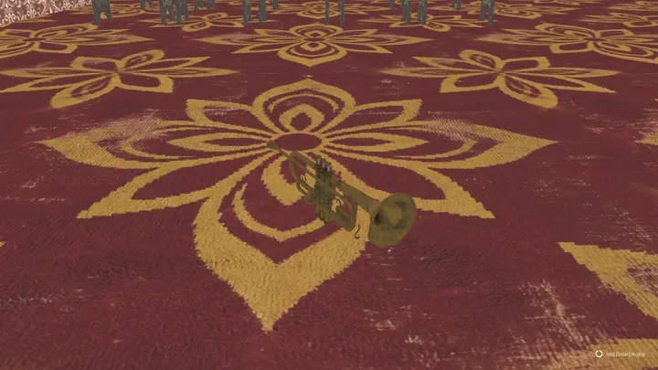
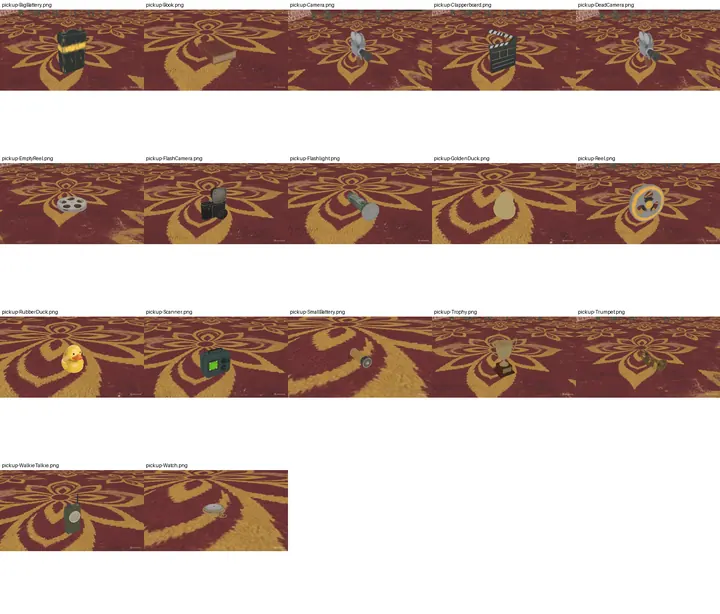

> **What went wrong:** The first camcorder picture had a real brand name on the body, so the prompt got 'plain smooth unmarked'; the reel picture from gpt-image-2 had the right shape but a real film-stock brand on the label, removed with an image-to-image edit. The large battery's verbatim spec prompt gave a wide box, and the clapperboard came out open, so Blender closed it.

<details><summary>Prompt: SM_Trumpet (#228, shared style prefix + object, fal-ai/nano-banana)</summary>

```
Product photo of one single object on a plain light-grey seamless background, soft even studio lighting, three-quarter view from slightly above, the whole object visible and centered with margin around it. A worn 1970s film-studio prop from a horror game, realistic PBR materials, subtle scratches, dust and patina. No text, no letters, no numbers, no logos, no brands, no people, no hands. The object: a brass trumpet with three piston valves, a flared bell, a mouthpiece and a tuning slide, tarnished brass with dark patina, lying on its side
```

</details>

<details><summary>Prompt: SM_Val_RubberDuck (Day 1, Meshy nano-banana-pro reference)</summary>

```
A single classic rubber duck toy, a chubby bright yellow duck with an orange beak and tiny black eyes, glossy plastic seen from the front at a three-quarter angle, fully visible and centered, on a plain light grey background with soft, even studio lighting. Stylized semi-realistic 1960s film-set look, chunky readable shapes with visible volume and shading, hand-painted PBR textures with subtle wear, warm tungsten tones with faded teal and mustard accents, matte, slightly worn.
```

</details>

<details><summary>Prompt: SM_Reel_Tape label fix (Meshy image-to-image, gpt-image-2)</summary>

```
Keep the exact same film reel, angle, lighting and background, but make the mustard yellow label band completely plain and blank: remove every letter, number and word from the reel so the band is a clean worn mustard colour.
```

</details>

<details><summary>Prompt: SM_Val_Clapperboard (#228)</summary>

```
Product photo of one single object on a plain light-grey seamless background, soft even studio lighting, three-quarter view from slightly above, the whole object visible and centered with margin around it. A worn 1970s film-studio prop from a horror game, realistic PBR materials, subtle scratches, dust and patina. No text, no letters, no numbers, no logos, no brands, no people, no hands. The object: a film clapperboard slate standing upright: a black board with white chalk lines and completely empty fields, a hinged clapper stick on top with black and white diagonal stripes, slightly open, nothing written on it
```

</details>

### Studio furniture, first night

The first furniture of the recording and editing studios: tape machines, moviola, mixing desk, mic stands, acoustic panels, the table you hide under, doors, vents, crates and more.

- **Tools:** Meshy text to image (nano-banana-pro) -> Meshy Image to 3D (meshy-t2.5 smart topology + meshy-7 PBR texture); five hero pieces (moviola, tape machine, mixing desk, vocal booth, hide table) through Hyper3D Rodin Gen-2.5. All were planned for Tripo.
- **How many:** 26 models with meta.json (16 SM_Studio_* plus 10 SM_Prop_* from that night); the dev log counts 28 studio props for the night
- **Cost:** Meshy text-to-image 9 credits per picture, image-to-3D 15; Rodin credits not reported by the Rodin MCP

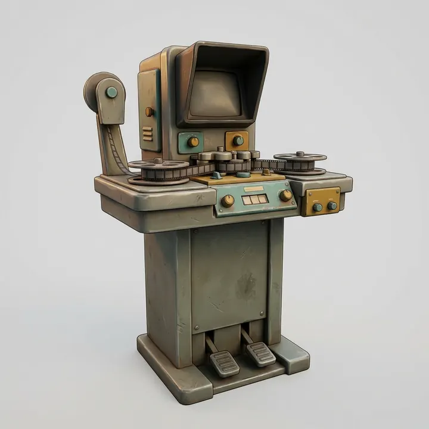
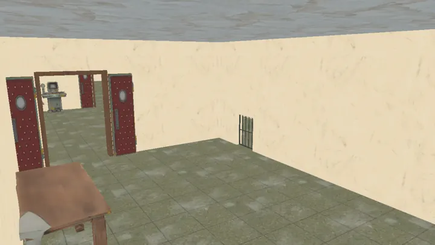

> **What went wrong:** Tripo's API key had no credits, so every model planned for Tripo went to Meshy or Rodin. The hide table came out with low stretchers on all four sides, so Blender deleted everything under the apron and added four box legs to leave room to crawl under it; the acoustic panel came out square instead of 120 x 60, so two stand side by side.

<details><summary>Prompt: SM_Studio_Moviola (Meshy nano-banana-pro reference)</summary>

```
A single upright 1960s film editing machine on a grey-green metal pedestal with a small hooded viewing screen, two foot pedals and two film spool arms seen from the front at a three-quarter angle, fully visible and centered, on a plain light grey background with soft, even studio lighting. Stylized semi-realistic 1960s film-set look, chunky readable shapes with visible volume and shading, hand-painted PBR textures with subtle wear, warm tungsten tones with faded teal and mustard accents, matte, slightly worn.
```

</details>

<details><summary>Prompt: SM_Studio_Moviola (Rodin prompt)</summary>

```
Upright 1960s film editing machine on a grey-green metal pedestal with a small hooded viewing screen, two foot pedals and two film spool arms. Stylized semi-realistic, chunky readable shapes, hand-painted PBR textures, warm tungsten tones with faded teal and mustard accents, matte, slightly worn.
```

</details>

<details><summary>Prompt: SM_Studio_HideTable (third try)</summary>

```
A single long heavy tall 1960s wooden editing workbench with a thick bare top on four thick square legs at the corners, the whole space under the top completely open and empty with no shelf and no crossbars, a plain grey cloth draped over one end of the top seen from the front at a three-quarter angle, fully visible and centered, on a plain light grey background with soft, even studio lighting. Stylized semi-realistic 1960s film-set look, chunky readable shapes with visible volume and shading, hand-painted PBR textures with subtle wear, warm tungsten tones with faded teal and mustard accents, matte, slightly worn.
```

</details>

### Studio props, set A

Furniture for four room types of the random studio: the darkroom, the dressing room, the canteen and the producer's office.

- **Tools:** fal-ai/nano-banana reference -> Meshy Image to 3D via REST (meshy-t2 smart topology + meshy-7 PBR texture), headless Blender prep, UE import script
- **How many:** 14
- **Cost:** 210 Meshy credits and about 0.55 USD on fal (0.039 USD per picture)

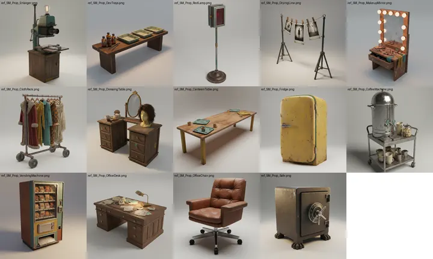
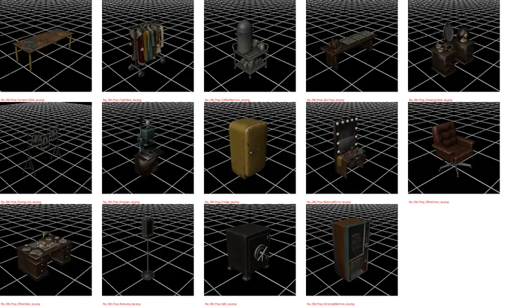
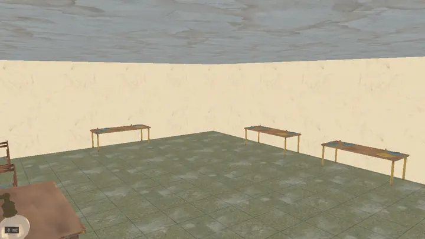

> **What went wrong:** Nothing broke in the generation; the darkroom simply never showed up in any studio seed we checked, so its four props (enlarger, trays, red lamp, drying line) are only seen in the Blender preview.

<details><summary>Prompt: SM_Prop_CoffeeMachine</summary>

```
A single large chrome urn-style canteen coffee machine with spouts, stacked cups and a sugar jar on a small steel serving cart with a lower shelf, fully visible and centered, seen from the front at a three-quarter angle from slightly above, on a plain light grey seamless background with soft, even studio lighting. Stylized semi-realistic 1970s film-studio look for a horror game, chunky readable shapes with visible volume, realistic PBR materials, worn, dusty and slightly grimy, warm tungsten tones with faded teal and mustard accents. No text, no logos, no brand names, no labels, no people.
```

</details>

<details><summary>Prompt: SM_Prop_Enlarger</summary>

```
A single 1970s photographic darkroom enlarger: a vertical steel column with the lamp head and bellows on top, mounted on its own small sturdy wooden cabinet base with a flat baseboard and an easel, fully visible and centered, seen from the front at a three-quarter angle from slightly above, on a plain light grey seamless background with soft, even studio lighting. Stylized semi-realistic 1970s film-studio look for a horror game, chunky readable shapes with visible volume, realistic PBR materials, worn, dusty and slightly grimy, warm tungsten tones with faded teal and mustard accents. No text, no logos, no brand names, no labels, no people.
```

</details>

### Studio props, set B

Reception desk, ficus, mop, small shelf, bucket, bottles, fire extinguisher, EXIT sign, green screen, set wall, editing desk, archive shelf, suitcases and a mannequin for the lobby, corridors, stage, editing room, vault and prop store.

- **Tools:** fal-ai/nano-banana reference -> Meshy Image to 3D via REST (meshy-t2 smart topology + meshy-7 PBR texture), Blender prep_prop.py with new --stretch and --mount options
- **How many:** 14, plus one redo of the mannequin
- **Cost:** 210 Meshy credits and about 0.55 USD on fal; the mannequin redo 15 Meshy credits and about 0.08 USD (2 pictures)

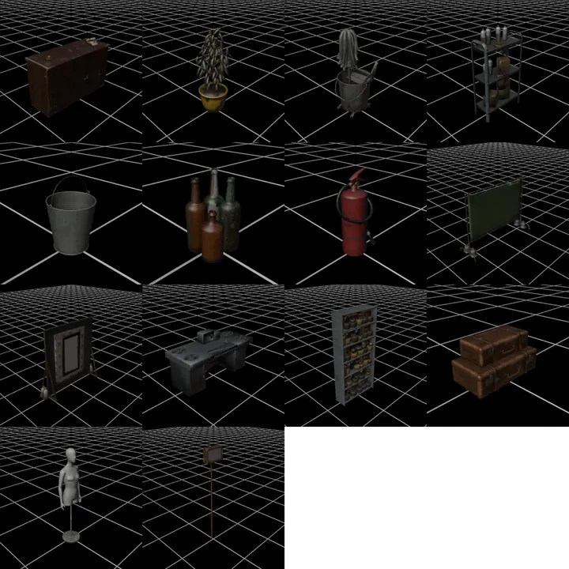
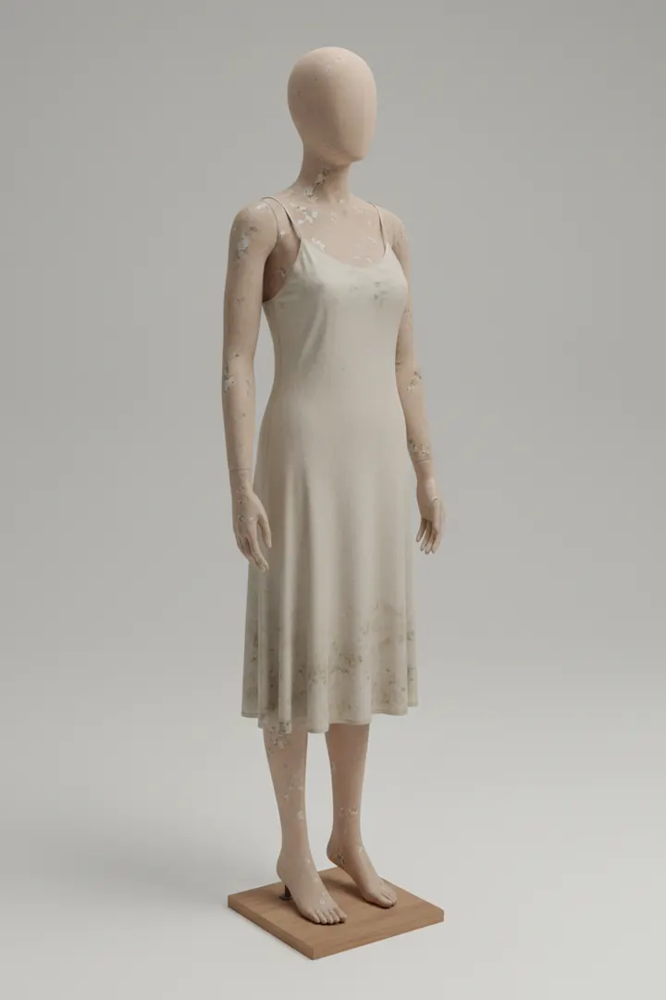
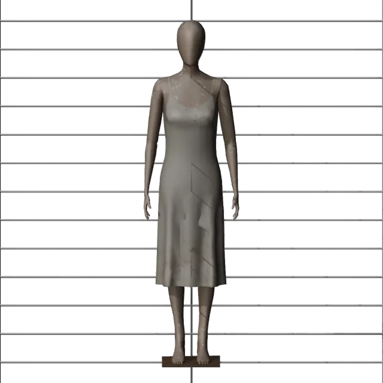

> **What went wrong:** The first mannequin came out as a dress form on a pole; the redo prompt shouts 'NO pole, NO stand, NO rod', and of its two candidates one still had a support rod at the heel. The EXIT sign came with a conduit pipe, so it is now exported without it and the studio generator hangs it on the wall.

<details><summary>Prompt: SM_Prop_Mannequin, the redo after the dress form</summary>

```
Single isolated object, fully visible and centered with margin, three-quarter front view from slightly above, on a plain light grey seamless background, soft even studio lighting. A worn prop from an abandoned 1970s film studio, eerie horror mood, realistic PBR materials with dust, scratches and faded paint, matte, solid simple silhouette. No text, no logos, no brands, no people. Object: a complete full-body 1970s department store display mannequin, life size, standing upright on its own two legs with feet slightly apart, both feet resting on a small low square wooden base plate, NO pole, NO stand, NO rod, arms hanging down close to the body, smooth bald egg-shaped featureless head with no face, pale beige fibreglass body with chipped and flaking paint and dark grime, wearing a plain simple knee-length off-white slip dress, whole body from head to feet visible, front view slightly turned.
```

</details>

<details><summary>Prompt: SM_Prop_PlantPot</summary>

```
Single isolated object, fully visible and centered with margin, three-quarter front view from slightly above, on a plain light grey seamless background, soft even studio lighting. A worn prop from an abandoned 1970s film studio, eerie horror mood, realistic PBR materials with dust, scratches and faded paint, matte, solid simple silhouette. No text, no logos, no brands, no people. Object: a tall half-dead rubber plant with drooping brown leaves in a large cracked mustard ceramic floor pot.
```

</details>

<details><summary>Prompt: SM_Prop_Sign_Exit</summary>

```
Single isolated object, fully visible and centered with margin, three-quarter front view from slightly above, on a plain light grey seamless background, soft even studio lighting. A worn prop from an abandoned 1970s film studio, eerie horror mood, realistic PBR materials with dust, scratches and faded paint, matte, solid simple silhouette. No other text, no logos, no brands, no people. Object: a 1970s illuminated exit sign box, rectangular metal housing, white glass front panel with the single word EXIT in bold red capital letters, seen from the front at a slight angle.
```

</details>

### Cinema hall and projector

The cinema where every day starts and ends: the projector that counts reels, the seats, the screen, the door leaves, wall sconces, the reel rack and the end-of-day button.

- **Tools:** Meshy text to image (nano-banana-pro) -> Meshy Image to 3D (meshy-t2.5 smart topology + meshy-7 PBR); the projector through Hyper3D Rodin Gen-2.5-High
- **How many:** 7
- **Cost:** Meshy: 24 credits per prop (9 picture + 15 model), 9 for the projector picture; Rodin credits not reported


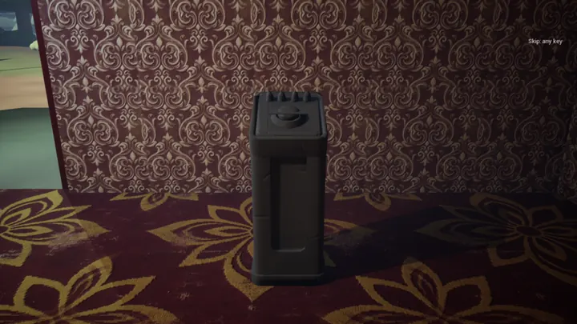

> **What went wrong:** The projector's battery bays came out as shallow panels rather than deep recesses; the end-day button was planned for Tripo and made in Meshy because Tripo's balance was zero.

<details><summary>Prompt: SM_Projector (Rodin prompt)</summary>

```
A heavy 1960s cinema film projector in dark green-grey painted metal and brass, two film reel arms on top, three square battery bays in a row on the front each with a small round indicator light, a large round lens at the front, on a sturdy iron stand.
```

</details>

<details><summary>Prompt: SM_Cinema_Seat</summary>

```
A single 1960s cinema seat in worn dark red velvet with a folding seat, wooden armrests with small brass number plates and a cast iron side frame seen from the front at a three-quarter angle, fully visible and centered, on a plain light grey background with soft, even studio lighting. Stylized semi-realistic 1960s film-set look, chunky readable shapes with visible volume and shading, hand-painted PBR textures with subtle wear, warm tungsten tones with faded teal and mustard accents, matte, slightly worn.
```

</details>

<details><summary>Prompt: SM_Cinema_EndDayButton</summary>

```
A single waist-high 1960s cinema control pedestal: a cast metal column with a slanted top panel holding one big round red push button inside a brass ring, and a row of four small round indicator lamps above the button seen from the front at a three-quarter angle, fully visible and centered, on a plain light grey background with soft, even studio lighting. Stylized semi-realistic 1960s film-set look, chunky readable shapes with visible volume and shading, hand-painted PBR textures with subtle wear, warm tungsten tones with faded teal and mustard accents, matte, slightly worn.
```

</details>

### Cinema facade and lobby

The town cinema's front with a real doorway, plus the ticket booth, concession counter, popcorn machine, rope barriers, stage curtains and broken seats.

- **Tools:** fal FLUX.2 [pro] (fal-ai/flux-2-pro) reference + fal-ai/nano-banana/edit -> Meshy Image to 3D via REST (meshy-t2 smart topology + meshy-n1 texture); the facade is a Blender box with a nano-banana/edit flat elevation image projected onto it
- **How many:** 6 props + 1 facade
- **Cost:** 120 Meshy credits (including two unused facade attempts) and about 0.40 USD on fal

![reference: FLUX.2 [pro] facade reference](img/sm_facade_cinema-ref_sm_facade_cinema.webp)
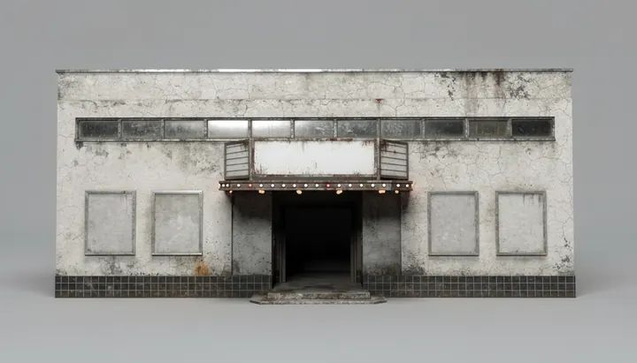
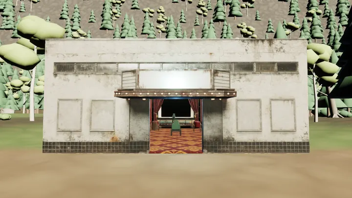

> **What went wrong:** The facade failed twice in Meshy: first a 7.7 m cube building with the door only drawn on, then a 7 m deep box whose window band melted into stripes. We built the wall with a 250 x 250 doorway in Blender and projected a flat AI elevation onto it. The ticket booth's sign had letters, which a nano-banana edit removed.

<details><summary>Prompt: SM_Facade_Cinema (FLUX.2 [pro] reference)</summary>

```
Single isolated building facade on a plain light-grey studio background, full facade in frame, 1970s small-town cinema, worn and dusty, realistic PBR materials, game asset reference, no text, no letters, no logos, no brands, no people. Object: front elevation of a small 1970s single-screen town cinema, a very wide and low flat false-front wall, twice as wide as it is tall, painted cracked plaster with a tiled base, one central entrance with a pair of plain dark doors in a deep recess, above the entrance a projecting marquee canopy with a blank white letter board and rows of bulbs underneath, two framed empty poster cases on each side of the entrance, a row of small high windows, flat parapet top, seen almost straight from the front with a slight angle
```

</details>

<details><summary>Prompt: SM_Facade_Cinema (nano-banana/edit, flat elevation)</summary>

```
Turn this into a perfectly flat orthographic front elevation texture of the same cinema facade, viewed exactly head-on with zero perspective, the facade wall filling the entire image edge to edge with no background, no sky, no ground, no steps and no shadows. Keep the cracked dirty plaster, the dark tiled base along the bottom edge, the row of small high windows, the four empty framed poster cases, and the centered marquee sign with blank white letter board and a row of bulbs under it above the centered entrance. The entrance is a plain dark rectangular opening in the middle bottom. No text, no letters, no logos.
```

</details>

<details><summary>Prompt: SM_Cinema_TicketBooth (nano-banana/edit fix)</summary>

```
Remove all letters from the sign on the roof of the booth so the roof band is plain blank painted metal. Keep everything else identical.
```

</details>

<details><summary>Prompt: SM_Prop_PopcornMachine</summary>

```
Single isolated object on a plain light-grey studio background, 3/4 view, full object in frame, 1970s small-town cinema, worn and dusty, realistic PBR materials, game asset reference, no text, no letters, no logos, no brands, no people. Object: old 1970s cinema popcorn machine cart, red painted metal cabinet with glass kettle display box on top, small wheels, about 60 cm wide 150 cm tall
```

</details>

### The walk-in crew bus

The crew's bus by the cinema, a set you walk into, with the shop register, the camera station whose CRT shows teammates' cameras, the sell bin under a SELL HERE sign and the revive defibrillator.

- **Tools:** fal FLUX.2 [pro] edit (fal-ai/flux-2-pro/edit) with three style references cut from our finished models (duck, reel, projector) -> Hyper3D Rodin Gen-2.5-High over MCP -> headless Blender 5.3 scripts -> UE editor Python import
- **How many:** 8 models (bus, interior, antenna array built in Blender, register, camera station, sell bin, sign, defibrillator)
- **Cost:** Rodin credits not reported by the Rodin MCP

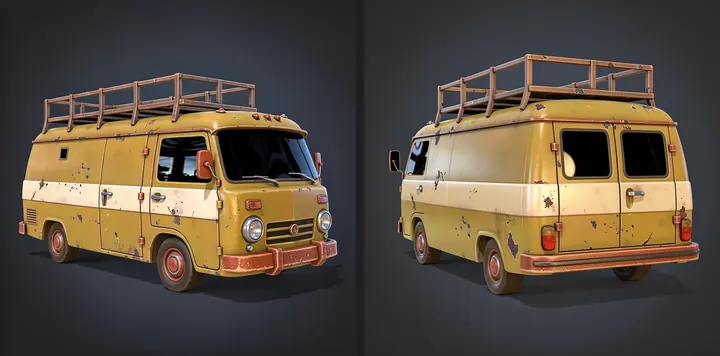
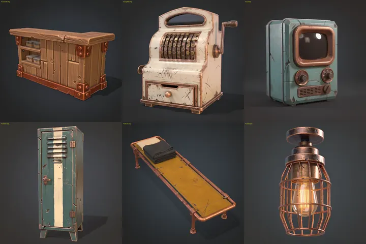
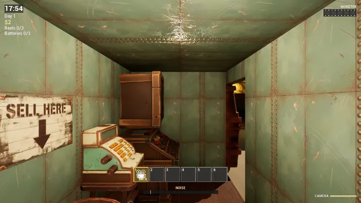

> **What went wrong:** The first bus pictures looked like a photo of a real, short van; one result of the second round had a star badge that read as a real car brand. fal would not draw a CRT as wide as the desk in three tries, so Blender scaled the monitor islands 1.4x, and Rodin's defibrillator cabinet came out turned 33 degrees. A red phone booth was tried for the revive point and replaced by the defibrillator.

<details><summary>Prompt: Bus body (FLUX.2 [pro] edit, style refs @image1..@image3)</summary>

```
A single very long boxy 1960s high-roof film crew van, an extended delivery bus body about three times longer than it is tall, with a flat roof and a long cargo section behind the cab. Made in the exact stylized art style of the objects in @image1, @image2 and @image3: a game asset with chunky, slightly faceted, hand-carved looking shapes, deep panel seams, bright worn highlights hand-painted along every edge and seam, small scratches, dents and rivets, simple readable forms, not photorealistic. Mustard yellow paint like the duck in @image1 with a wide cream stripe along the side, burnt copper bumpers, hubcaps, window frames and an empty roof rack like the metal in @image2, round chrome headlights, a large sliding side door on the right side of the cargo section, two rear doors, small dark tinted windows you cannot see through, dark brown tyres. No text, no logos, no lettering, no license plate. Seen from the front right at a three-quarter angle, the whole van fully visible and centered with space around it, on a plain dark charcoal grey background with soft, even studio lighting.
```

</details>

<details><summary>Prompt: Defibrillator</summary>

```
A single vintage 1960s wall-mounted defibrillator kit for a film crew van: a sturdy rectangular metal wall cabinet painted cream and faded teal with burnt copper trim and hinges, its front door open, inside a chunky old defibrillator machine with a big round analog dial, two toggle switches, a small red indicator lamp and two heavy paddles with black handles hanging on coiled cables, and on the top panel a simple white heart with a lightning bolt symbol, [the same style sentence as above]. No text, no letters, no red cross, no logo.
```

</details>

### Forest places

Small scenes in the clearings of the world map: gas station kiosk, pumps, sign and oil drums, camper trailers, folding chairs and a washing line, film set flats and film can crates, a tent, fire ring, cooler and lantern, and the Holy Trinity shrine.

- **Tools:** fal-ai/nano-banana reference -> Meshy Image to 3D (meshy-t2 smart topology + meshy-n1 texture); headless Blender prep_place.py; a 'places' step in the world builder
- **How many:** 14
- **Cost:** 210 Meshy credits (15 each)

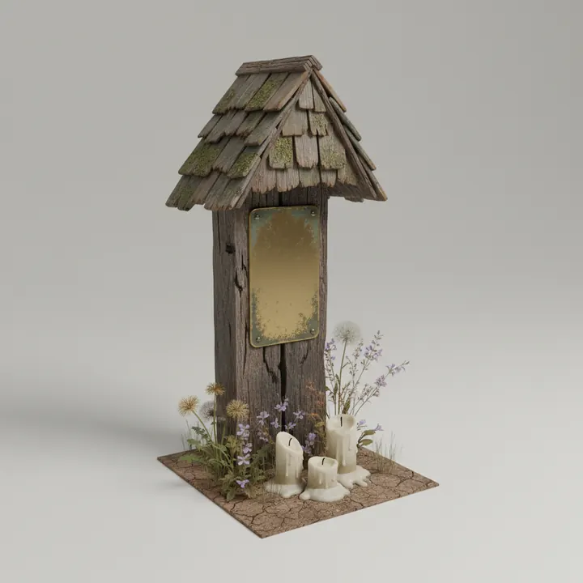
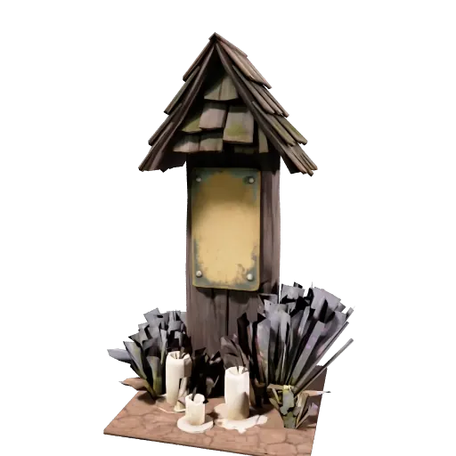
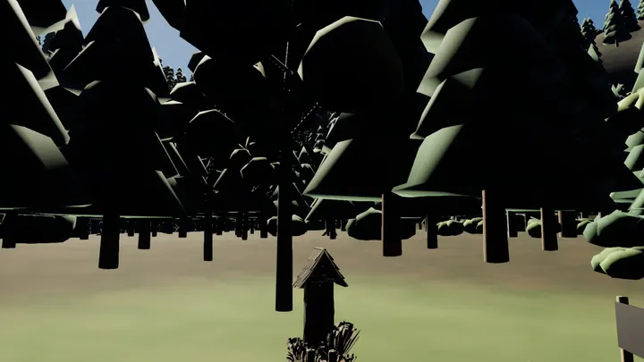

> **What went wrong:** The first fal key had been revoked, the Meshy queue refused more than 12 tasks at once, and our first collision check reported every model as hollow because the old FBX importer ignored the UCX boxes; the importer now gives each solid prop one simple box.

<details><summary>Prompt: SM_Place_TrinityShrine</summary>

```
Single isolated object, centered, full object visible, plain light-grey studio background, three-quarter view from slightly above, realistic PBR game asset, worn and weathered 1970s American backwoods film location prop, muted desaturated colours, no text, no letters, no numbers, no logos, no brands, no people. Object: a small wayside shrine: a short square wooden post with a tiny pitched shingle roof sheltering a blank brass plaque, three melted candle stubs and wild flowers at the foot
```

</details>

<details><summary>Prompt: SM_Place_GasKiosk</summary>

```
Single isolated object, centered, full object visible, plain light-grey studio background, three-quarter view from slightly above, realistic PBR game asset, worn and weathered 1970s American backwoods film location prop, muted desaturated colours, no text, no letters, no numbers, no logos, no brands, no people. Object: a tiny single-storey roadside gas station kiosk building seen from the front corner, flat roof with a small overhang, a closed wooden front door with a small glass pane in the middle of the front wall, one wide dusty shop window on each side of the door, peeling cream paint, rusty gutters
```

</details>

<details><summary>Prompt: SM_Place_Tent</summary>

```
Single isolated object, centered, full object visible, plain light-grey studio background, three-quarter view from slightly above, realistic PBR game asset, worn and weathered 1970s American backwoods film location prop, muted desaturated colours, no text, no letters, no numbers, no logos, no brands, no people. Object: an old canvas A-frame camping tent, faded khaki, one side sagging, the front flap open, guy ropes and wooden pegs, standing on nothing, no ground, no base, no terrain
```

</details>

### Dead wood and rock

Cliffs and boulders along the invisible wall before the mountains, dead and burnt trees around the studio and the ravine, logs and stumps along the paths.

- **Tools:** fal-ai/nano-banana reference -> Meshy Image to 3D (meshy-t2 smart topology, 3,000 to 6,000 triangles, meshy-7 PBR texture); Blender prep_nature.py (scale, pivot, convex collision), Nanite on import
- **How many:** 10 kept models placed as 211 instances; 2 bushes rejected
- **Cost:** 180 Meshy credits (12 tasks x 15, including the two rejected bushes) and about 0.47 USD on fal (12 pictures)

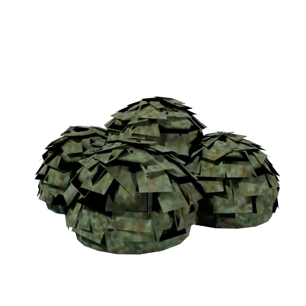
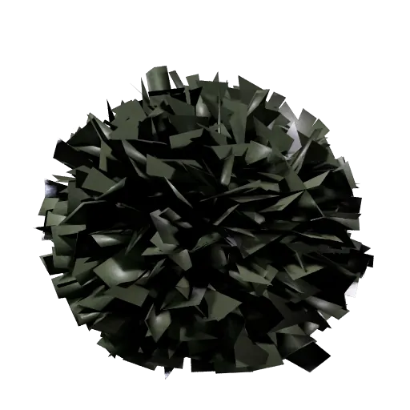
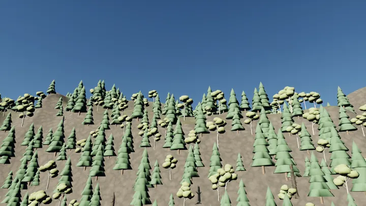

> **What went wrong:** Both AI bushes failed: the first came out as a ball of spiky shards, the retry as a pile of green artichokes, so we kept our own bushes and all the living trees. The first row of cliff faces looked like a fence from above, so each face now leans back a few degrees at its own height and angle.

<details><summary>Prompt: SM_AI_Tree_Burnt_A</summary>

```
Single isolated object centered on a plain light-grey studio background, 3/4 view from slightly above, full object visible with margin, soft even lighting, realistic PBR materials, muted desaturated colours of an overcast Pacific Northwest forest in the 1970s, slightly eerie, no text, no logos, no people, no ground plane, no shadows on the floor. Object: a burnt charred tree trunk snag about 5 m tall, black charcoal bark with cracks, jagged broken top, two thick stubby broken branches, flared roots at the base, no leaves, no thin twigs
```

</details>

<details><summary>Prompt: SM_AI_Cliff_A</summary>

```
Single isolated object centered on a plain light-grey studio background, 3/4 view from slightly above, full object visible with margin, soft even lighting, realistic PBR materials, muted desaturated colours of an overcast Pacific Northwest forest in the 1970s, slightly eerie, no text, no logos, no people, no ground plane, no shadows on the floor. Object: a section of a steep mountain cliff rock face, a wide vertical wall of fractured grey granite with ledges and vertical cracks, flat back side, about 12 m wide and 8 m tall, seen from the front at 3/4
```

</details>

<details><summary>Prompt: SM_AI_Rock_Boulder_A</summary>

```
Single isolated object centered on a plain light-grey studio background, 3/4 view from slightly above, full object visible with margin, soft even lighting, realistic PBR materials, muted desaturated colours of an overcast Pacific Northwest forest in the 1970s, slightly eerie, no text, no logos, no people, no ground plane, no shadows on the floor. Object: a large rounded granite boulder, grey with lichen spots and a little moss on top, weathered cracks, about 2 m wide, solid single rock
```

</details>

### Surfaces

Eight tiling surfaces: cinema carpet, wallpaper and brass, studio linoleum, plaster, acoustic foam, wood veneer and basement concrete.

- **Tools:** fal nano-banana-pro (text to image) for the base colour; normal and roughness maps computed locally in Python with numpy
- **How many:** 8
- **Cost:** 1.20 USD on fal (0.15 USD per picture)


> **What went wrong:** The spec named PBRgen, which was not used; this pass is an AI placeholder through fal, at 1024 px where the spec asked for 2K.

<details><summary>Prompt: Cinema_Floor_Carpet</summary>

```
Seamless tileable texture, orthographic top-down view straight onto the surface, flat even diffuse lighting with no shadows, no highlights and no vignette, the surface fills the whole frame edge to edge, no objects, no text, no logos. Stylised hand-painted realism with a large readable pattern and subtle wear, no tiny photographic micro detail. Surface: worn old theatre carpet, deep oxblood red (#6B1E2A) with a small repeating geometric pattern in muted mustard gold (#C9A227), slightly flattened pile, a few faded worn patches.
```

</details>

### The film crew (player character)

What teammates see in co-op: a 1970s film crew member in a work jacket in one of four colours, on the UE5 mannequin skeleton, with gestures for knocking, hiding, reviving, the trumpet, flinching and being caught.

- **Tools:** fal FLUX.2 [pro] (seed 7019) reference -> Meshy Image to 3D (meshy-t2.5 smart topology, about 20,000 triangles, meshy-n1 texture) + Meshy rigging -> Blender build_crew.py onto the mannequin skeleton; 7 clips from Meshy Text to Motion (prime) retargeted by Blender retarget_meshy_anims.py; 9 earlier clips (crouch walk, reel carry, held item, camcorder pose, throw and spares) from Hyper3D Rodin rigging with its animation catalog, retargeted with RTG_Rodin_To_Manny
- **How many:** 1 character, 7 Meshy clips, 9 Rodin clips
- **Cost:** Meshy 111 credits (15 model + 5 rig + 7 x 13 for motion and applying it); fal one FLUX.2 [pro] picture, about 0.05 USD; Rodin not reported

![reference: FLUX.2 [pro] A-pose reference](img/sk_crew_base-ref_a.webp)
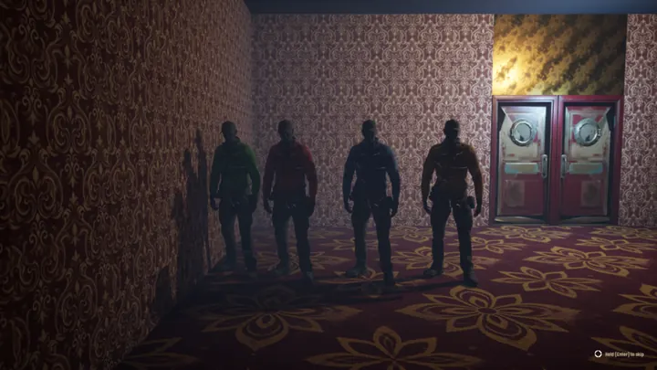
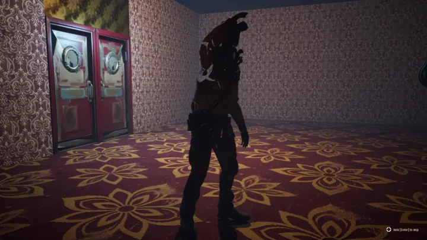

> **What went wrong:** Rodin's first two rigging tries failed (wrong format, then a human_UE template without a Hips bone); the third with the 'human' template worked. Before the crew model, crouching was faked by squashing the mannequin to 0.47 of its height, so a crouching teammate looked like someone had sat on him. The first crew export gave the root bone a scale of 100, so the mannequin clips squashed the body to one hundredth.

<details><summary>Prompt: SK_Crew_Base reference (FLUX.2 [pro])</summary>

```
Full body character reference for a realistic PBR video game character, front view, symmetrical A-pose (arms straight and angled 45 degrees down away from the body, hands open with fingers together, legs slightly apart), entire figure visible from the cap to the boots, centered, plain flat neutral grey background, soft even studio lighting, no shadows on background. A 1970s film crew member (grip / camera assistant), adult man of average build, neutral calm expression, generic ordinary face that does not resemble any real person, short hair under a faded olive-green baseball cap. Worn tan canvas work jacket with sewn-on plain patches without any text, logos or brands, sleeves to the wrists, jacket closed. Old over-ear headphones with a coiled cable resting around the neck. Leather utility belt with a roll of grey gaffer tape clipped on the hip and a small leather pouch. Dark brown cargo trousers with side pockets, worn brown leather work boots. Muted 1970s colour palette, slightly dusty and worn fabric, realistic materials, game asset reference sheet, no props in hands, no text, no watermark.
```

</details>

<details><summary>Prompt: AN_Player_Caught (Meshy Text to Motion)</summary>

```
A man standing is suddenly grabbed by the shoulders from the front, recoils in terror and struggles, flailing his arms and pushing away.
```

</details>

<details><summary>Prompt: AN_Player_Knock</summary>

```
A man stands facing a closed door and knocks on it three times with his right fist at head height, then lowers his arm and waits.
```

</details>

<details><summary>Prompt: AN_Player_Trumpet_Blow</summary>

```
A man standing raises a trumpet to his lips with both hands, blows it hard leaning back slightly, then lowers it.
```

</details>

### Take Fourteen, the monster

The game's only monster: a gaunt 240 cm figure of wound magnetic film tape with a rusty reel hub in its chest, ear loops of film strip and two antennae, with 13 animations on one rig.

- **Tools:** fal FLUX.2 [pro] (seed 1414) reference -> fal-ai/nano-banana/edit cleanup -> Meshy Image to 3D via REST (meshy-t2.5 smart topology, 22,225 triangles, meshy-n1 texture) -> Meshy Rig (24 bones) -> 8 Meshy Animate library clips + 5 Meshy Text to Motion clips; Blender removed root motion
- **How many:** 1 monster + 13 animations
- **Cost:** 102 Meshy credits and about 0.10 USD on fal

![reference: first FLUX.2 [pro] reference with loose tape](img/raw-ref_sk_monster_takefourteen_first.webp)
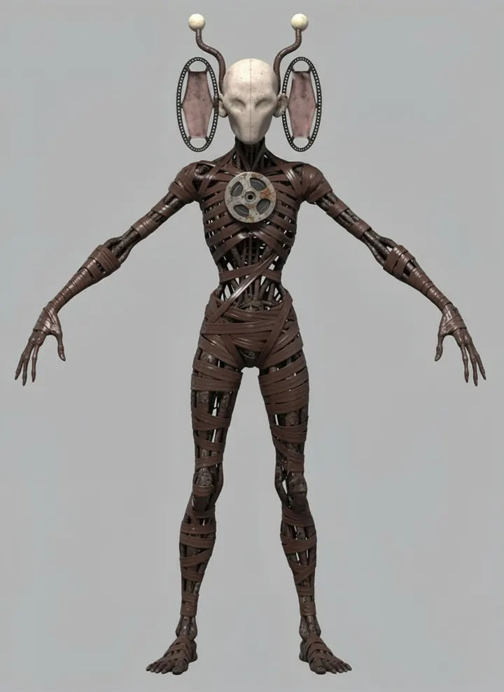


> **What went wrong:** The text-to-motion lunge jumped 1.6 m into the air, so Blender lowered it (x0.3), and two sideways library clips were turned to face forward. Loose tape strands that would have ruined the rig were edited out of the reference. The first Unreal import renamed the skeleton and left the monster frozen in its A-pose until we imported onto a throwaway skeleton copy.

<details><summary>Prompt: Reference (FLUX.2 [pro], as stored in meta.json with ellipses)</summary>

```
Full-body character concept for a 3D game model, front view, symmetrical T-pose ... A gaunt, very tall humanoid creature (about 240 cm) built entirely from tangled brown magnetic film tape and old film-reel parts ... two large oval ear-like loops made of looped film tape with dusty pale pink membrane inside, and two long thin antenna-like stalks with cream tips ... Smooth eyeless face ... horror for teens, no gore, no blood, no text, no logos, single character only.
```

</details>

<details><summary>Prompt: Cleanup (nano-banana/edit)</summary>

```
Edit this creature for a clean 3D game model: keep exactly the same character ... Remove every loose hanging strand of tape ... Move the two ear loops so they attach directly to the sides of the head ... completely eyeless and smooth ... symmetrical A-pose ... plain flat light-grey background, no text.
```

</details>

<details><summary>Prompt: AN_Monster_Lunge (Text to Motion)</summary>

```
Crouches low and coils, then leaps forward in one short powerful lunge with both long arms reaching out to grab, and lands crouched.
```

</details>

<details><summary>Prompt: AN_Monster_Idle_Listen (Text to Motion)</summary>

```
A tall creature stands still, slightly hunched forward, arms hanging loose, and slowly tilts its head to one side as if listening intently, holds, then slowly tilts its head to the other side and holds again.
```

</details>

### The Listener (first monster)

The first monster body from Day 1: an insect-like creature with huge ears that hunts by sound; it stays in the project as a fallback with its animations.

- **Tools:** Meshy text to image (nano-banana-pro, A-pose) -> Meshy Image to 3D (meshy-t2.5 smart topology, 30,000 triangles, meshy-n1 texture) -> Meshy Rig; Meshy Animate and Text to Motion for its clips
- **How many:** 1 monster
- **Cost:** 29 Meshy credits for the body (9 picture + 15 model + 5 rig)

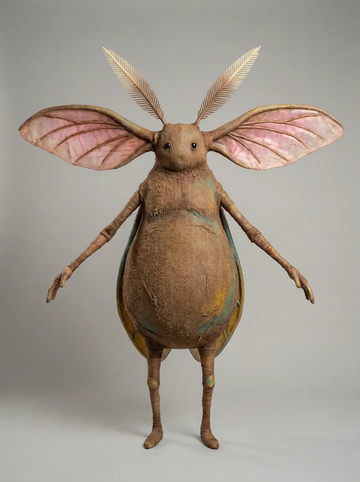

> **What went wrong:** It came out as 'a plush pear that could make someone smile', which is not what a horror monster should do, so on Day 3 it was replaced by Take Fourteen. The Meshy skeleton had no ear or antenna bones.

<details><summary>Prompt: SK_Monster_Listener (spec ASSET-001 step 1, used verbatim per meta.json)</summary>

```
A single full-body upright insect-like creature about 190 cm tall with a pear-shaped fuzzy brown body, a small head with two tiny pinprick eyes, two huge pink-lined membrane ears wider than its shoulders, two long feathery antennae with cream tips, thin stick-like arms and legs, standing in an A-pose with arms about 45 degrees down, seen from the front, fully visible and centered, on a plain light grey background with soft, even studio lighting. Stylized semi-realistic 1960s film-set look, chunky readable shapes with visible volume and shading, hand-painted PBR textures with subtle wear, warm tungsten tones with faded teal and mustard accents, matte, slightly worn.
```

</details>

### The golden duck's cameo

A 5-second shot in the final film: the golden duck alone on a black-and-white film set, captioned 'SPECIAL APPEARANCE / THE GOLDEN DUCK AS HIMSELF'.

- **Tools:** fal-ai/nano-banana-pro/edit (seed 204) on the duck model's reference picture -> fal-ai/kling-video/v2.5-turbo/pro/image-to-video (Kling 2.5 Turbo Pro) -> ffmpeg
- **How many:** 1 clip (English and Polish captions)
- **Cost:** 0.50 USD per the fal price list (0.15 still + 0.35 video)

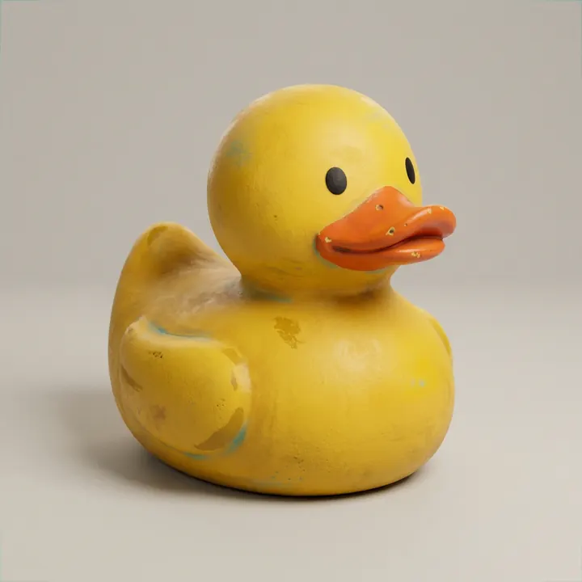
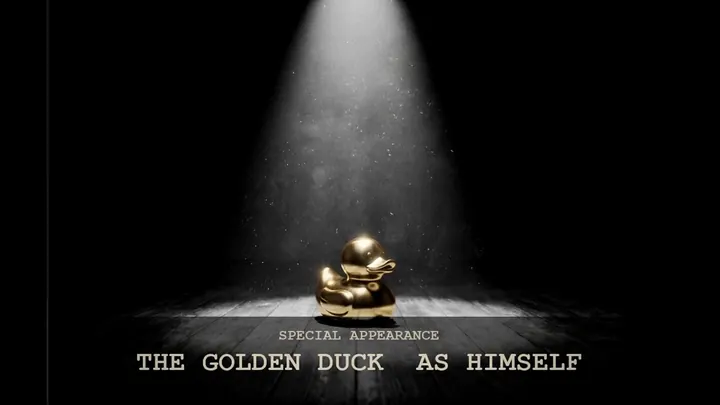

> **What went wrong:** Until fal had money again on 14 Nov this slot showed a still photo of the model with a slow zoom. Kling takes no seed, so the clip cannot be reproduced exactly.

<details><summary>Prompt: Still (nano-banana-pro edit)</summary>

```
The same rubber duck from the reference image, but made of polished gold, sitting alone on the wooden floor of an empty 1960s film studio set, lit by a single hard spotlight from above, dust floating in the light beam, darkness around. Black and white 16mm film still, heavy film grain, high contrast, deep shadows, soft vignette. Wide 16:9 frame, the duck small in the centre. No text, no people, no logos.
```

</details>

<details><summary>Prompt: Video (Kling image-to-video, plus the shared style suffix)</summary>

```
A small golden rubber duck sits alone on a film set under a single spotlight, dust drifting slowly through the light beam. Slow dolly-in toward the duck. The duck does not move. + wspólny dopisek stylu
```

</details>

### The Director's voice

The Director's intro, day start and day end lines, the cinema announcer, live comments from the booth and the final film lines.

- **Tools:** ElevenLabs Text to Speech eleven_v4, premade voice 'Bill', stability 0.35, similarity 0.75 (first through fal, later the ElevenLabs API); ElevenLabs Speech to Text (scribe_v1) checks every line word for word; ffmpeg loudspeaker filter for announcements
- **How many:** 38 game lines + 7 final film lines
- **Cost:** Day 1 lines are inside the fal audio totals; hints 57 ElevenLabs credits, 17 live lines 310 credits

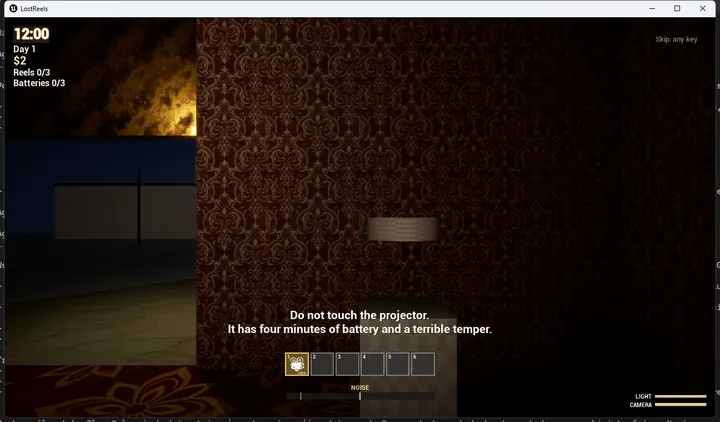

> **What went wrong:** Two takes came out with no speech at all and were dropped. S_VO_Dir_DayWin_01 ran 3.7 s against a 3 s limit, so it was sped up (atempo 1.26). A 192 kbps MP3 request got HTTP 403 because that format needs a higher plan.

<details><summary>Prompt: S_VO_PA_Siren_2min</summary>

```
TTS eleven-v4, voice Bill, stability 0.35, similarity 0.75: “Attention. Two minutes of daylight left. Come back to the cinema. All of you.” + filtr głośnika
```

</details>

<details><summary>Prompt: S_VO_Dir_Cut_01</summary>

```
TTS eleven-v4, voice Bill, stability 0.35, similarity 0.75: “CUT! Somebody wandered into the shot.”
```

</details>

<details><summary>Prompt: S_VO_Dir_Live_LastReel</summary>

```
TTS eleven_v4, Bill, filtr głośnika: “The last reel! I could kiss the projector. I won't. It bites.”
```

</details>

<details><summary>Prompt: S_VO_Dir_Hint_Shop</summary>

```
TTS eleven_v4, Bill: “Buy the scanner. It scans. That is all it does, but it does it well.”
```

</details>

### The Director in Polish

An optional Polish dub of all Director and announcer lines and the final film, with Polish subtitles and title cards.

- **Tools:** ElevenLabs Text to Speech eleven_v4 with language_code pl, same 'Bill' voice; ElevenLabs Speech to Text scribe_v1 (pl) for word-for-word checks; eleven_multilingual_v2 tried and not used; ffmpeg for the PL movies
- **How many:** 38 game lines + 7 final film lines
- **Cost:** 1021 ElevenLabs credits for the 38 lines (914 final, 74 for four rejected takes, 33 for the multilingual_v2 test) + 156 credits for the 7 final film lines

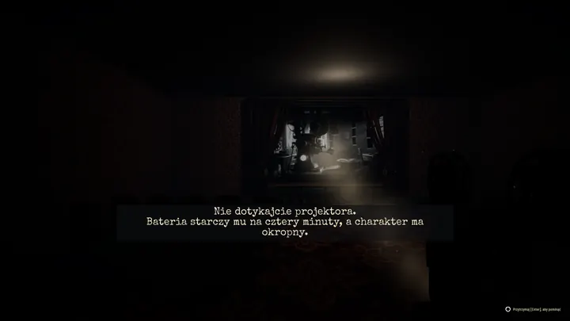
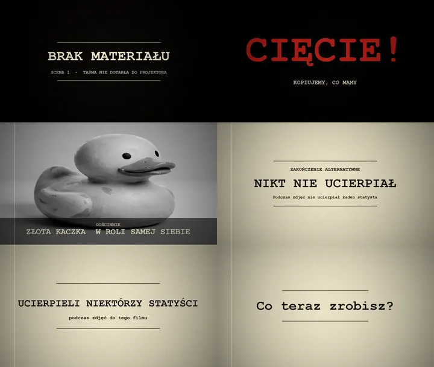

> **What went wrong:** Written in capitals like the English 'CUT!', CIĘCIE was read as 'Siecie'; in lower case it is fine. The whispered 'Noc' came out as 'Nok', so the line got a verb ('Zapadła noc.'), and DayWin_01 ran 4.3 s until we dropped 'Pięknie'.

<details><summary>Prompt: S_VO_Dir_Cut_01_PL (the retake)</summary>

```
TTS eleven_v4 pl, Bill: “Cięcie! Ktoś wlazł w kadr.”
```

</details>

<details><summary>Prompt: S_VO_Dir_Live_Night_02_PL (the retake)</summary>

```
TTS eleven_v4 pl, Bill, filtr głośnika: “[whispers] Zapadła noc. Ktoś jeszcze tam jest. Mam nadzieję, że to ktoś z was.”
```

</details>

<details><summary>Prompt: S_VO_Dir_FinalCut_Duck_PL</summary>

```
TTS eleven_v4 pl, Bill: “I kaczka. Nie pytajcie. Kaczka zostaje.”
```

</details>

### The Director's intro and reel clips

The 48.5 s intro film (the Director only from behind, the monster only as a silhouette) and three 6 s clips that play when a reel is delivered, all in a 1960s 16 mm black-and-white look.

- **Tools:** fal-ai/kling-video/v2.5-turbo/pro/text-to-video (Kling 2.5 Turbo Pro, 1920 x 1080, 24 fps) -> ffmpeg (desaturation, grain, flicker, gate weave, scratches, vignette); subtitles timed with local Whisper (Vexa STT)
- **How many:** 14 Kling shots, 130 s of raw video
- **Cost:** 9.10 USD per the fal price list (0.07 USD per second); the fal balance dropped by 11.50 USD, the rest most likely other jobs on the same account


> **What went wrong:** Kling drew a banknote with a portrait in intro07, so only the clenched fist stayed; it wrote gibberish on the cinema marquee in intro06, cropped down to the bus; and ending01 was rejected for faces and gibberish on the cinema screen, replaced by ending01_v2.

<details><summary>Prompt: Shared style suffix</summary>

```
Shot on black and white 16mm film in the early 1960s, heavy film grain, high contrast, deep shadows, soft vignette, slight gate weave, tense suspense horror mood, slow deliberate camera. No faces visible, no text, no letters, no signs, no logos.
```

</details>

<details><summary>Prompt: intro04 (the monster&#x27;s silhouette)</summary>

```
A pitch-dark recording studio. A tall thin creature stands perfectly still in the doorway, only its black outline visible against faint light behind it: long thin antennae and huge bat-like ears that slowly turn, listening. Very slow push in.
```

</details>

<details><summary>Prompt: reel01</summary>

```
An empty film studio corridor at night. A single caged wall lamp flickers on and off, long shadows on the walls. The camera slowly dollies forward toward a closed door at the far end; the door handle slowly turns by itself and the door opens a crack into blackness.
```

</details>

<details><summary>Prompt: intro07 (only the fist survived)</summary>

```
Close-up of a person's open palm, only the hand visible, holding two crumpled old paper banknotes; the hand slowly closes into a fist. Dramatic side light.
```

</details>

### The final film, cut from your reels

The ending film is assembled from the reels the crew actually delivered: real scenes or MISSING FOOTAGE cards, a wrap or a CUT! ending, the duck cameo, a harm/no-harm card, and always 'What do you do?' at the end.

- **Tools:** Kling 2.5 Turbo Pro shots reused from the reel clips and ending01_v2, ElevenLabs Music (S_Mus_Final_Cut), ElevenLabs TTS eleven_v4 'Bill' for 7 new lines, ffmpeg via build_movies.py finalcut (no paid generator in the assembly)
- **How many:** 12 segment files, each with an English and a Polish version
- **Cost:** not recorded

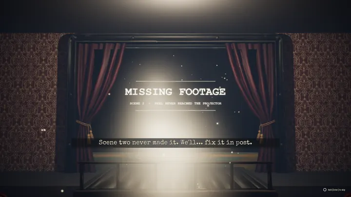
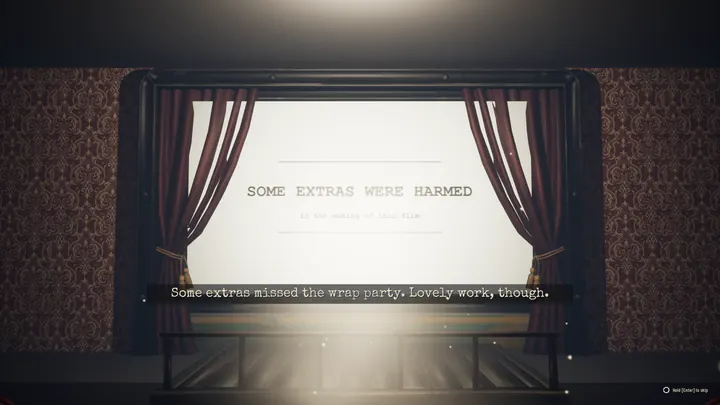

> **What went wrong:** The first wrap shot (ending01) was rejected for faces and gibberish on the cinema screen, so the wrap uses ending01_v2. The ideas audit warned that a judge might never see the payoff of one fixed film, which is why the ending is now cut from the reels you delivered.

<details><summary>Prompt: ending01_v2 (wrap shot, Kling)</summary>

```
Wide shot from the back of an empty old cinema: four small dark silhouettes seen from behind sit in the front row, tiny against a huge completely blank white screen that glows with plain flickering light, nothing projected on it. A soft smooth cone of projector light through the dust above the seats. Very slow pull back down the aisle.
```

</details>

<details><summary>Prompt: S_VO_Dir_FinalCut_Missing_03</summary>

```
“No scene three. Imagine something terrifying. You're good at that.”
```

</details>

<details><summary>Prompt: S_VO_Dir_FinalCut_Harm</summary>

```
“Some extras missed the wrap party. Lovely work, though.”
```

</details>

### HUD item icons

Flat cream pictograms for the inventory slots and HUD: battery, camera, ear, flashlight, rubber duck, clapperboard, empty reel, flash camera, scanner, trophy, trumpet and watch.

- **Tools:** Meshy text to image (nano-banana-pro, gpt-image-2 for one retry) and, after Meshy hit its API credit limit, fal nano-banana-pro; Python/PIL post-process to white + alpha
- **How many:** 12 AI icons in the game; 2 more (reel, small battery) were tried with AI and then drawn in Python
- **Cost:** 63 Meshy credits and 1.20 USD on fal (8 pictures at 0.15)


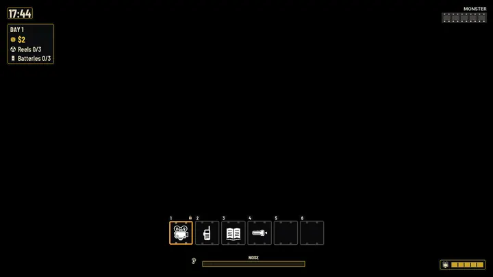

> **What went wrong:** The reel icon came out with four holes, then the retry read as a fidget spinner, so Python drew it; the small battery read as a jar or a bag. Meshy refused mid-batch with HTTP 402 'API key credit limit reached' (nothing charged), so the rest went through fal.

<details><summary>Prompt: T_UI_Icon_Ear</summary>

```
A human ear in profile. Flat pictogram icon made of one bold solid cream silhouette with a thick even outline, simple geometric shapes, a single flat color, centered front view, on a plain dark grey background, readable at 64 pixels.
```

</details>

<details><summary>Prompt: T_UI_Icon_Trumpet</summary>

```
A trumpet seen from the side, pointing right: a straight horizontal tube with a wide flared bell on the right, a mouthpiece on the left and three valve buttons on top. Flat pictogram icon made of one bold solid cream silhouette with a thick even outline, simple geometric shapes, a single flat color, centered front view, on a plain dark grey background, readable at 64 pixels.
```

</details>

<details><summary>Prompt: T_UI_Icon_Reel, second try (rejected)</summary>

```
A film reel: one big circle with exactly three round holes arranged in a triangle around a small hub. Flat pictogram icon made of one bold solid cream silhouette with a thick even outline, simple geometric shapes, a single flat color, centered front view, on a plain dark grey background, readable at 64 pixels.
```

</details>

### Achievement badges (no AI)

21 round film-reel badges, their grey locked variants and a hidden badge with a question mark.

- **Tools:** No AI image model: Claude Code wrote tools/ui/draw_achievement_icons.py, Python writing SVG rendered with resvg; no fonts, no third-party art
- **How many:** 21 badges + 21 locked variants + 1 hidden badge
- **Cost:** 0


### 'Projection Booth' UI kit (no AI)

One look for every screen: button plates with a focus frame, a sprocket strip, the countdown plate, slot frames, padlock, checkboxes, slider thumb, the logo, the CUT! slate and the day card.

- **Tools:** No AI image model: Python with PIL, numpy and fontTools written by Claude Code (draw_projection_booth.py), imported by a UE editor script; fonts Barlow Condensed, VT323, Fraunces and Special Elite
- **How many:** about 15 UI textures
- **Cost:** 0

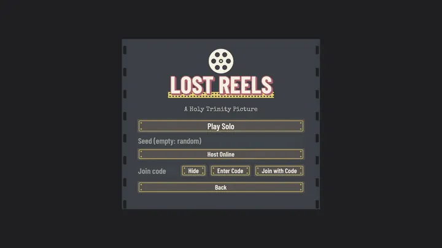
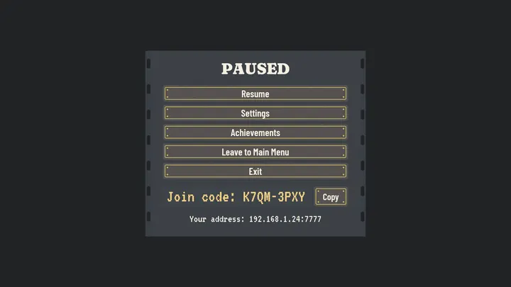

> **What went wrong:** The logo, the CUT! clapperboard and the itch.io cover were first rendered with Impact, a Windows system font we may not redistribute, and were re-rendered with Barlow Condensed Bold on 14 Nov.

### Sound effects

Footsteps on every floor, the monster's cries and chitter, items, the camera and flash, radios, the shop, ambience loops, UI ticks and stingers.

- **Tools:** ElevenLabs Sound Effects v2 (fal-ai/elevenlabs/sound-effects/v2 on Day 1, then eleven_text_to_sound_v2 directly through the ElevenLabs API, one take per file); ffmpeg and numpy for slicing, loops and loudness; numpy synthesis for the big-map stand-ins when fal was empty
- **How many:** Day 1 P0 batch (56 sound files incl. music and voice), 38 SFX in batch 2, 192 WAV files from 190 direct ElevenLabs calls (83 list entries), 19 extras
- **Cost:** fal 7.77 USD (Day 1 batch, incl. music and voice) and 4.87 USD (batch 2, incl. music and voice); ElevenLabs 3839 credits (190 calls) and 330 credits (19 extras)


> **What went wrong:** Footsteps were sliced automatically out of 10 to 12 s walking takes, and one came out only 0.11 s long. When the fal balance ran out on Day 2, the big map's footsteps, forest beds and heartbeat were synthesized from noise and sine waves in numpy instead.

<details><summary>Prompt: S_Mon_Hunt_Cry_01</summary>

```
Giant insect monster hunting its prey, a series of three fast furious raspy shrieks, harsh hoarse prehistoric bird-like cry, horror creature, echo in an empty hall
```

</details>

<details><summary>Prompt: S_Amb_Chair_Spin</summary>

```
Office chair spinning around with creaky squeaks and a silly kazoo whoo, playful
```

</details>

<details><summary>Prompt: S_Item_Duck_Squeak_01</summary>

```
Rubber duck toy squeezed once quickly, one short sharp squeak, loud in a silent empty room
```

</details>

<details><summary>Prompt: S_Mon_Spotted_Sting</summary>

```
Sudden horror stinger when a creature spots you, sharp dissonant string scrape with a low hit and a raspy creature hiss, short, not melodic
```

</details>

### Music

Day loops (calm and dread), night, chase and panic loops, the theme, the day-cleared sting and the final film cue.

- **Tools:** ACE-Step (fal-ai/ace-step/prompt-to-audio, instrumental, 6 takes per track) for the loops; ElevenLabs Music (fal-ai/elevenlabs/music) for the sting and the final cue; ElevenLabs Speech to Text to check there are no vocals
- **How many:** 8 tracks
- **Cost:** Included in the fal audio totals (7.77 and 4.87 USD); e.g. S_Mus_Day_Calm_Loop estimated at 0.0136 USD, the sting at 0.06 USD


> **What went wrong:** Six ACE-Step takes of the panic loop came out as surf rock, and ACE-Step stings stopped halfway through the fanfare, so the day-cleared sting and the final cue came from ElevenLabs Music, the only one with a build, a sudden stop and a tail.

<details><summary>Prompt: S_Mus_Night_Loop (ACE-Step)</summary>

```
Instrumental dark ambient score for an empty small town street at night: cold sustained low strings in D minor, a slow distant muted horn that never resolves, faint metallic shimmer like wind on wires, soft tape hiss, no rhythm, no drums, no melody, tense and still, as if something is walking just out of sight
```

</details>

<details><summary>Prompt: S_Mus_Final_Cut (ElevenLabs Music)</summary>

```
Instrumental finale cue of a 1960s adventure film: starts with soft solo piano and film projector crackle, builds to a warm triumphant small orchestra with strings, horns and vibraphone, reaches one grand major chord and then stops abruptly, followed by a single slightly off-key organ note, 120 beats per minute, bittersweet, unresolved
```

</details>

<details><summary>Prompt: S_Mus_Day_Calm_Loop (ACE-Step)</summary>

```
Instrumental ambient score for an empty old recording studio: very slow low string drone in D, sparse distant celesta notes that appear every ten seconds or so, faint tape hiss, no rhythm, no melody, barely there, holding its breath
```

</details>

## Bloopers: from the editing room

Short clips from our recorded team calls, in Polish, with English subtitles. Only the three of us speak in them, everyone agreed to be quoted, and swearing stayed on the cutting room floor. The Polish lines are what we said, give or take what the microphone heard.

### The design document

*Thu 12 Nov, 09:11 · choosing the game* · [listen (5 s)](clips/01-notebook.mp3)

> **Kimonzo:** Mamy notatniczek, mamy notatniczek.  
> *We've got a little notebook, we've got a little notebook.*
>
> **Bubuś:** Nie no, ja mam to mniej więcej…  
> *No, I've got it more or less…*

Ten minutes into the jam, the whole game existed in someone's head and in a chat window. The notebook won.

### Rated 13+

*Thu 12 Nov, 09:23 · choosing the game* · [listen (15 s)](clips/02-beans.mp3)

> **Bubuś:** …nic nie można już robić na tym świecie. To dzieciaki mają grać w gry typu… skakanie fasolkami przez przeszkody, tak?  
> *…you can't do anything in this world anymore. So kids are supposed to play games like… jumping beans over obstacles?*

We had just dropped the webcam idea: a game for teenagers should not ask children to share their faces online. Bubuś took it well.

### A request for the dev log

*Thu 12 Nov, 09:59 · choosing the game* · [listen (8 s)](clips/03-devlog.mp3)

> **Badys:** Ja proszę o jedno. Niech w dev logu będzie, że Kimo skończył pracę o 16 i dopiero zaczęliśmy pracę.  
> *I ask for one thing. Put it in the dev log that Kimo finished his day job at 4 pm and only then did we start working.*

Request granted.

### The first monster sound

*Thu 12 Nov, 10:00 · choosing the game* · [listen (11 s)](clips/04-monster-voice.mp3)

> **Bubuś:** O, na przykład patrz, taki głos będzie potworka, jak będzie blisko. Nie przestraszyłbyś się?  
> *Look, this is the monster's voice when it gets close. Wouldn't that scare you?*
>
> **Badys:** Nie, bo ci urwało po sekundzie.  
> *No, it cut off after a second.*

Two days later the monster had 51 short one-shot sounds of its own.

### The golden duck is born

*Thu 12 Nov, 10:11 · choosing the game* · [listen (14 s)](clips/05-golden-duck.mp3)

> **Badys:** O, gumowa kaczka: jest mały procent szans, że będzie złota. Idealnie, no.  
> *Oh, the rubber duck: there's a small chance it's golden. Perfect.*

The rubber duck does nothing. That was the point. Then it got a small chance of being gold, a quack, and in the end its own cameo.

### The film budget

*Thu 12 Nov, 10:31 · choosing the game* · [listen (10 s)](clips/06-ninety-dollars.mp3)

> **Kimonzo:** Mamy w sumie 90 dolarów, więc na spokojnie 10 minut filmu możemy wygenerować.  
> *We've got 90 dollars in total, so we can easily generate ten minutes of film.*
>
> **Badys:** Dobra, wygenerujemy sobie jakieś cutscenki.  
> *Right, we'll generate some cutscenes.*
>
> **Bubuś:** O kurde, my tam 15 sekund będziemy potrzebować.  
> *Oh wow, we'll need about fifteen seconds.*

In the end the Director's intro and the reels took fourteen video shots, about 130 seconds of raw footage.

### Status report

*Thu 12 Nov, 11:13 · end of the first call* · [listen (7 s)](clips/07-nothing-yet.mp3)

> **Kimonzo:** Co się dzieje?  
> *What's happening?*
>
> **Bubuś:** Na razie nic.  
> *Nothing so far.*
>
> **Kimonzo:** Tak, stop.  
> *Right, stop.*

The last words of the call that chose the game. The recording stopped, and the plan was written.

### On the agent's scope estimate

*Thu 12 Nov, 11:45 · reviewing the plan* · [listen (5 s)](clips/08-hallucinating.mp3)

> **Kimonzo:** On się myli, halucynuje. Oczywiście, że wszystko zrobimy, tylko pytanie…  
> *It's wrong, it's hallucinating. Of course we'll do everything, the only question is…*

The agent's plan said online co-op would not fit in the jam. It went in on Friday.

### Designing the monster

*Thu 12 Nov, 11:50 · reviewing the plan* · [listen (8 s)](clips/09-ant-with-ears.mp3)

> **Bubuś:** …to może być jakiś insekt, co ma takie małe oczka i duże uszy, i czułka.  
> *…it could be some insect with tiny little eyes, big ears, and antennae.*
>
> **Badys:** No na przykład… mrówka. Zgadzam się.  
> *Like… an ant. I agree.*

The first monster, the Listener, came from this minute. Its successor, Take Fourteen, kept the ears and the antennae.

### Credit where credit is due

*Thu 12 Nov, 12:15 · reviewing the plan* · [listen (12 s)](clips/10-stole-my-idea.mp3)

> **Bubuś:** Okradli mnie z mojego pomysłu. AI mi ukradło pomysł.  
> *They robbed me of my idea. The AI stole my idea.*
>
> **Badys:** Zabiera ci robotę coraz bardziej.  
> *It's taking your job, bit by bit.*

The agent's plan had credited Bubuś's camera horror idea to Badys.

### Reading the feature list

*Thu 12 Nov, 12:31 · reviewing the plan* · [listen (4 s)](clips/11-duck-class.mp3)

> **Badys:** Kaczka czasem złota. Jest klasa!  
> *Duck, sometimes golden. Classy!*

### The team poster

*Sat 14 Nov, 11:36 · posters and balance* · [listen (7 s)](clips/13-rookie-cap.mp3)

> **Kimonzo:** Jest kolorowa czapeczka dla świeżaka.  
> *There's a colourful cap for the rookie.*
>
> **Badys:** Kolorowa czapeczka, właśnie o to chodziło, że dla świeżaka.  
> *The colourful cap, exactly, that was the idea: for the rookie.*

Picking our own picture for the easter-egg poster in the game.

### Localisation plans

*Sat 14 Nov, 13:21 · the rc-1311h playtest* · [listen (9 s)](clips/14-tuvalu.mp3)

> **Badys:** Tak będzie każdy język świata. Nawet Tuwalu.  
> *At this rate it'll be every language in the world. Even Tuvaluan.*

kimonzo had just started the Polish translation.

### Our production philosophy

*Sat 14 Nov, 13:21 · the rc-1311h playtest* · [listen (7 s)](clips/15-quantity.mp3)

> **Badys:** Liczy się ilość, a nie jakość.  
> *Quantity over quality.*

He was joking. Mostly. That morning sixteen audit agents had read every corner of the game.

---

Generated from `docs/devlog.md` by `tools/devlog/build_site.py`. Fonts and licences in `fonts/`.
